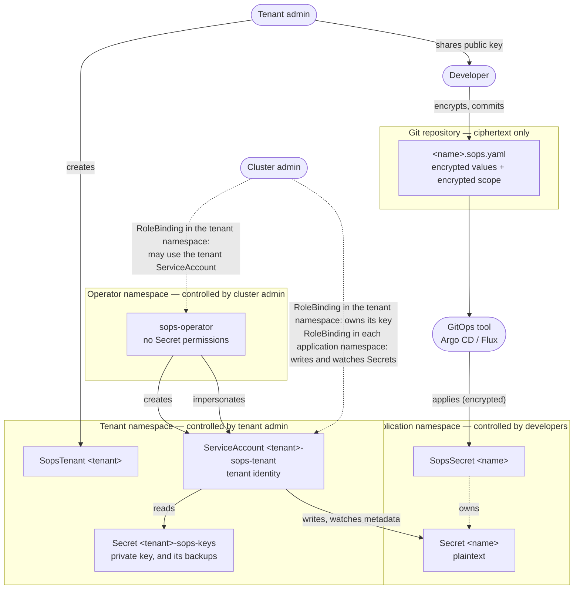
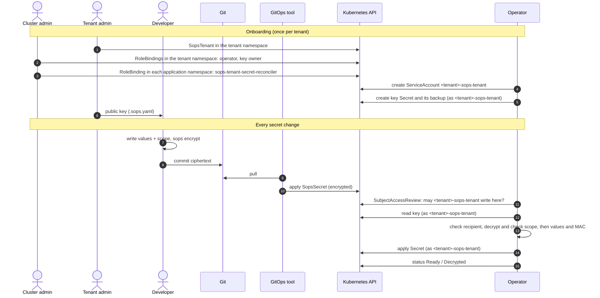
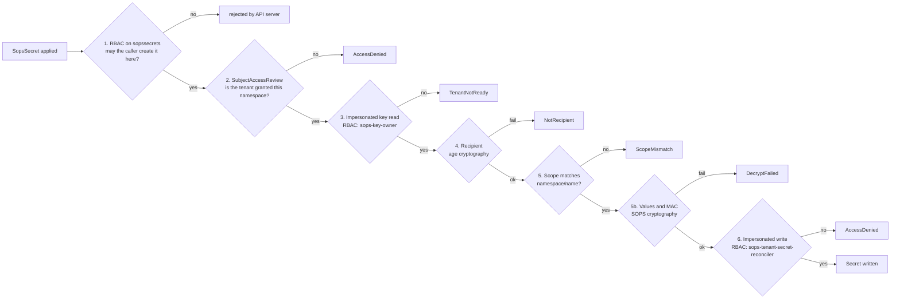

# SOPS Operator — Design

Status: **Draft** · Last updated: 2026-11-10

A Kubernetes operator that decrypts [SOPS](https://github.com/getsops/sops)-encrypted resources in-cluster into
plain Kubernetes Secrets, with self-service for tenants and zero standing privileges for the operator.

---

## 1. Goals and non-goals

### Goals

- Secrets live in Git **encrypted**; only the cluster decrypts them.
- **Self-service**: tenant admins manage their own keys, developers manage their own secrets.
- **Zero trust**: the operator holds no standing permission on Secrets; every read and write is authorized by the
  Kubernetes API server against an explicit grant made by the cluster admin.
- **No cross-tenant or cross-namespace leakage**, including copying ciphertext between namespaces of the same tenant.
- GitOps-friendly: one-way flow Git → cluster, one owner per Secret, health visible to Argo CD / Flux.
- Long-term maintainability: small API, standard tooling (SOPS CLI, age), OLM distribution.

### Non-goals (v1)

- Fetching secrets from external stores (use External Secrets Operator).
- Git access from the operator.
- Templating, generators, dynamic/leased secrets, PushSecret.
- Adopting, merging into, or seeding pre-existing Secrets.
- Cross-namespace or cluster-wide secrets.
- Key rotation on a schedule, or without teams re-encrypting their files.
- KMS backends (OpenBao, cloud KMS) — planned later behind the same API.

---

## 2. Background facts

### SOPS and age

- SOPS encrypts **values** in YAML/JSON and leaves keys and structure readable, so Git diffs stay reviewable.
- Each file has a random **data key**. Values are encrypted with AES-256-GCM using the data key, with the value's
  path in the document as additional authenticated data — a value cannot be moved to another key.
- The data key is encrypted once per **recipient** and stored in the file's `sops:` metadata block.
- A **MAC** over the values, encrypted with the data key, detects tampering. With `mac_only_encrypted: true` the MAC
  covers only encrypted values, which is required because Kubernetes adds fields to stored objects.
- Anyone with a recipient's **public** key can encrypt. Decrypting — and therefore editing an existing file — requires
  a **private** key.
- **age** key types (age v1.3.2, SOPS v3.13.3 as of this writing):

  | Type | Recipient | Used here |
  |---|---|---|
  | Post-quantum hybrid (ML-KEM-768 + X25519) | `age1pq1…` / `AGE-SECRET-KEY-PQ-1…` | **Generated keys** |
  | X25519 | `age1…` / `AGE-SECRET-KEY-1…` | Accepted for bring-your-own keys |
  | SSH (`ssh-ed25519`, `ssh-rsa`) | `ssh-…` | Rejected |
  | Plugins (YubiKey, TPM, Secure Enclave) | `age1<plugin>1…` | Rejected in-cluster; fine as human break-glass recipients |

- An age identity file contains only private keys; the public key is derived from them. The `# public key:` line
  written by `age-keygen` is a comment and is never trusted.
- SOPS exposes in-memory identity loading per master key (`age.ParsedIdentities.Import` / `ApplyToMasterKey`), so
  tenants' keys never need to pass through process-wide environment variables or files.

### Git is not a KMS

Git stores and delivers **ciphertext**; a KMS (or here, a Kubernetes Secret) holds the **private key** and decrypts.
The operator never talks to Git. A GitOps tool (Argo CD, Flux), CI, or a person applies the still-encrypted
`SopsSecret` to the API server; the operator watches the API.

```
dev: write → sops encrypt → git push
                                │
Argo CD / Flux / CI: apply (still encrypted)
                                │
Kubernetes API: SopsSecret ──► operator: authorize → load key → decrypt → apply Secret
                                │
                         workload mounts Secret
```

### Landscape

| Solution | Model | Why not used as-is |
|---|---|---|
| Bitnami Sealed Secrets | One cluster key pair; controller decrypts | Single key per cluster to back up/rotate; opaque diffs; no tenant model |
| Flux SOPS (kustomize-controller) | Decryption during Flux apply | Requires Flux; ties secrets to a GitOps engine |
| KSOPS / helm-secrets | Decrypt in Argo CD repo-server or CI | Plaintext passes through the pipeline |
| isindir/sops-secrets-operator | Operator, one key set for all | No tenant isolation |
| peak-scale/sops-operator | Operator with `SopsProvider` selectors (Capsule) | Cluster-wide Secret RBAC and cache; no ciphertext scoping; `GlobalSopsSecret` crosses namespaces |
| External Secrets Operator | Syncs from external stores | Different model (no ciphertext in Git) |
| Vault Secrets Operator | Syncs from Vault | Requires Vault; different model |

---

## 3. Roles

### 3.1 Actors

| Actor | Kind | Owns | Cannot |
|---|---|---|---|
| **Cluster admin** | Human (platform team) | Operator installation (OLM). Tenant onboarding: the RoleBindings that let the operator use the tenant ServiceAccount, let it own its key, and let it write Secrets in each namespace the tenant may target (§5.2). Break-glass private keys (offline). | — |
| **Tenant admin** | Human (team lead / tenant owner) | `SopsTenant` and its key Secret in the tenant namespace; may also create the two tenant-namespace RoleBindings (D47). Distributing the public key. Starting and ending key rotations. | Grant the tenant access to other namespaces. |
| **Developer** | Human | `SopsSecret` files in Git and objects in the namespaces they work in. Encrypting with the public key. | Read keys; decrypt or edit existing files; target a namespace other than the `SopsSecret`'s own. |
| **GitOps tool** (Argo CD, Flux, CI) | Machine | Applying the still-encrypted `SopsSecret` from Git to the cluster. | See plaintext or keys. |
| **Operator** | Machine | Decrypting and writing output Secrets — only by impersonating a tenant identity. | Access any Secret with its own identity. |
| **Tenant identity** (`team-a-system:team-a-sops-tenant`) | Machine (ServiceAccount) | The permissions its RoleBindings grant: own the tenant key and its backups; write and watch Secrets in granted namespaces. | Be used by workloads (no token automount; lives in the key namespace). |

### 3.2 Boundaries

Each box is a trust boundary; the label says who controls it. Solid arrows are actions, dotted arrows are grants.



### 3.3 Responsibility matrix

✅ performs · ⚙️ performed by the operator as the tenant identity · — not allowed

| Action | Cluster admin | Tenant admin | Developer | GitOps tool | Operator |
|---|---|---|---|---|---|
| Install / upgrade the operator | ✅ | — | — | — | — |
| Create the tenant ServiceAccount (`<tenant>-sops-tenant`) | — | triggers | — | — | ✅ |
| Bind the operator and the key owner in the tenant namespace | ✅ | may (D47) | — | — | — |
| Grant a tenant Secret write in a namespace | ✅ | — | — | — | — |
| Create / delete a `SopsTenant` | — | ✅ | — | — | — |
| Generate the tenant key | — | triggers | — | — | ⚙️ |
| Back up the tenant private key in the cluster | — | — | — | — | ⚙️ |
| Back up the cluster, tenant keys included | ✅ | — | — | — | — |
| Hold break-glass private keys (offline) | ✅ | — | — | — | — |
| Start and end a key rotation (`spec.startRotation`) | — | ✅ | — | — | ⚙️ |
| Bring the new key of a rotation (`generateKey: false`) | — | ✅ | — | — | — |
| Move files to the new key (`scripts/rotate.sh`) | — | ✅ | ✅ | — | — |
| Encrypt a secret | ✅ | ✅ | ✅ | — | — |
| Decrypt a secret | break-glass only | own tenant | — | — | ⚙️ |
| Commit a `SopsSecret` to Git | — | ✅ | ✅ | — | — |
| Apply a `SopsSecret` to the cluster | — | — | if allowed by RBAC | ✅ | — |
| Write the output Secret | — | — | — | — | ⚙️ |
| Read the output Secret | per namespace RBAC | per namespace RBAC | per namespace RBAC | — | — |

### 3.4 Boundary enforcement

| Boundary | Separates | Enforced by |
|---|---|---|
| Tenant ↔ tenant | Different keys, different tenant identities | Kubernetes RBAC: each tenant identity is granted only its own namespaces |
| Key namespace ↔ consumer namespaces | Private keys never leave `team-a-system`; developers have no access to Secrets there | Kubernetes RBAC |
| Namespace ↔ namespace within a tenant | Ciphertext for `team-a-prod` cannot be used in `team-a-dev` | Cryptography: encrypted `scope`, checked after decryption |
| Git ↔ cluster | Only ciphertext in Git and in the GitOps tool | SOPS encryption |
| Humans ↔ plaintext | Developers encrypt but cannot decrypt | Public-key cryptography |
| Operator ↔ Secrets | No standing access; every access is made as a tenant identity | Kubernetes RBAC + impersonation |

### 3.5 Lifecycle



---

## 4. API

Group `sops.stakater.com`, version `v1alpha1`. Two namespaced kinds.

### 4.1 `SopsTenant`

A tenant is a **key**. It does not list namespaces; access is granted by the cluster admin through RBAC (§5).

```yaml
apiVersion: sops.stakater.com/v1alpha1
kind: SopsTenant
metadata:
  name: team-a                  # key Secret: team-a-system/team-a-sops-keys
  namespace: team-a-system        # tenant namespace (dedicated; holds keys only)
spec:
  generateKey: true              # default; the operator generates the first key and the new key of a rotation
  startRotation: false           # true: rotate the key; false or unset: complete a rotation when ready (§4.5)
status:
  observedGeneration: 2
  serviceAccountName: team-a-sops-tenant
  keySecretName: team-a-sops-keys
  publicKey: age1pq1...          # for .sops.yaml
  usedBy: 4                      # SopsSecrets referencing this tenant
  conditions:
    - type: Ready
      status: "True"
      reason: KeyLoaded
```

| Field | Default | Meaning |
|---|---|---|
| `spec.generateKey` | `true` | Generate a post-quantum age key for a tenant that never had one (no key Secret, no recorded key, no backup, §4.4), and the new key of a rotation (§4.5). Set `false` to bring both yourself. |
| `spec.startRotation` | `false` | `true` starts a rotation once every `SopsSecret` of the tenant is healthy; `false` or unset completes it once every `SopsSecret` uses the new key, or abandons it before any does (§4.5). |
| `status.publicKey` | — | Public key of the key in the key Secret: the value to list in `.sops.yaml` (D39). During a rotation, the new key from the moment it is in place. |
| `status.rotation` | — | The rotation in progress: `phase`, `startedAt`, the old key's `previousPublicKey`, `migrated`, `pending` and `pendingSecrets` (§4.5). |
| `status.lastRotation` | — | Start and completion time of the last completed rotation, and the removed `previousPublicKey`. |
| `status.serviceAccountName` | — | The tenant's ServiceAccount, `<tenant>-sops-tenant` (D46). |
| `status.keySecretName` | — | The tenant's key Secret, `<tenant>-sops-keys` (D48). |
| `status.usedBy` | — | Number of `SopsSecret`s referencing this tenant. |
| `status.conditions[Ready]` | — | Reasons: `KeyLoaded`, `KeyGenerated`, `KeyMissing`, `KeyInvalid`, `KeyMismatch` (the key Secret holds another key than `status.publicKey` and no backup of the recorded key exists, §4.4), `AccessDenied` (tenant not onboarded). |
| `status.conditions[Rotated]` | — | Set once a rotation was asked for. Reasons: `RotationRefused`, `WaitingForKey`, `RotationPending`, `RotationBlocked`, `RotationComplete` (True), `RotationAbandoned` (§4.5). |

Printer columns: `READY`, `REASON`, `USED BY`, `LAST ROTATED`, `AGE`.

### 4.2 Key Secret

Named `<tenant>-sops-keys`, in the namespace of the `SopsTenant` (D48).

```yaml
apiVersion: v1
kind: Secret
metadata:
  name: team-a-sops-keys
  namespace: team-a-system
  labels:
    sops.stakater.com/enabled: "true"
    app.kubernetes.io/managed-by: sops-operator   # set when the operator creates it (generated or restored)
type: Opaque
stringData:
  age.agekey: |            # private keys only; the public key is in SopsTenant status.publicKey
    AGE-SECRET-KEY-PQ-1...
```

- `age.agekey` holds one or more identities; the **first** is primary. Further identities, for example a
  break-glass key, also decrypt.
- Generated keys are post-quantum hybrid. Bring-your-own keys may mix PQ and X25519 identities. SSH and plugin
  identities make the key `KeyInvalid`.
- The key Secret holds private keys only. The operator derives the primary public key and reports it in the
  tenant's `status.publicKey` (D39), where anyone allowed to read the `SopsTenant` finds it for `.sops.yaml` without
  access to the key Secret. Generated key files have no comment lines. An `age.pub` field is ignored.
- **Enabled label** (D49): the operator uses `<tenant>-sops-keys` only when it carries
  `sops.stakater.com/enabled: "true"` and is not an output Secret (no `sops.stakater.com/sopssecret` annotation, no
  ownerReference). A tenant admin who brings a key adds that one label; an unlabelled Secret makes the tenant
  report `KeyMissing`, naming the label. A key Secret with the operator's `managed-by` label, without annotation and
  owner, is labelled by the operator.
- The operator keeps an immutable backup of the key and restores the key Secret from it when it is deleted or
  changed outside a rotation (§4.4, D51). It replaces the key on purpose only in a rotation (§4.5).
- **No ownerReference**: deleting the tenant never deletes the key or its backups.

### 4.3 `SopsSecret`

One `SopsSecret` produces **one** Secret with the **same name** in the **same namespace**.

```yaml
apiVersion: sops.stakater.com/v1alpha1
kind: SopsSecret
metadata:
  name: db-creds                     # → Secret team-a-prod/db-creds
  namespace: team-a-prod
  annotations:
    sops.stakater.com/suspend: "true"     # optional; pauses reconciliation
spec:
  tenantRef:
    name: team-a
    namespace: team-a-system
  scope: ENC[AES256_GCM,...]         # encrypted; decrypts to "team-a-prod/db-creds"
  deletionPolicy: Delete             # Delete (default) | Retain
  template:                          # optional; metadata for the output Secret
    metadata:
      labels: {}
      annotations: {}
  type: Opaque
  data: {}                           # binary values (base64), encrypted
  stringData: {}                     # text values, encrypted
# written by `sops encrypt`:
sops:
status:
  observedGeneration: 1
  lastSyncTime: "2026-10-09T10:00:00Z"
  secretUID: 6f1c2b8e-0d1a-4c5e-9b7f-2a3d4e5f6a7b   # UID of the Secret this SopsSecret created
  conditions:
    - type: Ready
      status: "True"
      reason: Decrypted
```

| Field | Required | Meaning |
|---|---|---|
| `spec.tenantRef` | yes | Tenant whose key decrypts this file. |
| `spec.scope` | yes | **Encrypted** `<namespace>/<name>` where this ciphertext may be decrypted. Set by the author before encryption. |
| `spec.deletionPolicy` | no | `Delete`: the output Secret has an ownerReference to the `SopsSecret` and is garbage-collected with it. `Retain`: the output Secret has no ownerReference and stays when the `SopsSecret` is deleted. |
| `spec.template.metadata` | no | Labels and annotations copied to the output Secret (e.g. Reloader annotations). Copied as written; the `SopsSecret`'s own labels and annotations are not copied. Keys starting with `sops.stakater.com/` are dropped. |
| `spec.type` | no | `Opaque` (default), `kubernetes.io/tls`, `kubernetes.io/dockerconfigjson`, `kubernetes.io/basic-auth`, `kubernetes.io/ssh-auth`. Service-account and bootstrap token types are not allowed. |
| `spec.data` / `spec.stringData` | at least one | Same semantics as on a Secret. A key may not appear in both. |
| `status.rotation` | — | During a key rotation of the tenant: the `sops.age` entry for the new key (`newRecipient`, made for `fromGeneration`), and whether the current generation decrypted with the new key (`migrated`, `migratedGeneration`) or was accepted with the old key (`acceptedGeneration`) (§4.5). |
| `sops` | yes | SOPS metadata written by `sops encrypt`. Must contain `mac`, `lastmodified`, `version`, at least one `age` recipient, `encrypted_regex: ^(data|stringData|scope)$` and `mac_only_encrypted: true`. Only age recipients in a single key group are supported; other key types are rejected by the schema. |

Status reasons: `Decrypted`, `Suspended`, `TenantNotFound`, `TenantNotReady`, `AccessDenied`, `NotRecipient`,
`NextKeyRequired` (§4.5), `ScopeMismatch`, `DecryptFailed`, `Conflict`, `ApplyFailed` (e.g. type validation, size
limit).

Printer columns: `TENANT`, `READY`, `REASON`, `AGE`.

Behaviour:

- The operator manages only Secrets **it created**. A pre-existing Secret with the same name is a `Conflict`.
- With `deletionPolicy: Delete`, output Secrets carry an ownerReference to the `SopsSecret` (Argo CD shows them as
  children; `blockOwnerDeletion` is not set). Labels and annotations come only from the template, copied as written,
  never from the `SopsSecret` itself, so the GitOps tool's tracking labels and annotations on the `SopsSecret` never
  reach the Secret and the tool does not claim or prune it. A template is explicit; inheriting would need a list of
  every tool's tracking keys to leave out.
- `status.secretUID` records the Secret the operator created. Every later write is an update with that UID as a
  precondition. The API server rejects it (`409`) when the Secret is gone or was replaced; the operator then creates
  the Secret, which succeeds if it was deleted and fails with `AlreadyExists` → `Conflict` if someone else's Secret
  holds the name. A `SopsSecret` without `status.secretUID` whose Secret already exists is a `Conflict`.
- Every output Secret carries `sops.stakater.com/enabled: "true"`, `app.kubernetes.io/managed-by: sops-operator`
  and the annotation `sops.stakater.com/sopssecret` (the `SopsSecret`, in the same namespace). Its other labels and
  annotations come only from `spec.template.metadata`.
- Output Secrets stay mutable, and the operator reverts direct changes (D50). It watches the metadata of its
  tenant's output Secrets as the tenant identity, one watch per tenant and namespace selected by the `enabled` label,
  while a `SopsSecret` of the tenant there is `Decrypted`. A deletion or any change, of values, labels or
  annotations, reconciles the `SopsSecret`, which writes the Secret back in place at once (same UID, so volume
  mounts refresh). A write that changes nothing does not modify the Secret, so the operator's own writes cause no
  loop. The periodic resync corrects anything the watch missed.

### 4.4 Key backups

The operator keeps an immutable copy of every key a `SopsSecret` may still depend on, as the tenant identity, in
the tenant namespace:

```yaml
apiVersion: v1
kind: Secret
metadata:
  name: team-a-sops-keys-20261109-091200   # <tenant>-sops-keys-<YYYYMMDD-HHMMSS>, UTC
  namespace: team-a-system
  labels:
    sops.stakater.com/enabled: "true"
    sops.stakater.com/key-backup: "true"
    app.kubernetes.io/managed-by: sops-operator
  annotations:
    sops.stakater.com/public-key: age1pq1...
immutable: true
stringData:
  age.agekey: |
    AGE-SECRET-KEY-PQ-1...
```

- Outside a rotation there is one backup, of the current key, written the first time the operator loads the key.
  During a rotation there are two, of the old and the new key. Completing a rotation deletes the old key's
  backup; abandoning it deletes the new key's backup (§4.5).
- Outside a rotation, the operator restores `<tenant>-sops-keys` from the backup of the key recorded in
  `status.publicKey` when the key Secret is deleted, holds another key, or lost the `enabled` label. It records a
  Warning event `KeyRestored`. It watches the metadata of the key Secret as the tenant identity, so the restore
  happens at once.
- A key is generated only for a tenant that never had one: no key Secret, no recorded key and no backup, and
  `generateKey` is not `false`. A recorded key without a backup is never replaced: the tenant reports `KeyMissing`
  for a missing key Secret and `KeyMismatch` for another key.
- A tenant recreated with an empty status keeps a key Secret that one of the backups holds, and otherwise restores
  the newest backup instead of generating a key.
- Outside a rotation, a deleted backup is written again from the key Secret at the next reconcile; backups are not
  watched. During a rotation the old key exists only in its backup, so deleting that backup loses the old key.
- The tenant admin, the only user with Secret rights in the tenant namespace, can still delete both the key and its
  backup. That loses the key; cluster backups cover it (§7.2, D55).

### 4.5 Key rotation

A rotation replaces the tenant key through Git: the tenant admin starts and ends it in the `SopsTenant`, and teams
move their files to the new key with `scripts/rotate.sh` (§8.3) and commit them, each at its own pace. A rotation
never requires reading a private key outside the cluster: the operator prepares everything that needs one.

```yaml
spec:
  generateKey: true                     # true: the operator generates the new key; false: the tenant admin brings it
  startRotation: true
status:
  publicKey: age1pq1...                 # the new key, once it is in place
  rotation:                             # only while a rotation is in progress
    phase: InProgress                   # WaitingForKey, then InProgress
    startedAt: "2026-11-09T09:12:00Z"
    previousPublicKey: age1pq1...       # the old key, kept in its backup
    migrated: 11                        # SopsSecrets decrypted with the new key
    pending: 1                          # SopsSecrets not yet decrypted with the new key
    pendingSecrets:                     # at most 50, sorted
      - team-a-prod/db-credentials
  lastRotation:                         # the last completed rotation
    startedAt: "2026-04-01T08:00:00Z"
    completedAt: "2026-04-09T16:30:00Z"
    previousPublicKey: age1pq1...       # the removed key; scripts/rotate.sh removes it from files
  conditions:
    - type: Rotated
      status: "False"
      reason: RotationPending
```

`spec.startRotation` states the intention: `true` means the tenant wants a new key, `false` or unset means it wants
the rotation finished. A rotation completes only while the flag is not `true`, so a reapplied `true` never starts a
second rotation.

**Start.** When `startRotation` is `true` and no rotation is in progress, the operator checks that every
`SopsSecret` referencing the tenant is `Decrypted` for its current generation. If any is not, it changes nothing and
reports `RotationRefused`, naming the unhealthy `SopsSecret`s; it starts on its own once they are healthy. Otherwise
it records `status.rotation` with the old key in `previousPublicKey` before any key changes, so a crash never leaves
a new key without a recorded rotation. Then:

- With `generateKey: true` the operator generates the new key, backs it up and writes it into `<tenant>-sops-keys`.
- With `generateKey: false` the phase is `WaitingForKey` until the tenant admin replaces `<tenant>-sops-keys` (delete
  and create it with the `enabled` label, or update `age.agekey`) with a valid key other than the old one. The
  operator then backs up the new key. Until then a key Secret that is invalid, unlabelled or holds the old key is
  ignored, without `KeyInvalid`. Switching `generateKey` to `true` while waiting makes the operator generate the key.

Once the new key is in the key Secret, the phase is `InProgress`, `status.publicKey` is the new key and `Rotated`
reports `RotationPending`. The old key stays in its backup. From then on, a key Secret that is deleted or changed is
restored from the new key's backup.

**New-key entries.** For every `SopsSecret` of the tenant, the operator unwraps the file's data key with the old key
and wraps it for the new key, and puts the resulting `sops.age` entry in the `SopsSecret`'s status. The encrypted
values, the MAC and `lastmodified` do not depend on `sops.age`, so appending the entry to the file in Git is the
whole migration. The entry contains no plaintext and opens only that file's data key, and only for the holder of the
new private key.

```yaml
# SopsSecret status during a rotation
status:
  rotation:
    startedAt: "2026-11-09T09:12:00Z"   # the start of the tenant's rotation
    newRecipient:                       # append to sops.age in the file
      recipient: age1pq1...
      enc: |
        -----BEGIN AGE ENCRYPTED FILE-----
        ...
        -----END AGE ENCRYPTED FILE-----
    fromGeneration: 3                   # the generation the entry was made for
```

The operator renews the entry when the `SopsSecret` or the new key changes, and removes it when the rotation ends.

**During the rotation.** The operator decrypts with the new key first, then with the old key from its backup, and
records in the `SopsSecret`'s status whether its current generation decrypted with the new key. Every `SopsSecret`
that did not is pending, including those that fail for another reason. A new `SopsSecret`, or a new generation of an
existing one, must decrypt with the new key; otherwise it fails with `NextKeyRequired`, naming the new public key,
and the output Secret keeps its last values. While the phase is `WaitingForKey`, no file can be encrypted for the new
key yet, so every generation that decrypts is accepted.

**Completion.** When `startRotation` is `false` or unset, the operator counts pending `SopsSecret`s from a live list,
not from a cache. While any is pending, `Rotated` reports `RotationBlocked` and each pending `SopsSecret` gets a
Warning event. A date never completes a rotation. Once nothing is pending, the operator deletes the old key's
backup, removes `status.rotation` from the tenant and every `SopsSecret`, records `status.lastRotation` and reports
`Rotated=True`, reason `RotationComplete`. Each step is safe to repeat, so a crash resumes on the next reconcile.
The old key then exists only in etcd until the API server compacts old revisions, and in cluster backups taken
before.

**Abandon.** Setting `startRotation` to `false` while no `SopsSecret` records in its status that its current
generation decrypted with the new key (`status.rotation.migrated`, counted from a live list) abandons the rotation
(D54): the operator writes the old key from its backup into `<tenant>-sops-keys`, deletes the new key's backup, sets
`status.publicKey` back to the old key and reports `RotationAbandoned`. While a `SopsSecret` is decrypted with the
new key, its file may be encrypted for the new key alone, so the rotation can only complete, and `RotationBlocked`
says so. A `SopsSecret` that no longer uses the new key (deleted, or a later generation that failed with
`NextKeyRequired`) no longer blocks abandoning. A tenant without `SopsSecret`s whose new key is in place completes
instead. If the old key's backup is missing, the rotation cannot be abandoned: `RotationBlocked` asks to set
`startRotation` to `true` and finish it.

**Events.** On the tenant: `KeyGenerated`, `RotationPending` (new key in place), `RotationComplete` and
`RotationAbandoned` (Normal), and `KeyRestored` (Warning, also during a rotation). On each pending `SopsSecret`
while completion is blocked: `RotationBlocked` (Warning).

**Guards.**

- The operator only sees `SopsSecret`s that are applied: a file in Git that the GitOps tool has not applied yet is
  not counted. `scripts/rotate.sh` therefore checks every file against its `SopsSecret` in the cluster before it
  changes any file (§8.3).
- A `SopsSecret` counts as migrated only for the generation the new key decrypted (`migratedGeneration`); a later
  generation that fails is pending again.
- One tenant key per cluster. Two clusters sharing a key would each generate a different new key.

---

## 5. Authorization model

### 5.1 Flow for a `SopsSecret` in namespace X

1. Resolve `tenantRef` → `team-a-system/team-a`.
2. **Grant check** (SubjectAccessReview): may `system:serviceaccount:team-a-system:team-a-sops-tenant` create,
   update, list and watch Secrets in X (`sops-tenant-secret-reconciler`)? If not → `AccessDenied`, naming the role
   and the verbs. Done before any decryption.
3. Read the key Secret **impersonating** `team-a-system:team-a-sops-tenant`.
4. Verify the file's recipients include the tenant key → else `NotRecipient`.
5. Decrypt **only** the encrypted `scope` and verify it equals `X/<name>` → else `ScopeMismatch`. No other value of
   a document scoped elsewhere is decrypted. Then decrypt the values and verify the MAC → else `DecryptFailed`.
   Error messages never contain decrypted values (SOPS does not authenticate a value's type tag, and its parse
   errors quote the plaintext).
6. Create or update the Secret in X **impersonating** `team-a-system:team-a-sops-tenant` (D28). The API server enforces the cluster
   admin's RoleBinding again.

### 5.2 RBAC objects

Shipped as static objects in the OLM bundle:

| ClusterRole | Rules | Bound by | Where |
|---|---|---|---|
| `sops-operator-tenant` | `serviceaccounts`: `create`, `impersonate` | Cluster admin (or tenant admin, D47), to the operator | Each tenant namespace |
| `sops-key-owner` | `secrets`: `get`, `list`, `watch`, `create`, `update`, `delete` (§4.4, §4.5) | Cluster admin (or tenant admin, D47) | Tenant namespace |
| `sops-tenant-secret-reconciler` | `secrets`: `create`, `update`, `list`, `watch` (D56) | Cluster admin | Each namespace the tenant may write to |
| `sops-tenant-admin` | full access to `sopstenants`; aggregated to `admin` | — | — |
| `sops-secret-editor` | full access to `sopssecrets`; aggregated to `edit` | — | — |
| `sops-viewer` | read `sopstenants`, `sopssecrets`; aggregated to `view` | — | — |

The tenant-facing ClusterRoles are shipped from `config/tenant-rbac/` with exactly these names (not prefixed).

Each tenant has its own identity, the ServiceAccount `<tenant>-sops-tenant` in the tenant namespace (D46). The
operator creates it, with `automountServiceAccountToken: false` and the labels
`app.kubernetes.io/managed-by: sops-operator`, `app.kubernetes.io/component: tenant-identity` and
`app.kubernetes.io/instance: <tenant>`, and reports its name in `status.serviceAccountName`. It never changes or
deletes an existing ServiceAccount, and the ServiceAccount grants nothing until it is bound.

The operator has no cluster-wide permission on ServiceAccounts. RBAC cannot limit impersonation to a name pattern
such as `*-sops-tenant`, so the operator is allowed to create and act as ServiceAccounts per tenant namespace, with
`sops-operator-tenant` (D46). Until then the tenant reports `AccessDenied`, naming the binding to create. Tenant
namespaces hold tenant keys only, so the operator can act as nothing else there.

Onboarding for tenant `team-a` in tenant namespace `team-a-system`, writing to `team-a-prod`; can be applied
automatically by Stakater Tenant Operator or Capsule. RoleBinding names are free; only `roleRef` and `subjects`
matter. The first two RoleBindings grant only permissions the built-in `admin` role already holds in the tenant
namespace, so the tenant admin may create them too (D47). The `sops-tenant-secret-reconciler` RoleBindings are the
only grants that extend a tenant's reach and stay with the cluster admin.

Once per tenant namespace, the operator may create and use tenant ServiceAccounts in `team-a-system`. The subject
is the operator's ServiceAccount, in the namespace of its Subscription (`openshift-operators` here):

```yaml
apiVersion: rbac.authorization.k8s.io/v1
kind: RoleBinding
metadata:
  name: sops-operator
  namespace: team-a-system
roleRef:
  apiGroup: rbac.authorization.k8s.io
  kind: ClusterRole
  name: sops-operator-tenant
subjects:
  - kind: ServiceAccount
    name: sops-operator-controller-manager
    namespace: openshift-operators
```

Once per tenant, the tenant ServiceAccount owns its key and its backups:

```yaml
apiVersion: rbac.authorization.k8s.io/v1
kind: RoleBinding
metadata:
  name: team-a-key-owner
  namespace: team-a-system
roleRef:
  apiGroup: rbac.authorization.k8s.io
  kind: ClusterRole
  name: sops-key-owner
subjects:
  - kind: ServiceAccount
    name: team-a-sops-tenant
    namespace: team-a-system
```

One per namespace the tenant may write to:

```yaml
apiVersion: rbac.authorization.k8s.io/v1
kind: RoleBinding
metadata:
  name: team-a-secret-reconciler
  namespace: team-a-prod
roleRef:
  apiGroup: rbac.authorization.k8s.io
  kind: ClusterRole
  name: sops-tenant-secret-reconciler
subjects:
  - kind: ServiceAccount
    name: team-a-sops-tenant
    namespace: team-a-system
```

### 5.3 Operator permissions

```yaml
# clusterPermissions
- apiGroups: [sops.stakater.com]
  resources: [sopstenants, sopssecrets]
  verbs: [get, list, watch]
- apiGroups: [sops.stakater.com]
  resources: [sopstenants/status, sopssecrets/status]
  verbs: [get, update, patch]
- apiGroups: [authorization.k8s.io]
  resources: [subjectaccessreviews]
  verbs: [create]
- apiGroups: ["", events.k8s.io]
  resources: [events]
  verbs: [create, patch]
- apiGroups: [authentication.k8s.io]          # metrics endpoint authentication
  resources: [tokenreviews]
  verbs: [create]
# permissions (operator namespace): the standard operator-sdk leader-election Role
- apiGroups: [""]
  resources: [configmaps]
  verbs: [get, list, watch, create, update, patch, delete]
- apiGroups: [coordination.k8s.io]
  resources: [leases]
  verbs: [get, list, watch, create, update, patch, delete]
- apiGroups: [""]
  resources: [events]
  verbs: [create, patch]
```

The operator has **no** permission on Secrets, Roles or RoleBindings, and none on ServiceAccounts outside the tenant
namespaces that granted it `sops-operator-tenant`. There it may create and impersonate ServiceAccounts;
it can never read, change, delete or mint tokens for any.
Every Secret access is an impersonated call and appears in the Kubernetes audit log as the operator acting as the
tenant identity.

---

## 6. Zero-trust enforcement

No component is trusted because of where it runs or who deployed it. Every action is verified at the moment it
happens, against an explicit grant, by a component other than the one asking.

### 6.1 Principles and mechanisms

| Principle | Mechanism | Enforced by |
|---|---|---|
| **Never trust, always verify** | Every key read and Secret write is an impersonated API call, checked against RBAC on each request. Every ciphertext is verified (recipient, MAC, scope) before use. | API server, SOPS cryptography |
| **Explicit grants, default deny** | A tenant can write into a namespace only if the cluster admin created a RoleBinding there. No selectors, labels or naming conventions grant access. No grant → `AccessDenied`. | API server |
| **Least privilege** | Operator has no Secret or RBAC permissions and no cluster-wide ServiceAccount permissions; it acts only in tenant namespaces that granted it `sops-operator-tenant`. `sops-tenant-secret-reconciler` is bound only in granted namespaces, and the operator watches only metadata there. `sops-key-owner` is bound only in the key namespace. Developers can encrypt but not decrypt. | API server, public-key cryptography |
| **One identity per tenant** | Each tenant acts as its own ServiceAccount; no identity is shared across tenants. | API server |
| **Separation of duties** | Cluster admin grants access but never handles tenant keys or plaintext. Tenant admin manages keys but cannot grant namespaces. Developer writes secrets but cannot read keys. | API server (RBAC per role) |
| **Bind data to its destination** | Encrypted `scope` ties every ciphertext to one namespace and name. | SOPS cryptography + operator check |
| **Assume breach** | Every component's compromise is bounded (§6.4). | Design |
| **Continuous verification** | Grants and keys are re-checked on every reconcile and periodic resync, not cached as decisions. A revoked grant takes effect at the next reconcile. | Operator, API server |
| **Full auditability** | Impersonated calls appear in the Kubernetes audit log with both the operator and the tenant identity. Decisions are visible in status conditions and events. | API server audit log |
| **No long-lived credentials besides keys** | The operator authenticates with its auto-rotated projected token. The tenant ServiceAccount has no token automounted. | Kubernetes |

### 6.2 Enforcement points



| # | Check | Enforced by | Authoritative? |
|---|---|---|---|
| 1 | Caller may create `SopsSecret` in the namespace | API server (RBAC) | Yes |
| 2 | Tenant is granted the namespace | Operator (SubjectAccessReview) | No — early, clear failure; check 6 is authoritative |
| 3 | Tenant identity may read its key | API server (RBAC via impersonation) | Yes |
| 4 | File encrypted for this tenant | age cryptography | Yes |
| 5 | Ciphertext bound to this namespace and name, checked before any other value is decrypted; then the values decrypt and the file is untampered (MAC) | Operator, on a cryptographically protected value; SOPS | Yes, given a correct operator |
| 6 | Tenant identity may write Secrets in the namespace | API server (RBAC via impersonation) | Yes |

### 6.3 What must be trusted

Zero trust minimises, but cannot remove, the trusted computing base:

| Component | Trusted for |
|---|---|
| Kubernetes API server, RBAC and etcd | Enforcing grants; storing Secrets (with encryption at rest) |
| SOPS and age libraries | Correct cryptography |
| Operator binary | Performing the scope check (5); not leaking plaintext; impersonating only the tenant named in `tenantRef` |
| Operator image supply chain | Signed images (cosign), SBOM and provenance; pinned by digest in the OLM bundle |
| Nodes and kubelet | Delivering Secrets to workloads |

### 6.4 Blast radius when a component is compromised

| Compromised | Attacker gains | Attacker does not gain |
|---|---|---|
| Developer account | Can apply `SopsSecret`s with values of their choosing in their namespaces | Keys; other namespaces' plaintext; copied ciphertext is rejected by scope |
| Tenant admin account | Own tenant's private key and its backups, which they can also delete; Secret write in the namespaces granted to the tenant | Other tenants; new namespace grants |
| Tenant identity token | Same as the tenant's grants, including reading the Secrets in its granted namespaces | Other tenants |
| Git repository or GitOps tool | Ciphertext only; ability to apply or replay `SopsSecret`s it can already apply | Plaintext or keys |
| Operator | Can act as any ServiceAccount in tenant namespaces it was granted, within each tenant's grants; can create ServiceAccounts there, which grant nothing until bound | Any Secret outside tenant grants; RBAC changes; new grants; ServiceAccount tokens |
| Cluster admin | Everything (inherent) | — |

### 6.5 Revocation

| Revoke | Effect |
|---|---|
| Remove a namespace RoleBinding | Next reconcile → `AccessDenied`. The already-written Secret remains (the operator can no longer delete it); the cluster admin removes it if required. |
| Delete the tenant's key-owner RoleBinding | All `SopsSecret`s of the tenant → `TenantNotReady`; nothing more is decrypted. |
| Remove a recipient from a file (`sops updatekeys`) | That key can no longer decrypt the new version of the file. |
| Rotate the tenant key (§4.5) | After completion, the old key decrypts nothing in the cluster, and its backup is deleted. |

---

## 7. Threat model

### 7.1 Attacks and mitigations

| Attack | Mitigation |
|---|---|
| Developer in `mallory-ns` references another tenant's key | No cluster admin grant in `mallory-ns` → `AccessDenied`; the write would be denied by the API server anyway. |
| Tenant admin targets a namespace of another tenant | Tenants cannot grant themselves namespaces; only the cluster admin's RoleBinding does. |
| Developer copies a prod `SopsSecret` into a dev namespace of the same tenant | Encrypted `scope` decrypts to `team-a-prod/…` → `ScopeMismatch`. |
| Developer edits `scope` or splices ciphertext between files | Requires the private key; per-file data keys, path-bound values and the MAC make splicing fail. |
| Developer reads keys | Key Secrets live in the dedicated tenant namespace; developers have no access. |
| Tenant SA token stolen from a consumer namespace | No SA exists in consumer namespaces; the tenant SA lives in the tenant namespace with `automountServiceAccountToken: false`. |
| Operator overwrites a Secret it does not own | Only manages Secrets it created; pre-existing Secrets → `Conflict`. |
| User edits or deletes an output Secret or the key Secret | The watch reverts it at once: the output Secret from its `SopsSecret` (D50), the key Secret from its backup (D51). |
| A `SopsSecret` writes a Secret posing as a key or a key backup | Labels and annotations starting with `sops.stakater.com/` in `spec.template.metadata` are dropped, and an output Secret is never adopted as a key (D49). |
| Operator compromise reads all Secrets | No Secret RBAC; impersonation only in tenant namespaces that granted it, limited to tenant grants. |
| GitOps tool prunes output Secrets | Only the template's labels and annotations are copied, not the `SopsSecret`'s own with the tool's tracking keys; ownerReference to the `SopsSecret`. |
| Plaintext committed to Git | Pre-commit `sops filestatus` / `sops-checker`; documented workflow. |

### 7.2 Accepted risks

| Risk | Rationale / control |
|---|---|
| A compromised operator can act as any tenant within that tenant's grants. | Inherent to central decryption. Reduced later by the OpenBao backend (decryption approved and audited by Bao). |
| Tenant admins can read their own private key. | Own tenant only. Removed later by the OpenBao backend. |
| Anyone allowed to write `SopsSecret`s in a namespace can apply their own values (public key encryption). | Same power as writing a Secret; controlled by RBAC on `sopssecrets`. |
| Replay of an older, validly encrypted `SopsSecret`. | Equivalent to a Git revert; controlled by GitOps and RBAC on manual applies. |
| A direct change to an output Secret is visible until the watch reverts it, typically within a second; with the watch down, until the next resync. | No admission webhook (D50); configurable resync interval. |
| `sops-key-owner` grants `get`, `list`, `watch`, `create`, `update` and `delete` on all Secrets in the tenant namespace, so tenants sharing a namespace can read, replace or delete each other's keys. | Tenant namespace is dedicated to keys; per-tenant key access is planned for tenants sharing a namespace. |
| The tenant admin can delete both the key Secret and its backup, which loses the key. | They are the only users with Secret rights in the tenant namespace and own the key; cluster backups cover it (D55). |
| The tenant identity can read every Secret in the namespaces granted `sops-tenant-secret-reconciler` (`list` and `watch` return contents), and so can the operator acting as it. | Needed to watch output Secrets (D56). The operator requests metadata only and never logs Secret contents; grant only namespaces the tenant may see. |
| A removed key still exists in cluster backups (etcd, Velero) taken before its removal. | Backups of tenant namespaces are protected like the keys; their retention bounds how long a removed key exists. |
| Plaintext in output Secrets. | Outside the operator: enable etcd encryption at rest; restrict `get secrets` in consumer namespaces. |

---

## 8. Workflows

### 8.1 Onboarding

1. Cluster admin applies the onboarding RoleBindings for the tenant (§5.2).
2. Tenant admin creates the `SopsTenant` → operator creates the `<tenant>-sops-tenant` ServiceAccount and generates
   the key → `Ready/KeyGenerated`. A missing RoleBinding → `Ready/AccessDenied`, naming it.
3. Tenant admin reads `status.publicKey` from the `SopsTenant` and commits it to the team's `.sops.yaml`.

### 8.2 Developer: create or change a secret

```yaml
# .sops.yaml (committed)
creation_rules:
  - path_regex: \.sops\.ya?ml$
    encrypted_regex: ^(data|stringData|scope)$
    mac_only_encrypted: true
    age:
      - age1pq1...team-a          # tenant public key
      - age1pq1...breakglass     # platform break-glass recipient
```

```bash
# write plaintext SopsSecret (never commit this state), then:
yq -i '.spec.scope = .metadata.namespace + "/" + .metadata.name' prod/db-creds.sops.yaml
yq -i 'sort_keys(..)' prod/db-creds.sops.yaml
sops encrypt -i prod/db-creds.sops.yaml
git add prod/db-creds.sops.yaml && git commit -m "add db-creds"
```

- If the namespace is injected by kustomize, set the scope explicitly: `yq -i '.spec.scope = "team-a-prod/db-creds"'`.
- Keys must be sorted byte-wise before encryption (`yq sort_keys` does this). The SOPS MAC depends on key order and
  the Kubernetes API returns objects with keys sorted byte-wise; an unsorted file fails with `DecryptFailed`.
- `stringData` values must be quoted strings. SOPS parses unquoted scalars before encrypting (`0123` would become
  `83`), so the operator rejects them with `DecryptFailed` instead of writing a changed value.
- Developers cannot `sops edit` (requires the private key). To change a value, rewrite and re-encrypt the file.
- Pre-commit: `sops filestatus <file>` must report `{"encrypted":true}`.

### 8.3 Key rotation

1. The tenant admin sets `spec.startRotation: true` in the `SopsTenant` and commits. With `generateKey: false`, they
   also replace the key Secret with the new key once `Rotated` reports `WaitingForKey`. Once the new key is in
   place, `status.publicKey` is the new key and every `SopsSecret` offers its new-key entry.
2. Each team, at its own pace, runs `scripts/rotate.sh <SopsTenant file> <GitOps directory>` and commits the result.
   For every encrypted `SopsSecret` file of the tenant under the directory, the script reads the matching
   `SopsSecret` with `oc` and appends `status.rotation.newRecipient` to `sops.age`. It changes no file when a file
   has no `SopsSecret` in the cluster, differs from it, or the entry was made for another generation or key. It
   adds the new public key to every rule that lists the old key in the `.sops.yaml` files sops uses for the files
   and in every `.sops.yaml` under the directory. Other recipients, such as break-glass keys, stay.
3. The tenant admin sets `spec.startRotation: false` and commits, then follows `status.rotation`. The rotation
   completes once nothing is pending.
4. After completion, each team runs the script again. It removes `status.lastRotation.previousPublicKey` from the
   files and from those `.sops.yaml` files, and the team commits.

Teams need read access to the `SopsTenant` and their `SopsSecret`s, for example through `sops-viewer`, which is
aggregated to `view`. After a known leak, teams instead encrypt the changed values again for the new key only: the
entries keep the data key, and the old ciphertext in Git history decrypts with the leaked key.

### 8.4 Migration from existing Secrets

No adoption. Either replace the old Secret with a `SopsSecret` of the same name in one commit (seconds of absence;
running pods unaffected), or create the `SopsSecret` under a new name, switch workloads, then remove the old Secret.

### 8.5 Disaster recovery

Restore key Secrets and their backups **before** `SopsTenant`s, or set `generateKey: false`, so no new key is
generated in place of the lost one. A `SopsTenant` recreated with an empty status restores its key from the newest
backup (§4.4). Break-glass recipients allow recovery of every file if a tenant key is lost.

---

## 9. Delivery

- **Language/framework**: Go, operator-sdk (go/v4 plugin), controller-runtime, `getsops/sops/v3`, `filippo.io/age`. Tools pinned and checksum-verified by `hack/bootstrap-tools.sh`: operator-sdk v1.42.3, opm v1.74.0.
- **Distribution**: OLM only. Bundle + file-based catalog images; channel `alpha` (further channels, such as `stable`, are added in `catalog/channels.yaml`); install mode
  `AllNamespaces`; no webhooks (D50) and no OLM dependencies (compatible with OLM v0 `Subscription` and OLM v1
  `ClusterExtension`). Validation with CEL in the CRDs.
- **Bundle**: generated by `make bundle IMG=<image>` from `config/manifests` (base CSV, CRDs, operator RBAC, the
  tenant ClusterRoles of §5.2, samples, scorecard configuration) and validated with the `operatorframework` suite.
  `bundle/` is a build output and is not committed. The base CSV is regenerated from API markers by `make csv`,
  which also stamps `operator-icon.svg` (Hestia's icon) into it.
- **Catalog and promotion** (from Hestia): `catalog/package.yaml` and `catalog/channels.yaml` are committed;
  `channels.yaml` is the upgrade graph. A version is released to a channel by adding `sops-operator.vX.Y.Z` to it
  (with `replaces` or `skipRange`) in a reviewed change, so any number of channels and parallel version streams
  can be maintained. `make catalog-render` renders every bundle the channels list (published ones from
  `ghcr.io/stakater/sops-operator-bundle:vX.Y.Z`) into `catalog/release/index.yaml` and validates it; a version
  listed in no channel builds no catalog, and a bundle that cannot be rendered fails the build.
- **Publishing** (`.github/workflows/push.yaml`): `catalog/channels.yaml` is the only source of truth. A push to
  `main` that does not change `catalog/` publishes nothing. When it does, `hack/release-plan.sh` finds the one listed
  version whose bundle is not published yet; the workflow builds the operator image for `linux/amd64` and
  `linux/arm64`, the bundle referencing the operator by digest, and the catalog, tags them `vX.Y.Z`, attaches SBOM
  and provenance, signs them with cosign (keyless, GitHub OIDC), verifies the signatures and that the images can
  be pulled anonymously, then creates the git tag and GitHub release. When every listed version is already
  published (e.g. promoting a version to another channel), only the catalog is republished, tagged with the
  highest listed version; a published operator or bundle version is never overwritten. More than one unpublished
  version, or a registry that cannot be read, fails the release.
- **Configuration**: flags, with environment defaults settable through `Subscription.spec.config.env`:
  `RESYNC_INTERVAL` (Go duration, default `10m`). An invalid value stops the operator at startup.
- **Testing**: unit tests; envtest with the RBAC authorizer and a non-admin operator user; e2e on **kind** with the
  operator installed by **OLM** (`make test-e2e`, below) that compares `SopsTenant`, `SopsSecret` and output Secrets with
  committed golden files (`gotest.tools/v3/golden`, plain YAML; record or update with `UPDATE_GOLDEN=true`).
  `test/snapshot` normalizes objects first: volatile values (UIDs, resourceVersion, timestamps after validating
  them) become placeholders, Secret values and ciphertext are redacted, and an object with an age key is refused.
  Golden files no test compares any more fail the run.
  e2e tests are organised by **use case**: one file and one top-level test per use case, named after the feature
  or rule it checks (`TestTenantOnboarding` in `tenant_onboarding_test.go`, `TestSecretDecryption`,
  `TestSecretDeletion`, `TestExistingSecretMigration`, `TestNamespaceIsolation`, `TestSopsCLIWorkflow` with the
  pinned `sops` and `yq` CLIs, `TestGitOpsKeyRotation`, `TestKeyProtection`, `TestAccessRevocation`, `TestSelfHealing`,
  `TestOperatorRestart`; the operator runs with a 10s resync interval during e2e), one subtest per expected
  behaviour named `shall …`, and golden files stored as `test/e2e/testdata/<Test>/<shall_…>/<kind>-<label>.yaml`.
  Unit and envtest tests follow the same convention: one top-level test per feature (`TestSecretWriter`,
  `TestSecretOwnership`, …) with `shall …` subtests. `make test-scripts` runs `scripts/test.sh`, which tests
  `encrypt.sh` and `rotate.sh` with a throwaway key and a fake `oc`, without a cluster.
  Every envtest package starts its API server through `internal/testenv`, which stops it on SIGINT and SIGTERM
  and, before starting, stops `etcd` and `kube-apiserver` processes from the envtest assets directory whose
  parent has exited (a test binary that was killed or timed out leaves them running with PID 1 as parent).
  Processes of a test that is still running are never touched, so packages can run in parallel.
  There is one e2e flow, the way customers install: `make test-e2e` builds the operator and
  bundle images and a catalog that lists only that bundle (a fresh install; upgrades along the channel graph
  are tested per release), pushes them to a local registry (`localhost:5011`), installs OLM v0 on a dedicated kind
  cluster and subscribes to the catalog, passing `RESYNC_INTERVAL=10s` through `Subscription.spec.config.env`.
  Nothing from `config/` is applied, so the tenant ClusterRoles must come from the bundle. Each run uses a
  CatalogSource named after its image tag (OLM caches catalog contents by name) and first removes the cluster
  RBAC of the previous install (OLM keeps it after the CSV is deleted). `make scorecard` runs the operator-sdk
  basic and OLM suites against the bundle.
  `make test-upgrade` renders the real `catalog/channels.yaml` instead (published bundles from GHCR, this build
  as `VERSION`) and runs `TestUpgrade`: for each path in its table it subscribes at the starting version with
  manual approval, creates a tenant and a SopsSecret, approves OLM's InstallPlans up to the target version, and
  checks that the upgraded operator decrypts a change into the same Secret with the same tenant key. The table is
  derived from the channel graph and edited in every change that edits the graph.
- **CI**: own GitHub Actions workflows, no shared pipeline. `pull_request` runs, in order: lint, envtest tests,
  `make lint-scripts test-scripts` and a check that generated files are current; the image build without any write
  token; the OLM e2e tests, `make test-upgrade` and `make scorecard` on kind; and only then the push of the image to
  `ghcr.io/stakater/sops-operator:pr-<number>-<sha7>` from a separate job that holds the only write token
  (`GITHUB_TOKEN` with `packages: write`, no long-lived registry secret) and runs no pull-request code. Actions are
  pinned by commit SHA and kept current by Dependabot. A `push` workflow on `main` publishes
  releases (below).
- **Conventions** (from Stakater operators): project/module name `sops-operator`; images
  `ghcr.io/stakater/sops-operator`, `-bundle`, `-catalog` tagged `vX.Y.Z`; Makefile variables `VERSION`,
  `OPERATOR_NAME`, `DOCKER_REPO_BASE`, `CATALOG_DIR_PATH`; file-based catalog in `catalog/`; CSV provider
  "Stakater AB", `maturity: alpha`, SVG icon in Stakater style (black outline, `#fecd07`).

---

## 10. Decision log

| # | Decision | Rationale |
|---|---|---|
| D1 | Use SOPS instead of Sealed Secrets | Readable diffs, multiple recipients, no single cluster key, works outside Kubernetes. |
| D2 | Build a new operator | Existing operators require cluster-wide Secret RBAC or lack tenant isolation and ciphertext scoping. |
| D3 | Go + operator-sdk, distributed via OLM only | Operator ecosystem fit (OpenShift, OperatorHub). Helm can be generated from `config/` later. |
| D4 | v1 backend: age key in a Kubernetes Secret; OpenBao later | No infrastructure dependency; backend stays pluggable. |
| D5 | `SopsTenant` is namespaced; its key Secret is `<tenant>-sops-keys` (D48); generated if missing (`generateKey`) | Self-service via namespace RBAC; predictable key location. |
| D6 | Generated keys are age post-quantum hybrid | Ciphertext lives in Git history indefinitely ("harvest now, decrypt later"). |
| D7 | No `.sops.yaml` in the CR; the public key is only reported in status (D39) | Repos own their `.sops.yaml`; the public key is derived from the key Secret, never configured. |
| D8 | Namespace access is granted only by cluster admin RoleBindings to the tenant ServiceAccount | Single source of truth enforced by the API server; no binding CRD, no selectors. |
| D9 | Operator has zero standing privileges; all Secret access through impersonation | Compromise of the operator does not expose or allow tampering with arbitrary Secrets. |
| D10 | SubjectAccessReview before decrypting | Nothing is decrypted for namespaces the tenant cannot write to; clear status. |
| D11 | One `SopsSecret` → one Secret with the same name in the same namespace | Simplest mapping; mirrors a Secret manifest. |
| D12 | No adoption, merge or create-once; foreign Secret → `Conflict` | GitOps is one-way with one owner per Secret. |
| D13 | `deletionPolicy: Delete \| Retain` | Standard GitOps prune plus a safety net. |
| D14 | `data` and `stringData`, no `immutable` | Binary and text values; Secret manifests convert with minimal change. Immutable conflicts with updates from Git. |
| D15 | Required encrypted `spec.scope` | Prevents copying ciphertext to another namespace or name of the same tenant. |
| D16 | `sops` metadata is mutable; integrity comes from SOPS cryptography | Legitimate edits rewrite it; whole-file replacement and replay are accepted risks. |
| D17 | Operator has no Git access | Avoids becoming a GitOps engine and holding Git credentials next to keys. |
| D18 | A key is generated only for a tenant that never had one (no key Secret, no recorded key, no backup); the operator replaces the key in the key Secret only to restore it from a backup (D51) or in a rotation (D52), and never deletes it | Ease of use without ever losing a key a `SopsSecret` may depend on. |
| D19 | No finalizer on `SopsTenant`; no ownerReference on the key | The key must survive tenant deletion; recreating the tenant reuses it. |
| D20 | Service-account and bootstrap token Secret types are not allowed | They are cluster credentials, not application secrets. |
| D21 | `suspend` annotation and `status.lastSyncTime`; no data hash in status | Operational control and visibility without leaking low-entropy values. |
| D22 | Output Secrets take labels and annotations only from `spec.template.metadata`, copied as written (minus `sops.stakater.com/`), never from the `SopsSecret` itself | The GitOps tool's tracking keys on the `SopsSecret` never reach the Secret, so the tool does not prune it; a template is explicit and needs no list of tracking keys to leave out. |
| D23 | e2e on kind; CI on pull requests and pushes | Reproducible locally and in CI. |
| D24 | Authoritative enforcement lives in the API server and in cryptography; operator-side checks exist for early, clear failures (except the scope check) | Keeps the trusted computing base small (§6.3). |
| D25 | Module `github.com/stakater/sops-operator`; images `ghcr.io/stakater/sops-operator`, `-bundle`, `-catalog` | Stakater organization. |
| D26 | Several `SopsTenant`s may share a namespace; each has its own ServiceAccount and grants (D46) | Reach can differ per tenant; key access is still namespace-wide (`sops-key-owner`), so separate key namespaces until per-tenant key access exists. |
| D27 | Minimum Kubernetes 1.31 (OpenShift 4.18+); envtest on 1.31, e2e on the oldest kind node image of the pinned kind release (1.34) | CEL validation features; current enterprise coverage. |
| D28 | Writes never read the Secret; ownership is tracked by storing the created Secret's UID in status and sending it as a precondition on every update; a rejected update falls back to create, and `AlreadyExists` → `Conflict`. | Ownership does not depend on reading a Secret, so the watch of D50 needs only metadata. |
| D29 | Files are key-sorted byte-wise (`yq 'sort_keys(..)'`) before encryption; the operator rebuilds the document as byte-sorted JSON | The SOPS MAC is order-dependent and the API server returns keys sorted byte-wise. |
| D30 | `Retain` means "no ownerReference"; no finalizer on `SopsSecret` | Deletion needs no Secret access and no extra verbs. |
| D31 | Only age recipients in one key group; `encrypted_regex` and `mac_only_encrypted` enforced by the CRD schema | Unsupported files are rejected at apply time, not at decryption. |
| D32 | Tenant-facing ClusterRoles shipped from `config/tenant-rbac/` with fixed names | Onboarding templates reference stable names. |
| D33 | operator-sdk and opm are pinned and installed per project into `bin/` with checksum verification | Reproducible builds locally and in CI; no reliance on globally installed tools. |
| D34 | Own CI workflows instead of the shared Stakater pipeline; PR images pushed with `GITHUB_TOKEN` from an isolated job | Pull-request code never runs with a write token and no long-lived registry secret is needed; the shared pipeline exposed its registry token to PR code. |
| D35 | The scope is verified before any other value is decrypted; decryption errors carry fixed messages | Copied ciphertext with a tampered type tag must not leak plaintext through error messages. |
| D36 | `stringData` accepts only quoted strings | Unquoted scalars are reformatted by SOPS before encryption, which would silently change values. |
| D37 | `status.secretUID` is written with a merge patch without optimistic locking | A stale resourceVersion must not lose the only proof of ownership (D28). |
| D38 | The SopsSecret reconciler reads SopsSecrets uncached (API reader) | A cache that has not seen the last status write would report `Conflict` for the operator's own Secret (found by e2e). |
| D39 | The key Secret holds only private keys (`age.agekey`, no comment lines); the primary public key is reported in `SopsTenant` `status.publicKey`; an `age.pub` field is ignored | One place per kind of key, nothing to keep in sync. Reading the public key needs only `get` on the `SopsTenant`, not on a Secret that also holds the private key. |
| D40 | The source SopsSecret is recorded on the output Secret as the annotation `sops.stakater.com/sopssecret`, not a label | Object names can exceed the 63-character label value limit; a label made such Secrets invalid (found by testing ESO's long-name case). |
| D41 | The bundle is generated and not committed; the base CSV is | Generated files drift; the base CSV carries hand-written metadata and is checked by CI like other generated files. |
| D42 | Catalog releases follow Hestia's promotion flow (hand-edited `channels.yaml`, all listed bundles re-rendered) and fail on any bundle that cannot be rendered | Customers run several versions in parallel across channels; releases must be declarative and reviewed, and a missing bundle must never silently remove a version from the upgrade graph. |
| D43 | OLM e2e installs the pull request's bundle from a catalog that lists only that bundle, through a Subscription, not `operator-sdk run bundle` | Tests the path customers use (catalog, channel, OperatorGroup, Subscription config) as a fresh install, independent of which versions `channels.yaml` promotes, and works with kind's standard local registry. Upgrades along the channel graph are tested per release, against the real catalog. |
| D44 | A push to `main` publishes only what `catalog/channels.yaml` lists, and only when `catalog/` changes; the version comes from the channels file, not from git tags or the Makefile | Version rollout is a reviewed change to one file; no image is pushed for unreleased code and no published version is overwritten (Hestia's flow pushes images on every merge under the next version's tag). |
| D45 | The operator creates each tenant's ServiceAccount (create only, never update or delete); the cluster admin creates only RoleBindings | Onboarding is RoleBindings only, and the identity exists as an object the bindings refer to. An unbound ServiceAccount grants nothing. |
| D46 | Each tenant's ServiceAccount is `<tenant>-sops-tenant`; the operator creates and impersonates ServiceAccounts only in tenant namespaces where `sops-operator-tenant` is bound to it | Tenants sharing a namespace need their own identities. RBAC cannot restrict impersonation to a name pattern, so a per-tenant name needs a per-namespace grant instead of a cluster-wide one; this also removes the operator's cluster-wide ServiceAccount permissions. Tenant names are at most 63 characters (label value). |
| D47 | The tenant admin may create the two tenant-namespace RoleBindings (`sops-operator-tenant` to the operator, `sops-key-owner` to the tenant ServiceAccount); `sops-tenant-secret-reconciler` stays with the cluster admin | Both grant only what the built-in `admin` role already holds in that namespace, so a namespace admin may create them (tested in envtest); they extend nobody's reach. Namespaces a tenant may write to remain the cluster admin's decision. |
| D48 | The key Secret is `<tenant>-sops-keys`, not the tenant's own name | A Secret named only after the tenant says nothing about its content and can clash with an application Secret of the same name; the suffix matches `<tenant>-sops-tenant`. A fixed name per tenant also allows a later key-owner grant limited to that one Secret and its backups. |
| D49 | One label, `sops.stakater.com/enabled: "true"`, marks every Secret the operator owns: output Secrets, the key Secret and key backups. The operator watches and adopts only Secrets that carry it, and labels a key Secret an earlier version generated (`managed-by`, no annotation, no owner); the tenant follows from where a Secret is (a key Secret is `<tenant>-sops-keys` in the tenant namespace, an output Secret has its `SopsSecret`'s name in the same namespace). `sops.stakater.com/` labels and annotations in `spec.template.metadata` are dropped. | A tenant admin who brings a key adds one label. The watches and adoption ignore every other Secret, and a `SopsSecret` cannot make its output Secret look like a key or a backup. |
| D50 | Output Secrets stay mutable; a metadata-only watch per tenant and namespace, as the tenant identity and selected by the `enabled` label, reverts a deletion or any change at once by reconciling the `SopsSecret`. No admission webhook. | A webhook with `failurePolicy: Fail` would block changes to these Secrets, and Kubernetes' own deletions of them, whenever the operator is down, and would send Secret contents to the operator. Reverting keeps the declared state without either; the Secret is updated in place, so its UID stays and volume mounts refresh. |
| D51 | The operator keeps immutable backups `<tenant>-sops-keys-<YYYYMMDD-HHMMSS>` of every key a `SopsSecret` may still depend on and restores a deleted or changed key Secret from the backup of the recorded key outside a rotation; a recorded key without a backup is reported, never regenerated | A deleted or overwritten key would otherwise freeze every `SopsSecret` of the tenant, and a regenerated key decrypts none of the files in Git. Immutable backups cannot be edited, only deleted. |
| D52 | A rotation is started and ended with `spec.startRotation`; `spec.generateKey` chooses who supplies the new key (the operator, or the tenant admin replacing the key Secret while `WaitingForKey`). During the rotation the key Secret holds the new key and the old key stays in its backup; completion deletes the old key's backup. It starts only when every `SopsSecret` is healthy and completes only when every `SopsSecret` decrypted with the new key, never on a date. | Rotation goes through Git like every other change. The key Secret always holds the key `.sops.yaml` should list (`status.publicKey`), and at most two keys exist. A tenant spans several teams, so the operator counts, and a rotation that removed a key still in use would freeze Secrets without warning. |
| D53 | During a rotation the operator puts in each `SopsSecret`'s status the `sops.age` entry for the new key; `scripts/rotate.sh` appends it to the file in Git after checking the file against the cluster; a new or changed file must be encrypted for the new key (`NextKeyRequired`) | Teams need neither a private key nor SOPS knowledge to migrate: the entry wraps the file's existing data key, and values and MAC do not depend on `sops.age`. Requiring the new key for changes keeps the pending count from growing. |
| D54 | `startRotation: false` abandons a rotation only while no `SopsSecret` is decrypted with the new key (`status.rotation.migrated`, live list): the old key is written back from its backup and the new key's backup is deleted; afterwards the rotation can only complete | While no `SopsSecret` uses the new key every file still decrypts with the old key, so going back loses nothing. Otherwise, a file may be encrypted for the new key alone, and removing that key would break it. |
| D55 | Accepted risk: the tenant admin deleting both the key Secret and its backup loses the key | The tenant admin is the only user with Secret rights in the tenant namespace and owns the key. Protecting it from them would need an admission webhook (D50) or a key store outside the namespace (Q11); cluster backups cover it. |
| D56 | `sops-tenant-secret-reconciler` (`create`, `update`, `list`, `watch` on Secrets) is the one role that grants a namespace; the access check asks for all four verbs | The watch of D50 needs `list` and `watch`. RBAC cannot narrow them by label, so the identity can read the Secrets there; the label narrows only what the operator watches. A namespace bound to a role without them reports `AccessDenied` naming this role, and its Secrets stay as they are. |

---

## 11. Open questions

| # | Question |
|---|---|
| Q2 | Minimum SOPS version that supports `age1pq1` recipients (needs age ≥ 1.3). |
| Q5 | Namespace-wide scope (`team-a-prod/*`) for files reused under several names — v1 or later? |
| Q6 | Should the operator enforce the presence of platform break-glass recipients in every `SopsSecret`? |
| Q8 | Ship an Argo CD health check for `SopsTenant` and `SopsSecret` in the docs. |
| Q9 | e2e coverage of OLM v1 (`ClusterExtension`) in addition to OLM v0. |
| Q11 | **KMS key stores (parked).** Zero trust without ESO: a `SopsKeyStore` (provider union, OpenBao Transit first, then Azure Key Vault, AWS/GCP KMS) referenced by `SopsTenant.spec.keyStoreRef`; the private key never leaves the KMS. The operator authenticates as the tenant (`TokenRequest` for `<tenant-ns>:<tenant>-sops-tenant` → Bao Kubernetes/JWT auth → policy limited to `transit/decrypt/<key>`); developers encrypt with encrypt-only Bao access; the offline age break-glass recipient stays. Must pin the Vault address to the configured endpoint before any network call (SOPS allows all hosts by default and the address is inside the file). Open: who owns the Bao connection (cluster admin endpoints + tenant-chosen role/key recommended). Without a key store: the age key Secret and its backups, with the public key in `status.publicKey` (D39). |
