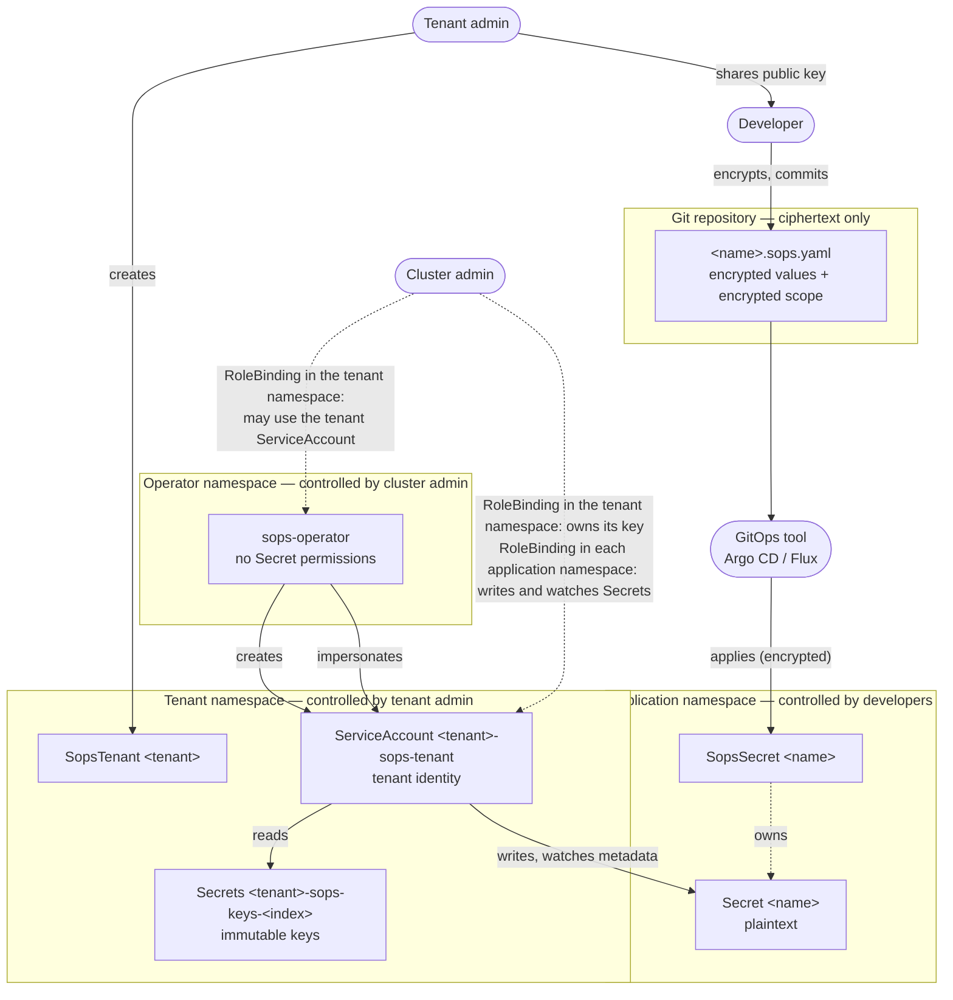
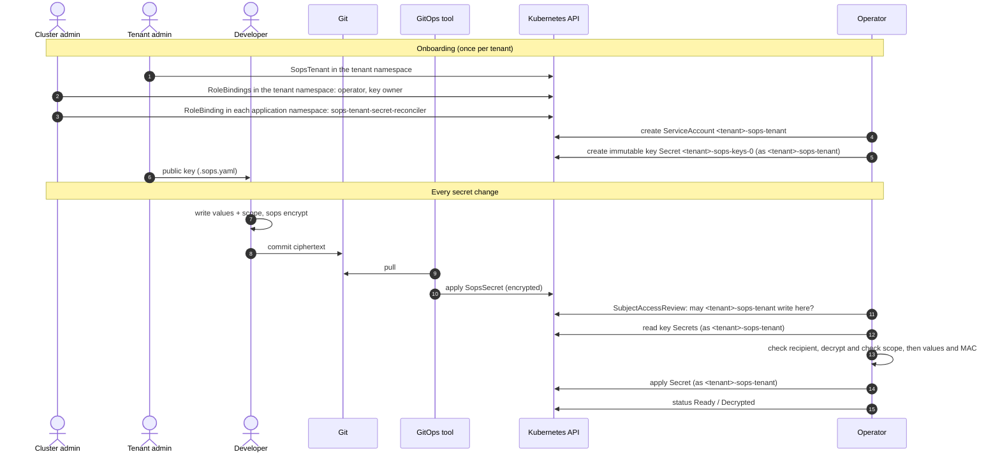
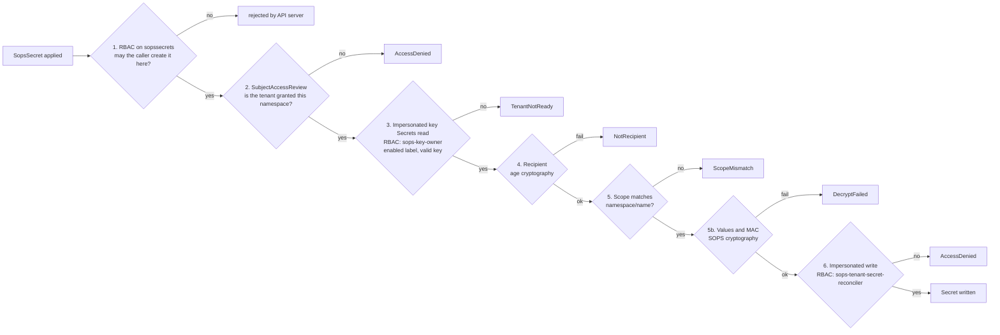

# SOPS Operator — Design

Status: **Draft** · Last updated: 2026-11-10

A Kubernetes operator that decrypts [SOPS](https://github.com/getsops/sops)-encrypted resources in-cluster into
plain Kubernetes Secrets, with self-service for tenants and zero standing privileges for the operator.

---

## 1. Goals and non-goals

### Goals

- Secrets live in Git **encrypted**; only the cluster decrypts them.
- **Self-service**: tenant admins manage their own keys, developers manage their own secrets.
- **Zero trust**: the operator holds no standing permission on Secrets; every read and write is authorized by the
  Kubernetes API server against an explicit grant made by the cluster admin.
- **No cross-tenant or cross-namespace leakage**, including copying ciphertext between namespaces of the same tenant.
- GitOps-friendly: one-way flow Git → cluster, one owner per Secret, health visible to Argo CD / Flux.
- Long-term maintainability: small API, standard tooling (SOPS CLI, age), OLM distribution.

### Non-goals (v1)

- Fetching secrets from external stores (use External Secrets Operator).
- Git access from the operator.
- Templating, generators, dynamic/leased secrets, PushSecret.
- Adopting, merging into, or seeding pre-existing Secrets that are not marked for the operator (D12).
- Cross-namespace or cluster-wide secrets.
- Key rotation (not yet supported; §8.3).
- KMS backends (OpenBao, cloud KMS) — planned later behind the same API.

---

## 2. Background facts

### SOPS and age

- SOPS encrypts **values** in YAML/JSON and leaves keys and structure readable, so Git diffs stay reviewable.
- Each file has a random **data key**. Values are encrypted with AES-256-GCM using the data key, with the value's
  path in the document as additional authenticated data — a value cannot be moved to another key.
- The data key is encrypted once per **recipient** and stored in the file's `sops:` metadata block.
- A **MAC** over the values, encrypted with the data key, detects tampering. With `mac_only_encrypted: true` the MAC
  covers only encrypted values, which is required because Kubernetes adds fields to stored objects.
- Anyone with a recipient's **public** key can encrypt. Decrypting — and therefore editing an existing file — requires
  a **private** key.
- **age** key types (age v1.3.2, SOPS v3.13.3 as of this writing):

  | Type | Recipient | Used here |
  |---|---|---|
  | Post-quantum hybrid (ML-KEM-768 + X25519) | `age1pq1…` / `AGE-SECRET-KEY-PQ-1…` | **Generated keys** |
  | X25519 | `age1…` / `AGE-SECRET-KEY-1…` | Accepted for bring-your-own keys |
  | SSH (`ssh-ed25519`, `ssh-rsa`) | `ssh-…` | Rejected |
  | Plugins (YubiKey, TPM, Secure Enclave) | `age1<plugin>1…` | Rejected in-cluster; fine as human break-glass recipients |

- An age identity file contains only private keys; the public key is derived from them. The `# public key:` line
  written by `age-keygen` is a comment and is never trusted.
- SOPS exposes in-memory identity loading per master key (`age.ParsedIdentities.Import` / `ApplyToMasterKey`), so
  tenants' keys never need to pass through process-wide environment variables or files.

### Git is not a KMS

Git stores and delivers **ciphertext**; a KMS (or here, a Kubernetes Secret) holds the **private key** and decrypts.
The operator never talks to Git. A GitOps tool (Argo CD, Flux), CI, or a person applies the still-encrypted
`SopsSecret` to the API server; the operator watches the API.

```
dev: write → sops encrypt → git push
                                │
Argo CD / Flux / CI: apply (still encrypted)
                                │
Kubernetes API: SopsSecret ──► operator: authorize → load key → decrypt → apply Secret
                                │
                         workload mounts Secret
```

### Landscape

| Solution | Model | Why not used as-is |
|---|---|---|
| Bitnami Sealed Secrets | One cluster key pair; controller decrypts | Single key per cluster to back up/rotate; opaque diffs; no tenant model |
| Flux SOPS (kustomize-controller) | Decryption during Flux apply | Requires Flux; ties secrets to a GitOps engine |
| KSOPS / helm-secrets | Decrypt in Argo CD repo-server or CI | Plaintext passes through the pipeline |
| isindir/sops-secrets-operator | Operator, one key set for all | No tenant isolation |
| peak-scale/sops-operator | Operator with `SopsProvider` selectors (Capsule) | Cluster-wide Secret RBAC and cache; no ciphertext scoping; `GlobalSopsSecret` crosses namespaces |
| External Secrets Operator | Syncs from external stores | Different model (no ciphertext in Git) |
| Vault Secrets Operator | Syncs from Vault | Requires Vault; different model |

---

## 3. Roles

### 3.1 Actors

| Actor | Kind | Owns | Cannot |
|---|---|---|---|
| **Cluster admin** | Human (platform team) | Operator installation (OLM). Tenant onboarding: the RoleBindings that let the operator use the tenant ServiceAccount, let it own its key, and let it write Secrets in each namespace the tenant may target (§5.2). Break-glass private keys (offline). | — |
| **Tenant admin** | Human (team lead / tenant owner) | `SopsTenant` and its key Secrets in the tenant namespace; may also create the two tenant-namespace RoleBindings (D47). Distributing the public key. | Grant the tenant access to other namespaces. |
| **Developer** | Human | `SopsSecret` files in Git and objects in the namespaces they work in. Encrypting with the public key. | Read keys; decrypt or edit existing files; target a namespace other than the `SopsSecret`'s own. |
| **GitOps tool** (Argo CD, Flux, CI) | Machine | Applying the still-encrypted `SopsSecret` from Git to the cluster. | See plaintext or keys. |
| **Operator** | Machine | Decrypting and writing output Secrets — only by impersonating a tenant identity. | Access any Secret with its own identity. |
| **Tenant identity** (`team-a-system:team-a-sops-tenant`) | Machine (ServiceAccount) | The permissions its RoleBindings grant: own the tenant's key Secrets; write and watch Secrets in granted namespaces. | Be used by workloads (no token automount; lives in the key namespace). |

### 3.2 Boundaries

Each box is a trust boundary; the label says who controls it. Solid arrows are actions, dotted arrows are grants.



### 3.3 Responsibility matrix

✅ performs · ⚙️ performed by the operator as the tenant identity · — not allowed

| Action | Cluster admin | Tenant admin | Developer | GitOps tool | Operator |
|---|---|---|---|---|---|
| Install / upgrade the operator | ✅ | — | — | — | — |
| Create the tenant ServiceAccount (`<tenant>-sops-tenant`) | — | triggers | — | — | ✅ |
| Bind the operator and the key owner in the tenant namespace | ✅ | may (D47) | — | — | — |
| Grant a tenant Secret write in a namespace | ✅ | — | — | — | — |
| Create / delete a `SopsTenant` | — | ✅ | — | — | — |
| Generate the tenant key | — | triggers | — | — | ⚙️ |
| Bring a key, or add a key with a higher index | — | ✅ | — | — | — |
| Make a brought key Secret immutable with its public key | — | — | — | — | ⚙️ |
| Back up the cluster, tenant keys included | ✅ | — | — | — | — |
| Hold break-glass private keys (offline) | ✅ | — | — | — | — |
| Encrypt a secret | ✅ | ✅ | ✅ | — | — |
| Decrypt a secret | break-glass only | own tenant | — | — | ⚙️ |
| Commit a `SopsSecret` to Git | — | ✅ | ✅ | — | — |
| Apply a `SopsSecret` to the cluster | — | — | if allowed by RBAC | ✅ | — |
| Write the output Secret | — | — | — | — | ⚙️ |
| Read the output Secret | per namespace RBAC | per namespace RBAC | per namespace RBAC | — | — |

### 3.4 Boundary enforcement

| Boundary | Separates | Enforced by |
|---|---|---|
| Tenant ↔ tenant | Different keys, different tenant identities | Kubernetes RBAC: each tenant identity is granted only its own namespaces |
| Key namespace ↔ consumer namespaces | Private keys never leave `team-a-system`; developers have no access to Secrets there | Kubernetes RBAC |
| Namespace ↔ namespace within a tenant | Ciphertext for `team-a-prod` cannot be used in `team-a-dev` | Cryptography: encrypted `scope`, checked after decryption |
| Git ↔ cluster | Only ciphertext in Git and in the GitOps tool | SOPS encryption |
| Humans ↔ plaintext | Developers encrypt but cannot decrypt | Public-key cryptography |
| Operator ↔ Secrets | No standing access; every access is made as a tenant identity | Kubernetes RBAC + impersonation |

### 3.5 Lifecycle



---

## 4. API

Group `sops.stakater.com`, version `v1alpha1`. Two namespaced kinds.

### 4.1 `SopsTenant`

A tenant is a **key**. It does not list namespaces; access is granted by the cluster admin through RBAC (§5).

```yaml
apiVersion: sops.stakater.com/v1alpha1
kind: SopsTenant
metadata:
  name: team-a                  # key Secrets: team-a-system/team-a-sops-keys-<index>
  namespace: team-a-system        # tenant namespace (dedicated; holds keys only)
spec:
  generateKey: true              # default; the operator generates the key of a new tenant (§4.4)
status:
  observedGeneration: 2
  serviceAccountName: team-a-sops-tenant
  keySecretName: team-a-sops-keys-0   # current key: the highest index
  publicKey: age1pq1...          # copy of the current key's age.pub; reported, never read (D57)
  usedBy: 4                      # SopsSecrets referencing this tenant
  conditions:
    - type: Ready
      status: "True"
      reason: KeyLoaded
```

| Field | Default | Meaning |
|---|---|---|
| `spec.generateKey` | `true` | Generate a post-quantum age key for a new tenant: no key Secret, no v0.0.4 key Secret and no `SopsSecret` referencing the tenant (§4.4). Set `false` to bring your own key. |
| `status.publicKey` | — | Public key of the current key, a copy of its `age.pub`: the value to list in `.sops.yaml` (D39). Cleared at the start of each reconcile and set only when a current key is found. |
| `status.serviceAccountName` | — | The tenant's ServiceAccount, `<tenant>-sops-tenant` (D46). |
| `status.keySecretName` | — | The current key Secret, the highest `<tenant>-sops-keys-<index>` (D48, D51). Cleared and set like `status.publicKey`. |
| `status.usedBy` | — | Number of `SopsSecret`s referencing this tenant. |
| `status.conditions[Ready]` | — | Reasons: `KeyLoaded`, `KeyGenerated`, `KeyMissing` (no key Secret and none may be generated, or the current one lacks the `enabled` label; the message says which, §4.4), `KeyInvalid` (the current key Secret holds no valid key, or its `age.pub` does not match), `AccessDenied` (tenant not onboarded; the message names the binding). |

Printer columns: `READY`, `REASON`, `USED BY`, `AGE`.

The status is rebuilt on every reconcile from the key Secrets and the `SopsSecret`s of the tenant. The
operator never reads it to decide anything, so a tenant whose status is lost (restored from a backup, recreated,
re-synced by GitOps) behaves exactly like before (D57).

### 4.2 Key Secrets

Each tenant key is an immutable Secret `<tenant>-sops-keys-<index>` in the namespace of the `SopsTenant` (D48), with
a decimal index 0, 1, 2, … without leading zeros. The highest index is the current key (§4.4, D51).

```yaml
apiVersion: v1
kind: Secret
metadata:
  name: team-a-sops-keys-0
  namespace: team-a-system
  labels:
    sops.stakater.com/enabled: "true"
    app.kubernetes.io/managed-by: sops-operator   # set when the operator creates it
immutable: true
type: Opaque
stringData:
  age.agekey: |            # private keys
    AGE-SECRET-KEY-PQ-1...
  age.pub: age1pq1...      # public key of the primary identity
```

- `age.agekey` holds one or more identities; the **first** is primary. Further identities, for example a
  break-glass key, also decrypt.
- Generated keys are post-quantum hybrid. Bring-your-own keys may mix PQ and X25519 identities. SSH and plugin
  identities make the key `KeyInvalid`.
- `age.pub` holds the public key of the primary identity (D39). It stays readable when the `SopsTenant` or its
  status is gone; the tenant's `status.publicKey` is a copy for anyone allowed to read the `SopsTenant`.
  Generated key files have no comment lines.
- **Enabled label** (D49): the label `sops.stakater.com/enabled: "true"` is the tenant admin's consent. The
  operator uses a key Secret only when it carries the label and is not an output Secret (no
  `sops.stakater.com/sopssecret` annotation, no ownerReference). A key Secret the tenant admin brings is used once
  it carries the label; the operator then adds `age.pub` and makes it immutable, leaving the private key as it is.
- **Immutable**: a key Secret cannot be edited, only deleted. Deleting one loses that key (§7.2, D55).
- The `SopsSecret` controller reads all key Secrets of the tenant as the tenant identity for every decryption,
  current first; it never reads the tenant's status (D57). Every key Secret with the label and a valid key
  decrypts. Without one, the `SopsSecret` reports `TenantNotReady`.
- **No ownerReference**: deleting the tenant never deletes its keys; a `SopsTenant` created again uses them.

### 4.3 `SopsSecret`

One `SopsSecret` produces **one** Secret with the **same name** in the **same namespace**.

```yaml
apiVersion: sops.stakater.com/v1alpha1
kind: SopsSecret
metadata:
  name: db-creds                     # → Secret team-a-prod/db-creds
  namespace: team-a-prod
  annotations:
    sops.stakater.com/suspend: "true"     # optional; pauses reconciliation
spec:
  tenantRef:
    name: team-a
    namespace: team-a-system
  scope: ENC[AES256_GCM,...]         # encrypted; decrypts to "team-a-prod/db-creds"
  deletionPolicy: Delete             # Delete (default) | Retain
  template:                          # optional; metadata for the output Secret
    metadata:
      labels: {}
      annotations: {}
  type: Opaque
  data: {}                           # binary values (base64), encrypted
  stringData: {}                     # text values, encrypted
# written by `sops encrypt`:
sops:
status:
  observedGeneration: 1
  lastSyncTime: "2026-10-09T10:00:00Z"
  conditions:
    - type: Ready
      status: "True"
      reason: Decrypted
```

| Field | Required | Meaning |
|---|---|---|
| `spec.tenantRef` | yes | Tenant whose key decrypts this file. |
| `spec.scope` | yes | **Encrypted** `<namespace>/<name>` where this ciphertext may be decrypted. Set by the author before encryption. |
| `spec.deletionPolicy` | no | `Delete` (default): the finalizer `sops.stakater.com/output-secret` on the `SopsSecret` lets the operator delete the labelled output Secret before the `SopsSecret` is gone. `Retain`: no finalizer; the output Secret stays when the `SopsSecret` is deleted. Output Secrets have no ownerReference in either mode (D58). |
| `spec.template.metadata` | no | Labels and annotations copied to the output Secret (e.g. Reloader annotations). Copied as written; the `SopsSecret`'s own labels and annotations are not copied. Keys starting with `sops.stakater.com/` are dropped. |
| `spec.type` | no | `Opaque` (default), `kubernetes.io/tls`, `kubernetes.io/dockerconfigjson`, `kubernetes.io/basic-auth`, `kubernetes.io/ssh-auth`. Service-account and bootstrap token types are not allowed. |
| `spec.data` / `spec.stringData` | at least one | Same semantics as on a Secret. A key may not appear in both. |
| `sops` | yes | SOPS metadata written by `sops encrypt`. Must contain `mac`, `lastmodified`, `version`, at least one `age` recipient, `encrypted_regex: ^(data|stringData|scope)$` and `mac_only_encrypted: true`. Only age recipients in a single key group are supported; other key types are rejected by the schema. |

Status reasons: `Decrypted`, `Suspended`, `TenantNotFound`, `TenantNotReady`, `AccessDenied`, `NotRecipient`,
`ScopeMismatch`, `DecryptFailed`, `Conflict`, `ApplyFailed` (e.g. type validation, size limit). The status only
reports; it is rebuilt on every reconcile and never read back (D57).

Printer columns: `TENANT`, `READY`, `REASON`, `AGE`.

Behaviour:

- **Ownership** (D28): a Secret belongs to a `SopsSecret` when it has the `SopsSecret`'s name and namespace and
  carries `sops.stakater.com/enabled: "true"`. There are no exceptions: any other Secret with that name, one
  written by v0.0.4 included, is never changed or deleted, and the `SopsSecret` reports `Conflict` with the message
  "Secret <namespace>/<name> exists without the label sops.stakater.com/enabled=true; add the label to let this
  SopsSecret manage it". The admin adopts an existing Secret only by adding the label (D12).
- **No ownerReference** (D58): output Secrets carry no ownerReference in any mode, so no UID ties a Secret to one
  `SopsSecret` object. ownerReferences written by v0.0.4 are removed on the next write. Argo CD therefore does not
  show the output Secret as a child of the `SopsSecret` in its resource tree.
- Labels and annotations come only from the template, copied as written, never from the `SopsSecret` itself, so the
  GitOps tool's tracking labels and annotations on the `SopsSecret` never reach the Secret and the tool does not
  claim or prune it. A template is explicit; inheriting would need a list of every tool's tracking keys to leave
  out.
- **Deletion** (D58): with `deletionPolicy: Delete` the operator keeps the finalizer
  `sops.stakater.com/output-secret` on the `SopsSecret`. When the `SopsSecret` is deleted, the operator lists the
  Secret with the same name and namespace as the tenant identity, metadata only, deletes it only if it carries the
  `enabled` label, with a precondition on the UID and resourceVersion it just listed, and then removes the
  finalizer. A deletion the tenant may not make (`Forbidden`, e.g. the namespace is being deleted together with its
  grant, or the grant was revoked) does not block: the finalizer is removed and the Secret is left to the namespace
  deletion or to the admin. With `deletionPolicy: Retain` there is no finalizer; the Secret stays and keeps its
  label. Changing the policy adds or removes the finalizer.
- To write, the operator lists Secrets by name (`metadata.name` field selector) as the tenant identity, metadata
  only, and never reads Secret data. It creates the Secret when the list is empty, updates it at the
  resourceVersion it listed when it belongs to the `SopsSecret`, and otherwise reports `Conflict`. A Secret
  replaced between list and update fails the update and is checked again on the next reconcile.
- Ownership does not depend on status, so a `SopsSecret` whose status is lost, or that is recreated or restored,
  keeps managing its Secret. A Secret kept by `deletionPolicy: Retain` keeps its label and is taken over by the
  next `SopsSecret` with the same name (D12).
- Ownership is the same for every name: there is no reserved name. A `SopsSecret` named like a key Secret in the
  tenant namespace cannot change it, because key Secrets are immutable: the API server rejects the write and the
  `SopsSecret` reports `ApplyFailed`. This needs `sops-tenant-secret-reconciler` bound in the tenant namespace,
  which should not be done (§5.2).
- Every output Secret carries `sops.stakater.com/enabled: "true"`, `app.kubernetes.io/managed-by: sops-operator`
  and the annotation `sops.stakater.com/sopssecret` (the `SopsSecret`, in the same namespace). Its other labels and
  annotations come only from `spec.template.metadata`.
- Output Secrets stay mutable, and the operator reverts direct changes (D50). It watches the metadata of its
  tenant's output Secrets as the tenant identity, one watch per tenant and namespace selected by the `enabled` label,
  while a `SopsSecret` of the tenant there is `Decrypted`. A deletion or any change, of values, labels or
  annotations, reconciles the `SopsSecret`, which writes the Secret back in place at once (same UID, so volume
  mounts refresh). A write that changes nothing does not modify the Secret, so the operator's own writes cause no
  loop. The periodic resync corrects anything the watch missed.

### 4.4 Indexed immutable keys

The operator decides from the key Secrets and the `SopsSecret`s of the tenant, never from status (D57). It
lists the Secrets of the tenant namespace as the tenant identity and keeps those named
`<tenant>-sops-keys-<index>`:

- **Seal**: every key Secret that carries the `enabled` label, holds a valid key and is still mutable gets
  `age.pub` for its primary identity and `immutable: true`. Nothing else about it changes.
- **Current key**: the highest index. It must carry the `enabled` label (otherwise `KeyMissing`, naming the
  Secret and the label), must not be an output Secret (`KeyMissing`), and must hold a valid key whose `age.pub`
  matches (otherwise `KeyInvalid`, naming the Secret). There is no fall-back to a lower index: a broken current
  key is reported, not skipped. A valid current key sets `status.keySecretName` and `status.publicKey` (`KeyLoaded`).
- **Decryption**: every key Secret with the label and a valid key decrypts (§4.2), so files encrypted for an
  older key keep working after a higher-indexed key is added.
- **No key Secret**: the first key is written to `<tenant>-sops-keys-0`, immutable, with `age.pub`:
  - **Upgrade from v0.0.4**: the key of `<tenant>-sops-keys` is moved into `<tenant>-sops-keys-0` only once
    `<tenant>-sops-keys` carries the `enabled` label, whoever created it; without the label the tenant reports
    `KeyMissing`, naming the label. The old Secret is left in place for the tenant admin to delete.
  - **Generation**: otherwise a key is generated only when `generateKey` is not `false` and no `SopsSecret`
    references the tenant, counted from an uncached list. Otherwise the tenant reports `KeyMissing`; the message
    gives the number of `SopsSecret`s, whose files a new key could not decrypt. The operator records the event
    `KeyGenerated`.
- The operator watches the metadata of the key Secrets (and of a v0.0.4 key Secret) as the tenant identity, so a
  new, labelled or deleted key Secret is handled at once; the periodic resync covers a missed event.
- A `SopsTenant` recreated with an empty status finds the same current key.
- There are no backups, no restore and no finalizer. The tenant admin, the only user with Secret rights in the
  tenant namespace, can delete a key Secret. That loses that key; cluster backups cover it (§7.2, D55). While
  `SopsSecret`s use the tenant, no new key is generated in place of a deleted last key.
- Key rotation is not yet supported (§8.3).

---

## 5. Authorization model

### 5.1 Flow for a `SopsSecret` in namespace X

1. Resolve `tenantRef` → `team-a-system/team-a`; a missing `SopsTenant` → `TenantNotFound`.
2. **Grant check** (SubjectAccessReview): may `system:serviceaccount:team-a-system:team-a-sops-tenant` create,
   update, list and watch Secrets in X (`sops-tenant-secret-reconciler`)? If not → `AccessDenied`, naming the role
   and these four verbs. Done before any decryption. `delete` is not checked: it is used only when the `SopsSecret`
   is deleted, and a denied deletion does not block (D56, D58).
3. List the key Secrets `<tenant>-sops-keys-<index>` **impersonating** `team-a-system:team-a-sops-tenant` and
   keep those with the `enabled` label and a valid key, current first. None, or unreadable → `TenantNotReady`. The
   tenant's status is not consulted (D57).
4. Verify the file's recipients include one of the tenant keys → else `NotRecipient`.
5. Decrypt **only** the encrypted `scope` and verify it equals `X/<name>` → else `ScopeMismatch`. No other value of
   a document scoped elsewhere is decrypted. Then decrypt the values and verify the MAC → else `DecryptFailed`.
   Error messages never contain decrypted values (SOPS does not authenticate a value's type tag, and its parse
   errors quote the plaintext).
6. Create or update the Secret in X **impersonating** `team-a-system:team-a-sops-tenant`, after a metadata-only
   list by name that shows whether it belongs to the `SopsSecret` (D28); a foreign Secret → `Conflict`. The API
   server enforces the cluster admin's RoleBinding again.
7. While the `SopsSecret` is `Decrypted`, watch the metadata of the tenant's labelled Secrets in X as the tenant
   identity (D50).
8. When the `SopsSecret` is deleted with `deletionPolicy: Delete`, delete its labelled Secret in X
   **impersonating** the tenant identity, then remove the finalizer, also when the deletion is forbidden (§4.3,
   D58).

### 5.2 RBAC objects

Shipped as static objects in the OLM bundle:

| ClusterRole | Rules | Bound by | Where |
|---|---|---|---|
| `sops-operator-tenant` | `serviceaccounts`: `create`, `impersonate` | Cluster admin (or tenant admin, D47), to the operator | Each tenant namespace |
| `sops-key-owner` | `secrets`: `get`, `list`, `watch`, `create`, `update` (§4.4): find and watch the key Secrets, create the first one, and add `age.pub` and `immutable` to a brought one | Cluster admin (or tenant admin, D47) | Tenant namespace |
| `sops-tenant-secret-reconciler` | `secrets`: `create`, `update`, `delete`, `list`, `watch` (D56); `delete` for `deletionPolicy: Delete` | Cluster admin | Each namespace the tenant may write to; not the tenant namespace |
| `sops-tenant-admin` | full access to `sopstenants`; aggregated to `admin` | — | — |
| `sops-secret-editor` | full access to `sopssecrets`; aggregated to `edit` | — | — |
| `sops-viewer` | read `sopstenants`, `sopssecrets`; aggregated to `view` | — | — |

The tenant-facing ClusterRoles are shipped from `config/tenant-rbac/` with exactly these names (not prefixed).

Each tenant has its own identity, the ServiceAccount `<tenant>-sops-tenant` in the tenant namespace (D46). The
operator creates it, with `automountServiceAccountToken: false` and the labels
`app.kubernetes.io/managed-by: sops-operator`, `app.kubernetes.io/component: tenant-identity` and
`app.kubernetes.io/instance: <tenant>`, and reports its name in `status.serviceAccountName`. It never changes or
deletes an existing ServiceAccount, and the ServiceAccount grants nothing until it is bound.

The operator has no cluster-wide permission on ServiceAccounts. RBAC cannot limit impersonation to a name pattern
such as `*-sops-tenant`, so the operator is allowed to create and act as ServiceAccounts per tenant namespace, with
`sops-operator-tenant` (D46). Until then the tenant reports `AccessDenied`, naming the binding to create. Tenant
namespaces hold tenant keys only, so the operator can act as nothing else there.

Onboarding for tenant `team-a` in tenant namespace `team-a-system`, writing to `team-a-prod`; can be applied
automatically by Stakater Tenant Operator or Capsule. RoleBinding names are free; only `roleRef` and `subjects`
matter. The first two RoleBindings grant only permissions the built-in `admin` role already holds in the tenant
namespace, so the tenant admin may create them too (D47). The `sops-tenant-secret-reconciler` RoleBindings are the
only grants that extend a tenant's reach and stay with the cluster admin.

Once per tenant namespace, the operator may create and use tenant ServiceAccounts in `team-a-system`. The subject
is the operator's ServiceAccount, in the namespace of its Subscription (`openshift-operators` here):

```yaml
apiVersion: rbac.authorization.k8s.io/v1
kind: RoleBinding
metadata:
  name: sops-operator
  namespace: team-a-system
roleRef:
  apiGroup: rbac.authorization.k8s.io
  kind: ClusterRole
  name: sops-operator-tenant
subjects:
  - kind: ServiceAccount
    name: sops-operator-controller-manager
    namespace: openshift-operators
```

Once per tenant, the tenant ServiceAccount owns its key Secrets:

```yaml
apiVersion: rbac.authorization.k8s.io/v1
kind: RoleBinding
metadata:
  name: team-a-key-owner
  namespace: team-a-system
roleRef:
  apiGroup: rbac.authorization.k8s.io
  kind: ClusterRole
  name: sops-key-owner
subjects:
  - kind: ServiceAccount
    name: team-a-sops-tenant
    namespace: team-a-system
```

One per namespace the tenant may write to. Do not bind it in the tenant namespace: application Secrets do not
belong next to the keys, and a `SopsSecret` named like a key Secret there would only fail with `ApplyFailed` (§4.3).

```yaml
apiVersion: rbac.authorization.k8s.io/v1
kind: RoleBinding
metadata:
  name: team-a-secret-reconciler
  namespace: team-a-prod
roleRef:
  apiGroup: rbac.authorization.k8s.io
  kind: ClusterRole
  name: sops-tenant-secret-reconciler
subjects:
  - kind: ServiceAccount
    name: team-a-sops-tenant
    namespace: team-a-system
```

### 5.3 Operator permissions

```yaml
# clusterPermissions (config/rbac/role.yaml)
- apiGroups: ["", events.k8s.io]
  resources: [events]
  verbs: [create, patch]
- apiGroups: [authorization.k8s.io]
  resources: [subjectaccessreviews]
  verbs: [create]
- apiGroups: [sops.stakater.com]
  resources: [sopssecrets]
  verbs: [get, list, patch, update, watch]   # update and patch: the output Secret finalizer
- apiGroups: [sops.stakater.com]
  resources: [sopssecrets/finalizers]
  verbs: [update]
- apiGroups: [sops.stakater.com]
  resources: [sopssecrets/status, sopstenants/status]
  verbs: [get, patch, update]
- apiGroups: [sops.stakater.com]
  resources: [sopstenants]
  verbs: [get, list, watch]
# clusterPermissions (config/rbac/metrics_auth_role.yaml): metrics endpoint authentication
- apiGroups: [authentication.k8s.io]
  resources: [tokenreviews]
  verbs: [create]
- apiGroups: [authorization.k8s.io]
  resources: [subjectaccessreviews]
  verbs: [create]
# permissions (operator namespace): the standard operator-sdk leader-election Role
- apiGroups: [""]
  resources: [configmaps]
  verbs: [get, list, watch, create, update, patch, delete]
- apiGroups: [coordination.k8s.io]
  resources: [leases]
  verbs: [get, list, watch, create, update, patch, delete]
- apiGroups: [""]
  resources: [events]
  verbs: [create, patch]
```

The operator updates and patches `SopsSecret`s only to add and remove its finalizer `sops.stakater.com/output-secret`;
it never changes their spec. The operator has **no** permission on Secrets, Roles or RoleBindings, and none on
ServiceAccounts outside the tenant namespaces that granted it `sops-operator-tenant`. There it may create and impersonate ServiceAccounts;
it can never read, change, delete or mint tokens for any.
Every Secret access is an impersonated call and appears in the Kubernetes audit log as the operator acting as the
tenant identity.

---

## 6. Zero-trust enforcement

No component is trusted because of where it runs or who deployed it. Every action is verified at the moment it
happens, against an explicit grant, by a component other than the one asking.

### 6.1 Principles and mechanisms

| Principle | Mechanism | Enforced by |
|---|---|---|
| **Never trust, always verify** | Every key read and Secret write is an impersonated API call, checked against RBAC on each request. Every ciphertext is verified (recipient, MAC, scope) before use. | API server, SOPS cryptography |
| **Explicit grants, default deny** | A tenant can write into a namespace only if the cluster admin created a RoleBinding there. No selectors, labels or naming conventions grant access. No grant → `AccessDenied`. | API server |
| **Least privilege** | Operator has no Secret or RBAC permissions and no cluster-wide ServiceAccount permissions; it acts only in tenant namespaces that granted it `sops-operator-tenant`. `sops-tenant-secret-reconciler` is bound only in granted namespaces, and the operator watches only metadata there. `sops-key-owner` is bound only in the key namespace. Developers can encrypt but not decrypt. | API server, public-key cryptography |
| **One identity per tenant** | Each tenant acts as its own ServiceAccount; no identity is shared across tenants. | API server |
| **Separation of duties** | Cluster admin grants access but never handles tenant keys or plaintext. Tenant admin manages keys but cannot grant namespaces. Developer writes secrets but cannot read keys. | API server (RBAC per role) |
| **Bind data to its destination** | Encrypted `scope` ties every ciphertext to one namespace and name. | SOPS cryptography + operator check |
| **Assume breach** | Every component's compromise is bounded (§6.4). | Design |
| **Status reports, never decides** | Status can always be lost (backup restore, recreate, GitOps re-sync, `kubectl replace`). The operator derives state from spec and the objects it manages (existence, data, labels, annotations, creation time, owner references), rebuilds status on every reconcile, and never reads status, its own resource's or another's, to decide anything (D57). | Operator |
| **Continuous verification** | Grants and keys are re-checked on every reconcile and periodic resync, not cached as decisions. A revoked grant takes effect at the next reconcile. | Operator, API server |
| **Full auditability** | Impersonated calls appear in the Kubernetes audit log with both the operator and the tenant identity. Decisions are visible in status conditions and events. | API server audit log |
| **No long-lived credentials besides keys** | The operator authenticates with its auto-rotated projected token. The tenant ServiceAccount has no token automounted. | Kubernetes |

### 6.2 Enforcement points



| # | Check | Enforced by | Authoritative? |
|---|---|---|---|
| 1 | Caller may create `SopsSecret` in the namespace | API server (RBAC) | Yes |
| 2 | Tenant is granted the namespace | Operator (SubjectAccessReview) | No — early, clear failure; check 6 is authoritative |
| 3 | Tenant identity may read its keys; at least one key Secret is labelled and valid | API server (RBAC via impersonation); operator | Yes |
| 4 | File encrypted for this tenant | age cryptography | Yes |
| 5 | Ciphertext bound to this namespace and name, checked before any other value is decrypted; then the values decrypt and the file is untampered (MAC) | Operator, on a cryptographically protected value; SOPS | Yes, given a correct operator |
| 6 | Tenant identity may write Secrets in the namespace | API server (RBAC via impersonation) | Yes |

### 6.3 What must be trusted

Zero trust minimises, but cannot remove, the trusted computing base:

| Component | Trusted for |
|---|---|
| Kubernetes API server, RBAC and etcd | Enforcing grants; storing Secrets (with encryption at rest) |
| SOPS and age libraries | Correct cryptography |
| Operator binary | Performing the scope check (5); not leaking plaintext; impersonating only the tenant named in `tenantRef` |
| Operator image supply chain | Signed images (cosign), SBOM and provenance; pinned by digest in the OLM bundle |
| Nodes and kubelet | Delivering Secrets to workloads |

### 6.4 Blast radius when a component is compromised

| Compromised | Attacker gains | Attacker does not gain |
|---|---|---|
| Developer account | Can apply `SopsSecret`s with values of their choosing in their namespaces | Keys; other namespaces' plaintext; copied ciphertext is rejected by scope |
| Tenant admin account | Own tenant's private keys, which they can also delete; Secret write in the namespaces granted to the tenant | Other tenants; new namespace grants |
| Tenant identity token | Same as the tenant's grants, including reading the Secrets in its granted namespaces | Other tenants |
| Git repository or GitOps tool | Ciphertext only; ability to apply or replay `SopsSecret`s it can already apply | Plaintext or keys |
| Operator | Can act as any ServiceAccount in tenant namespaces it was granted, within each tenant's grants; can create ServiceAccounts there, which grant nothing until bound | Any Secret outside tenant grants; RBAC changes; new grants; ServiceAccount tokens |
| Cluster admin | Everything (inherent) | — |

### 6.5 Revocation

| Revoke | Effect |
|---|---|
| Remove a namespace RoleBinding | Next reconcile → `AccessDenied`. The already-written Secret remains: the operator can no longer change it, nor delete it when the `SopsSecret` is deleted, and that deletion is not blocked (D58); the cluster admin removes the Secret if required. |
| Delete the tenant's key-owner RoleBinding | All `SopsSecret`s of the tenant → `TenantNotReady`; nothing more is decrypted. |
| Remove a recipient from a file (`sops updatekeys`) | That key can no longer decrypt the new version of the file. |

---

## 7. Threat model

### 7.1 Attacks and mitigations

| Attack | Mitigation |
|---|---|
| Developer in `mallory-ns` references another tenant's key | No cluster admin grant in `mallory-ns` → `AccessDenied`; the write would be denied by the API server anyway. |
| Tenant admin targets a namespace of another tenant | Tenants cannot grant themselves namespaces; only the cluster admin's RoleBinding does. |
| Developer copies a prod `SopsSecret` into a dev namespace of the same tenant | Encrypted `scope` decrypts to `team-a-prod/…` → `ScopeMismatch`. |
| Developer edits `scope` or splices ciphertext between files | Requires the private key; per-file data keys, path-bound values and the MAC make splicing fail. |
| Developer reads keys | Key Secrets live in the dedicated tenant namespace; developers have no access. |
| Tenant SA token stolen from a consumer namespace | No SA exists in consumer namespaces; the tenant SA lives in the tenant namespace with `automountServiceAccountToken: false`. |
| Operator overwrites or deletes a Secret it does not own | Only a Secret with the `SopsSecret`'s name that carries the `enabled` label is written or deleted, with no exceptions; any other → `Conflict` (D28). A deletion is made at the UID and resourceVersion just listed, so a Secret replaced in between is not deleted. |
| Someone labels an unrelated Secret `sops.stakater.com/enabled` so a `SopsSecret` of the same name overwrites it, or deletes it with `deletionPolicy: Delete` | Adding the label needs `update` on that Secret, which already allows changing it; the `SopsSecret` must still decrypt for that namespace and name (§7.2). |
| A recreated or restored `SopsSecret` loses its Secret to garbage collection | Output Secrets have no ownerReference; the Secret is deleted only by the finalizer of a `SopsSecret` being deleted (D58). |
| A revoked grant or a namespace deletion leaves a `SopsSecret` stuck in deletion | A forbidden deletion removes the finalizer anyway (D58). |
| A `SopsSecret` named like a key Secret in the tenant namespace | Key Secrets are immutable: the API server rejects the write → `ApplyFailed` (§4.3). It needs `sops-tenant-secret-reconciler` in the tenant namespace, which is not granted there (§5.2). |
| User edits an output Secret or a key Secret | The watch reverts an output Secret at once from its `SopsSecret` (D50). A key Secret is immutable and cannot be edited (D51). |
| User deletes a key Secret | That key is lost (§7.2, D55). While `SopsSecret`s use the tenant, no new key is generated in its place (`KeyMissing`, D18). |
| A `SopsSecret` writes a Secret posing as a key | Labels and annotations starting with `sops.stakater.com/` in `spec.template.metadata` are dropped, and an output Secret is never used as a key (D49). |
| Operator compromise reads all Secrets | No Secret RBAC; impersonation only in tenant namespaces that granted it, limited to tenant grants. |
| Status of a `SopsTenant` or `SopsSecret` is lost, replaced or edited | No decision reads status (D57): the current key follows from the key Secrets, ownership follows from the Secret's labels, and status is rebuilt at the next reconcile. |
| GitOps tool prunes output Secrets | Only the template's labels and annotations are copied, not the `SopsSecret`'s own with the tool's tracking keys (D22). |
| Plaintext committed to Git | Pre-commit `sops filestatus` / `sops-checker`; documented workflow. |

### 7.2 Accepted risks

| Risk | Rationale / control |
|---|---|
| A compromised operator can act as any tenant within that tenant's grants. | Inherent to central decryption. Reduced later by the OpenBao backend (decryption approved and audited by Bao). |
| Tenant admins can read their own private key. | Own tenant only. Removed later by the OpenBao backend. |
| Anyone allowed to write `SopsSecret`s in a namespace can apply their own values (public key encryption). | Same power as writing a Secret; controlled by RBAC on `sopssecrets`. |
| Replay of an older, validly encrypted `SopsSecret`. | Equivalent to a Git revert; controlled by GitOps and RBAC on manual applies. |
| A direct change to an output Secret is visible until the watch reverts it, typically within a second; with the watch down, until the next resync. | No admission webhook (D50); configurable resync interval. |
| `sops-key-owner` grants `get`, `list`, `watch`, `create` and `update` on all Secrets in the tenant namespace, so tenants sharing a namespace can read or replace each other's keys. | Tenant namespace is dedicated to keys; per-tenant key access is planned for tenants sharing a namespace. |
| Deleting a key Secret loses that key, and files encrypted only for it no longer decrypt. | Only the tenant admin has Secret rights in the tenant namespace, and they own the keys; cluster backups cover it (D55). While `SopsSecret`s use the tenant, no new key is generated in place of a deleted one. |
| A `SopsSecret` named like a key Secret in the tenant namespace reports `ApplyFailed`. | Needs `sops-tenant-secret-reconciler` in the tenant namespace, which should not be granted; the key Secret is immutable and stays as it is (§4.3). |
| The tenant identity can read every Secret in the namespaces granted `sops-tenant-secret-reconciler` (`list` and `watch` return contents), and so can the operator acting as it. | Needed to watch output Secrets (D56). The operator requests metadata only and never logs Secret contents; grant only namespaces the tenant may see. |
| Anyone who can label Secrets in a namespace can hand a Secret to a `SopsSecret` of the same name, which then overwrites it and, with `deletionPolicy: Delete`, deletes it with the `SopsSecret`. | Labelling needs `update` on the Secret, so they hold Secret write rights there anyway; the cluster admin's grant and the encrypted scope still apply. |
| A `SopsSecret` deleted after its tenant lost the namespace grant, or whose deletion is otherwise forbidden, leaves its Secret behind. | Deletion never blocks (D58); a namespace being deleted removes the Secret, otherwise the admin does. |
| Plaintext in output Secrets. | Outside the operator: enable etcd encryption at rest; restrict `get secrets` in consumer namespaces. |

---

## 8. Workflows

### 8.1 Onboarding

1. Cluster admin applies the onboarding RoleBindings for the tenant (§5.2).
2. Tenant admin creates the `SopsTenant` → operator creates the `<tenant>-sops-tenant` ServiceAccount and generates
   the key → `Ready/KeyGenerated`. A missing RoleBinding → `Ready/AccessDenied`, naming it.
3. Tenant admin reads the public key from `age.pub` of the key Secret `<tenant>-sops-keys-0`, or from
   `status.publicKey` of the `SopsTenant`, and commits it to the team's `.sops.yaml`.

### 8.2 Developer: create or change a secret

```yaml
# .sops.yaml (committed)
creation_rules:
  - path_regex: \.sops\.ya?ml$
    encrypted_regex: ^(data|stringData|scope)$
    mac_only_encrypted: true
    age:
      - age1pq1...team-a          # tenant public key
      - age1pq1...breakglass     # platform break-glass recipient
```

```bash
# write plaintext SopsSecret (never commit this state), then:
yq -i '.spec.scope = .metadata.namespace + "/" + .metadata.name' prod/db-creds.sops.yaml
yq -i 'sort_keys(..)' prod/db-creds.sops.yaml
sops encrypt -i prod/db-creds.sops.yaml
git add prod/db-creds.sops.yaml && git commit -m "add db-creds"
```

- If the namespace is injected by kustomize, set the scope explicitly: `yq -i '.spec.scope = "team-a-prod/db-creds"'`.
- Keys must be sorted byte-wise before encryption (`yq sort_keys` does this). The SOPS MAC depends on key order and
  the Kubernetes API returns objects with keys sorted byte-wise; an unsorted file fails with `DecryptFailed`.
- `stringData` values must be quoted strings. SOPS parses unquoted scalars before encrypting (`0123` would become
  `83`), so the operator rejects them with `DecryptFailed` instead of writing a changed value.
- Developers cannot `sops edit` (requires the private key). To change a value, rewrite and re-encrypt the file.
- Pre-commit: `sops filestatus <file>` must report `{"encrypted":true}`.

### 8.3 Key rotation

Not yet supported (D52–D54). A tenant admin can add a key by hand: a labelled key Secret with the next index
becomes the current key, while the older keys keep decrypting (§4.4). An old key is removed by deleting its
Secret once no file is encrypted only for it.

### 8.4 Migration from existing Secrets

A Secret with the same name is not adopted unless it carries the `enabled` label (D12); otherwise the `SopsSecret`
reports `Conflict`. Either replace the old Secret with a `SopsSecret` of the same name in one commit (seconds of
absence; running pods unaffected), or create the `SopsSecret` under a new name, switch workloads, then remove the
old Secret. Someone allowed to update the old Secret can instead add the label
`sops.stakater.com/enabled: "true"` to it; the `SopsSecret` then replaces its values, labels and annotations.

There are no exceptions: output Secrets written by v0.0.4 report `Conflict` until they are labelled, and their
ownerReferences are removed on the next write (D58). A Secret kept by `deletionPolicy: Retain` keeps its label and
is taken over by the next `SopsSecret` with its name.

### 8.5 Disaster recovery

Restore the key Secrets **before** the `SopsTenant`s, or set `generateKey: false`, so no new key is generated in
place of a lost one. Status need not be restored: a `SopsTenant` recreated with an empty status finds its current
key in the key Secrets (§4.4), and a `SopsSecret` restored without status keeps managing its Secret (§4.3). No UID
ties them: a restored output Secret is managed again through its `enabled` label, whatever the UID of the restored
`SopsSecret` (D58).
Break-glass recipients allow recovery of every file if a tenant key is lost.

---

## 9. Delivery

- **Language/framework**: Go, operator-sdk (go/v4 plugin), controller-runtime, `getsops/sops/v3`, `filippo.io/age`. Tools pinned and checksum-verified by `hack/bootstrap-tools.sh`: operator-sdk v1.42.3, opm v1.74.0.
- **Distribution**: OLM only. Bundle + file-based catalog images; channel `alpha` (further channels, such as `stable`, are added in `catalog/channels.yaml`); install mode
  `AllNamespaces`; no webhooks (D50) and no OLM dependencies (compatible with OLM v0 `Subscription` and OLM v1
  `ClusterExtension`). Validation with CEL in the CRDs.
- **Bundle**: generated by `make bundle IMG=<image>` from `config/manifests` (base CSV, CRDs, operator RBAC, the
  tenant ClusterRoles of §5.2, samples, scorecard configuration) and validated with the `operatorframework` suite.
  `bundle/` is a build output and is not committed. The base CSV is regenerated from API markers by `make csv`,
  which also stamps `operator-icon.svg` (Hestia's icon) into it.
- **Catalog and promotion** (from Hestia): `catalog/package.yaml` and `catalog/channels.yaml` are committed;
  `channels.yaml` is the upgrade graph. A version is released to a channel by adding `sops-operator.vX.Y.Z` to it
  (with `replaces` or `skipRange`) in a reviewed change, so any number of channels and parallel version streams
  can be maintained. `make catalog-render` renders every bundle the channels list (published ones from
  `ghcr.io/stakater/sops-operator-bundle:vX.Y.Z`) into `catalog/release/index.yaml` and validates it; a version
  listed in no channel builds no catalog, and a bundle that cannot be rendered fails the build.
- **Publishing** (`.github/workflows/push.yaml`): `catalog/channels.yaml` is the only source of truth. A push to
  `main` that does not change `catalog/` publishes nothing. When it does, `hack/release-plan.sh` finds the one listed
  version whose bundle is not published yet; the workflow builds the operator image for `linux/amd64` and
  `linux/arm64`, the bundle referencing the operator by digest, and the catalog, tags them `vX.Y.Z`, attaches SBOM
  and provenance, signs them with cosign (keyless, GitHub OIDC), verifies the signatures and that the images can
  be pulled anonymously, then creates the git tag and GitHub release. When every listed version is already
  published (e.g. promoting a version to another channel), only the catalog is republished, tagged with the
  highest listed version; a published operator or bundle version is never overwritten. More than one unpublished
  version, or a registry that cannot be read, fails the release.
- **Configuration**: flags, with environment defaults settable through `Subscription.spec.config.env`:
  `RESYNC_INTERVAL` (Go duration, default `10m`). An invalid value stops the operator at startup.
- **Testing**: unit tests; envtest with the RBAC authorizer and a non-admin operator user; e2e on **kind** with the
  operator installed by **OLM** (`make test-e2e`, below) that compares `SopsTenant`, `SopsSecret` and output Secrets with
  committed golden files (`gotest.tools/v3/golden`, plain YAML; record or update with `UPDATE_GOLDEN=true`).
  `test/snapshot` normalizes objects first: volatile values (UIDs, resourceVersion, timestamps after validating
  them) become placeholders, Secret values and ciphertext are redacted, and an object with an age key is refused.
  Golden files no test compares any more fail the run.
  e2e tests are organised by **use case**: one file and one top-level test per use case, named after the feature
  or rule it checks (`TestTenantOnboarding` in `tenant_onboarding_test.go`, `TestSecretDecryption`,
  `TestSecretDeletion`, `TestExistingSecretMigration`, `TestNamespaceIsolation`, `TestSopsCLIWorkflow` with the
  pinned `sops` and `yq` CLIs, `TestSecretOwnership`, `TestTenantKeys`,
  `TestAccessRevocation`, `TestSelfHealing`, `TestOperatorRestart`; the operator runs with a 10s resync interval during e2e), one subtest per expected
  behaviour named `shall …`, and golden files stored as `test/e2e/testdata/<Test>/<shall_…>/<kind>-<label>.yaml`.
  Unit and envtest tests follow the same convention: one top-level test per feature (`TestSecretWriter`,
  `TestSecretOwnership`, …) with `shall …` subtests. `make test-scripts` runs `scripts/test.sh`, which tests
  `encrypt.sh` with a throwaway key, without a cluster.
  Every envtest package starts its API server through `internal/testenv`, which stops it on SIGINT and SIGTERM
  and, before starting, stops `etcd` and `kube-apiserver` processes from the envtest assets directory whose
  parent has exited (a test binary that was killed or timed out leaves them running with PID 1 as parent).
  Processes of a test that is still running are never touched, so packages can run in parallel.
  There is one e2e flow, the way customers install: `make test-e2e` builds the operator and
  bundle images and a catalog that lists only that bundle (a fresh install; upgrades along the channel graph
  are tested per release), pushes them to a local registry (`localhost:5011`), installs OLM v0 on a dedicated kind
  cluster and subscribes to the catalog, passing `RESYNC_INTERVAL=10s` through `Subscription.spec.config.env`.
  `make test-e2e E2E_RUN='<regex>'` runs only the matching e2e tests (`go test -run`); the kind cluster is kept
  for reruns and removed with `make cleanup-test-e2e`.
  Nothing from `config/` is applied, so the tenant ClusterRoles must come from the bundle. Each run uses a
  CatalogSource named after its image tag (OLM caches catalog contents by name) and first removes the cluster
  RBAC of the previous install (OLM keeps it after the CSV is deleted). `make scorecard` runs the operator-sdk
  basic and OLM suites against the bundle.
  `make test-upgrade` renders the real `catalog/channels.yaml` instead (published bundles from GHCR, this build
  as `VERSION`) and runs `TestUpgrade`: for each path in its table it subscribes at the starting version with
  manual approval, creates a tenant and a SopsSecret, approves OLM's InstallPlans up to the target version, and
  checks that the upgraded operator decrypts a change into the same Secret with the same tenant key. The table is
  derived from the channel graph and edited in every change that edits the graph.
- **CI**: own GitHub Actions workflows, no shared pipeline. `pull_request` runs, in order: a check that generated
  files are current, lint, envtest tests and `make lint-scripts test-scripts`; the build without any write token of
  the operator image and, with `make pr-images`, of a bundle and a catalog for it; the OLM e2e tests,
  `make test-upgrade` and `make scorecard` on kind; and only then the push of the three images as
  `ghcr.io/stakater/sops-operator{,-bundle,-catalog}:pr-<number>-<sha7>` from a separate job that holds the only write
  token (`GITHUB_TOKEN` with `packages: write`, no long-lived registry secret) and runs no pull-request code. The PR
  bundle is the pre-release `<version>-pr.<number>.<sha7>`, so it never takes the name or version of a release; the
  PR catalog is `catalog/channels.yaml` with that bundle in place of the version it releases, so it upgrades from the
  same version. Actions are
  pinned by commit SHA and kept current by Dependabot. A `push` workflow on `main` publishes
  releases (below).
- **Conventions** (from Stakater operators): project/module name `sops-operator`; images
  `ghcr.io/stakater/sops-operator`, `-bundle`, `-catalog` tagged `vX.Y.Z`; Makefile variables `VERSION`,
  `OPERATOR_NAME`, `DOCKER_REPO_BASE`, `CATALOG_DIR_PATH`; file-based catalog in `catalog/`; CSV provider
  "Stakater AB", `maturity: alpha`, SVG icon in Stakater style (black outline, `#fecd07`).

---

## 10. Decision log

| # | Decision | Rationale |
|---|---|---|
| D1 | Use SOPS instead of Sealed Secrets | Readable diffs, multiple recipients, no single cluster key, works outside Kubernetes. |
| D2 | Build a new operator | Existing operators require cluster-wide Secret RBAC or lack tenant isolation and ciphertext scoping. |
| D3 | Go + operator-sdk, distributed via OLM only | Operator ecosystem fit (OpenShift, OperatorHub). Helm can be generated from `config/` later. |
| D4 | v1 backend: age key in a Kubernetes Secret; OpenBao later | No infrastructure dependency; backend stays pluggable. |
| D5 | `SopsTenant` is namespaced; its key Secrets are `<tenant>-sops-keys-<index>` (D48, D51); generated for a new tenant (`generateKey`, D18) | Self-service via namespace RBAC; predictable key location. |
| D6 | Generated keys are age post-quantum hybrid | Ciphertext lives in Git history indefinitely ("harvest now, decrypt later"). |
| D7 | No `.sops.yaml` in the CR; the public key is only reported, in the key Secret's `age.pub` and in status (D39) | Repos own their `.sops.yaml`; the public key is derived from the key, never configured. |
| D8 | Namespace access is granted only by cluster admin RoleBindings to the tenant ServiceAccount | Single source of truth enforced by the API server; no binding CRD, no selectors. |
| D9 | Operator has zero standing privileges; all Secret access through impersonation | Compromise of the operator does not expose or allow tampering with arbitrary Secrets. |
| D10 | SubjectAccessReview before decrypting | Nothing is decrypted for namespaces the tenant cannot write to; clear status. |
| D11 | One `SopsSecret` → one Secret with the same name in the same namespace | Simplest mapping; mirrors a Secret manifest. |
| D12 | No adoption without the label, no merge or create-once: a `SopsSecret` writes and deletes only a Secret of its name that carries the `enabled` label (D28); any other, one written by v0.0.4 included, → `Conflict`, naming the label. No exceptions: the admin adopts an existing Secret only by adding the label. A Secret kept by `deletionPolicy: Retain` is reclaimed by the next `SopsSecret` with the same name. | GitOps is one-way with one owner per Secret. The label is the operator's mark and an explicit decision on the object itself, so a retained Secret is still the operator's and a recreated `SopsSecret` continues where the old one stopped; inferring ownership from other marks would let the operator overwrite Secrets nobody handed to it. |
| D13 | `deletionPolicy: Delete \| Retain` | Standard GitOps prune plus a safety net. |
| D14 | `data` and `stringData`, no `immutable` | Binary and text values; Secret manifests convert with minimal change. Immutable conflicts with updates from Git. |
| D15 | Required encrypted `spec.scope` | Prevents copying ciphertext to another namespace or name of the same tenant. |
| D16 | `sops` metadata is mutable; integrity comes from SOPS cryptography | Legitimate edits rewrite it; whole-file replacement and replay are accepted risks. |
| D17 | Operator has no Git access | Avoids becoming a GitOps engine and holding Git credentials next to keys. |
| D18 | A key is generated only when there is no key Secret `<tenant>-sops-keys-<index>` and no v0.0.4 key Secret, `generateKey` is not `false`, and no `SopsSecret` references the tenant (uncached list); otherwise `KeyMissing` with the number of `SopsSecret`s. The operator never changes a key and never deletes a key Secret. | Ease of use without ever generating a key in place of one a `SopsSecret` may depend on. A `SopsSecret` of the tenant proves a key existed; an uncached list keeps a cache that has not synced from hiding it. |
| D19 | No finalizer on `SopsTenant`; no ownerReference on the key | The key must survive tenant deletion; recreating the tenant reuses it. |
| D20 | Service-account and bootstrap token Secret types are not allowed | They are cluster credentials, not application secrets. |
| D21 | `suspend` annotation and `status.lastSyncTime`; no data hash in status | Operational control and visibility without leaking low-entropy values. |
| D22 | Output Secrets take labels and annotations only from `spec.template.metadata`, copied as written (minus `sops.stakater.com/`), never from the `SopsSecret` itself | The GitOps tool's tracking keys on the `SopsSecret` never reach the Secret, so the tool does not prune it; a template is explicit and needs no list of tracking keys to leave out. |
| D23 | e2e on kind; CI on pull requests and pushes | Reproducible locally and in CI. |
| D24 | Authoritative enforcement lives in the API server and in cryptography; operator-side checks exist for early, clear failures (except the scope check) | Keeps the trusted computing base small (§6.3). |
| D25 | Module `github.com/stakater/sops-operator`; images `ghcr.io/stakater/sops-operator`, `-bundle`, `-catalog` | Stakater organization. |
| D26 | Several `SopsTenant`s may share a namespace; each has its own ServiceAccount and grants (D46) | Reach can differ per tenant; key access is still namespace-wide (`sops-key-owner`), so separate key namespaces until per-tenant key access exists. |
| D27 | Minimum Kubernetes 1.31 (OpenShift 4.18+); envtest on 1.31, e2e on the oldest kind node image of the pinned kind release (1.34) | CEL validation features; current enterprise coverage. |
| D28 | A Secret belongs to a `SopsSecret` when it has the `SopsSecret`'s name and namespace and carries the `enabled` label (D49); nothing else counts. The writer lists Secrets by name as the tenant identity, metadata only, updates at the resourceVersion it read, and deletes with a precondition on the UID and resourceVersion it read; it never reads Secret data. Replaces the UID kept in `status.secretUID`. | Status can be lost (D57); the label is on the object it describes. A `SopsSecret` whose status is lost, or that is recreated or restored, keeps its Secret, and the watch of D50 needs only metadata. Updating at the read version never overwrites a Secret replaced in between. |
| D29 | Files are key-sorted byte-wise (`yq 'sort_keys(..)'`) before encryption; the operator rebuilds the document as byte-sorted JSON | The SOPS MAC is order-dependent and the API server returns keys sorted byte-wise. |
| D30 | Superseded by D58 (v0.0.5). Was: `Retain` means "no ownerReference"; no finalizer on `SopsSecret`. | Owner UIDs tied a Secret to one `SopsSecret` object. |
| D31 | Only age recipients in one key group; `encrypted_regex` and `mac_only_encrypted` enforced by the CRD schema | Unsupported files are rejected at apply time, not at decryption. |
| D32 | Tenant-facing ClusterRoles shipped from `config/tenant-rbac/` with fixed names | Onboarding templates reference stable names. |
| D33 | operator-sdk and opm are pinned and installed per project into `bin/` with checksum verification | Reproducible builds locally and in CI; no reliance on globally installed tools. |
| D34 | Own CI workflows instead of the shared Stakater pipeline; PR images pushed with `GITHUB_TOKEN` from an isolated job | Pull-request code never runs with a write token and no long-lived registry secret is needed; the shared pipeline exposed its registry token to PR code. |
| D35 | The scope is verified before any other value is decrypted; decryption errors carry fixed messages | Copied ciphertext with a tampered type tag must not leak plaintext through error messages. |
| D36 | `stringData` accepts only quoted strings | Unquoted scalars are reformatted by SOPS before encryption, which would silently change values. |
| D37 | Superseded by D28 (v0.0.5). Was: `status.secretUID` is written with a merge patch without optimistic locking. | Ownership no longer lives in status. |
| D38 | Superseded by D28 (v0.0.5). Was: the SopsSecret reconciler reads SopsSecrets uncached (API reader). | Ownership no longer depends on the last status write, so the cache suffices. |
| D39 | Each key Secret holds its private keys in `age.agekey` (no comment lines) and the public key of the primary identity in `age.pub`, written once when the Secret is made immutable; the current key's public key is copied to `SopsTenant` `status.publicKey`. An immutable key Secret whose `age.pub` does not match is `KeyInvalid`. | Immutability means the two fields cannot drift. The public key stays with its key, readable when status or the `SopsTenant` is gone; the status copy needs only `get` on the `SopsTenant`, not on a Secret that also holds the private key. |
| D40 | The source SopsSecret is recorded on the output Secret as the annotation `sops.stakater.com/sopssecret`, not a label | Object names can exceed the 63-character label value limit; a label made such Secrets invalid (found by testing ESO's long-name case). |
| D41 | The bundle is generated and not committed; the base CSV is | Generated files drift; the base CSV carries hand-written metadata and is checked by CI like other generated files. |
| D42 | Catalog releases follow Hestia's promotion flow (hand-edited `channels.yaml`, all listed bundles re-rendered) and fail on any bundle that cannot be rendered | Customers run several versions in parallel across channels; releases must be declarative and reviewed, and a missing bundle must never silently remove a version from the upgrade graph. |
| D43 | OLM e2e installs the pull request's bundle from a catalog that lists only that bundle, through a Subscription, not `operator-sdk run bundle` | Tests the path customers use (catalog, channel, OperatorGroup, Subscription config) as a fresh install, independent of which versions `channels.yaml` promotes, and works with kind's standard local registry. Upgrades along the channel graph are tested per release, against the real catalog. |
| D44 | A push to `main` publishes only what `catalog/channels.yaml` lists, and only when `catalog/` changes; the version comes from the channels file, not from git tags or the Makefile | Version rollout is a reviewed change to one file; no image is pushed for unreleased code and no published version is overwritten (Hestia's flow pushes images on every merge under the next version's tag). |
| D45 | The operator creates each tenant's ServiceAccount (create only, never update or delete); the cluster admin creates only RoleBindings | Onboarding is RoleBindings only, and the identity exists as an object the bindings refer to. An unbound ServiceAccount grants nothing. |
| D46 | Each tenant's ServiceAccount is `<tenant>-sops-tenant`; the operator creates and impersonates ServiceAccounts only in tenant namespaces where `sops-operator-tenant` is bound to it | Tenants sharing a namespace need their own identities. RBAC cannot restrict impersonation to a name pattern, so a per-tenant name needs a per-namespace grant instead of a cluster-wide one; this also removes the operator's cluster-wide ServiceAccount permissions. Tenant names are at most 63 characters (label value). |
| D47 | The tenant admin may create the two tenant-namespace RoleBindings (`sops-operator-tenant` to the operator, `sops-key-owner` to the tenant ServiceAccount); `sops-tenant-secret-reconciler` stays with the cluster admin | Both grant only what the built-in `admin` role already holds in that namespace, so a namespace admin may create them (tested in envtest); they extend nobody's reach. Namespaces a tenant may write to remain the cluster admin's decision. |
| D48 | Key Secrets are `<tenant>-sops-keys-<index>`, not the tenant's own name. The single key Secret `<tenant>-sops-keys` of v0.0.4 is moved into `<tenant>-sops-keys-0` once it carries the `enabled` label (§4.4) and left for the tenant admin to delete. | A Secret named only after the tenant says nothing about its content and can clash with an application Secret of the same name; the suffix matches `<tenant>-sops-tenant`. Predictable names per tenant also allow a later key-owner grant limited to those Secrets. |
| D49 | One label, `sops.stakater.com/enabled: "true"`, marks every Secret the operator owns: output Secrets and key Secrets. On a key Secret it is the tenant admin's consent. The operator watches, writes, deletes and uses as a key only Secrets that carry it, with no exceptions for Secrets written by v0.0.4; the tenant follows from where a Secret is (a key Secret is `<tenant>-sops-keys-<index>` in the tenant namespace, an output Secret has its `SopsSecret`'s name in the same namespace). `sops.stakater.com/` labels and annotations in `spec.template.metadata` are dropped. | A tenant admin who brings a key adds one label. The watches and adoption ignore every other Secret, and a `SopsSecret` cannot make its output Secret look like a key. |
| D50 | Output Secrets stay mutable; a metadata-only watch per tenant and namespace, as the tenant identity and selected by the `enabled` label, reverts a deletion or any change at once by reconciling the `SopsSecret`. No admission webhook. | A webhook with `failurePolicy: Fail` would block changes to these Secrets, and Kubernetes' own deletions of them, whenever the operator is down, and would send Secret contents to the operator. Reverting keeps the declared state without either; the Secret is updated in place, so its UID stays and volume mounts refresh. |
| D51 | Each tenant key is an immutable Secret `<tenant>-sops-keys-<index>`. The highest index is the current key; it must carry the `enabled` label and hold a valid key, with no fall-back to a lower index. Every labelled key Secret with a valid key decrypts. A brought key Secret is made immutable, with `age.pub`, once it carries the label. No backups, no restore, no finalizer. Key Secrets are watched (metadata, as the tenant identity). | An immutable Secret cannot be overwritten, so a key never changes under its files, and there is nothing to restore or keep in sync. The current key follows from the names, not from status (D57). Not falling back makes a broken current key visible instead of silently encrypting for an older one. Indexes leave room for rotation (D52–D54). |
| D52–D54 | Reserved for key rotation (not yet supported) | The numbers stay with the key-rotation design. |
| D55 | Accepted risk: deleting a key Secret loses that key. While `SopsSecret`s use the tenant, no new key is generated in its place (D18); the key Secret is restored from a cluster backup. | The tenant admin is the only user with Secret rights in the tenant namespace and owns the keys. Protecting them from the tenant admin would need an admission webhook (D50) or a key store outside the namespace (Q11); cluster backups cover it. |
| D56 | `sops-tenant-secret-reconciler` (`create`, `update`, `delete`, `list`, `watch` on Secrets) is the one role that grants a namespace; the access check asks for `create`, `update`, `list` and `watch` | The watch of D50 needs `list` and `watch`. RBAC cannot narrow them by label, so the identity can read the Secrets there; the label narrows only what the operator watches. A namespace bound to a role without them reports `AccessDenied` naming this role, and its Secrets stay as they are. `delete` serves only `deletionPolicy: Delete` (D58), whose deletion does not block when denied, so it is not part of the check. |
| D57 | Status reports, never decides: status is rebuilt from observation on every reconcile and never drives a decision. The operator derives state from spec and the objects it manages (existence, data, labels, annotations, creation time, owner references) and reads no status, neither its own resource's nor another's; the `SopsSecret` controller reads the key Secrets, not the tenant's `Ready` condition; `status.publicKey` and `status.keySecretName` are cleared at the start of each reconcile and set only when a current key is found. | Status can always be lost: backup restores, recreated resources, GitOps re-syncs and `kubectl replace` drop it. A decision taken from lost status would generate a new key, give up a Secret or block a tenant; one taken from the objects survives. |
| D58 | No owner references on output Secrets, in any mode. With `deletionPolicy: Delete` the operator keeps the finalizer `sops.stakater.com/output-secret` on the `SopsSecret` and, when it is deleted, deletes the labelled Secret of the same name as the tenant identity (precondition on the UID and resourceVersion just listed), then removes the finalizer. A deletion it may not make (`Forbidden`) never blocks: the finalizer is removed and the Secret is left. `Retain` adds no finalizer; switching the policy adds or removes it. ownerReferences written by v0.0.4 are removed on the next write. | An owner UID would tie the Secret to one `SopsSecret` object, while ownership is name, namespace and label (D28): a restored or recreated `SopsSecret` must keep its Secret, and garbage collection by owner UID could delete a Secret whose `SopsSecret` was recreated. A finalizer deletes by the same rule as the writer writes. Never blocking keeps namespace deletion and revoked grants from leaving `SopsSecret`s stuck; the Secret left behind is removed with its namespace or by the admin. Argo CD no longer shows the Secret as a child of the `SopsSecret`. |

---

## 11. Open questions

| # | Question |
|---|---|
| Q2 | Minimum SOPS version that supports `age1pq1` recipients (needs age ≥ 1.3). |
| Q5 | Namespace-wide scope (`team-a-prod/*`) for files reused under several names — v1 or later? |
| Q6 | Should the operator enforce the presence of platform break-glass recipients in every `SopsSecret`? |
| Q8 | Ship an Argo CD health check for `SopsTenant` and `SopsSecret` in the docs. |
| Q9 | e2e coverage of OLM v1 (`ClusterExtension`) in addition to OLM v0. |
| Q11 | **KMS key stores (parked).** Zero trust without ESO: a `SopsKeyStore` (provider union, OpenBao Transit first, then Azure Key Vault, AWS/GCP KMS) referenced by `SopsTenant.spec.keyStoreRef`; the private key never leaves the KMS. The operator authenticates as the tenant (`TokenRequest` for `<tenant-ns>:<tenant>-sops-tenant` → Bao Kubernetes/JWT auth → policy limited to `transit/decrypt/<key>`); developers encrypt with encrypt-only Bao access; the offline age break-glass recipient stays. Must pin the Vault address to the configured endpoint before any network call (SOPS allows all hosts by default and the address is inside the file). Open: who owns the Bao connection (cluster admin endpoints + tenant-chosen role/key recommended). Without a key store: the immutable age key Secrets, with the public key in `age.pub` and `status.publicKey` (D39). |
