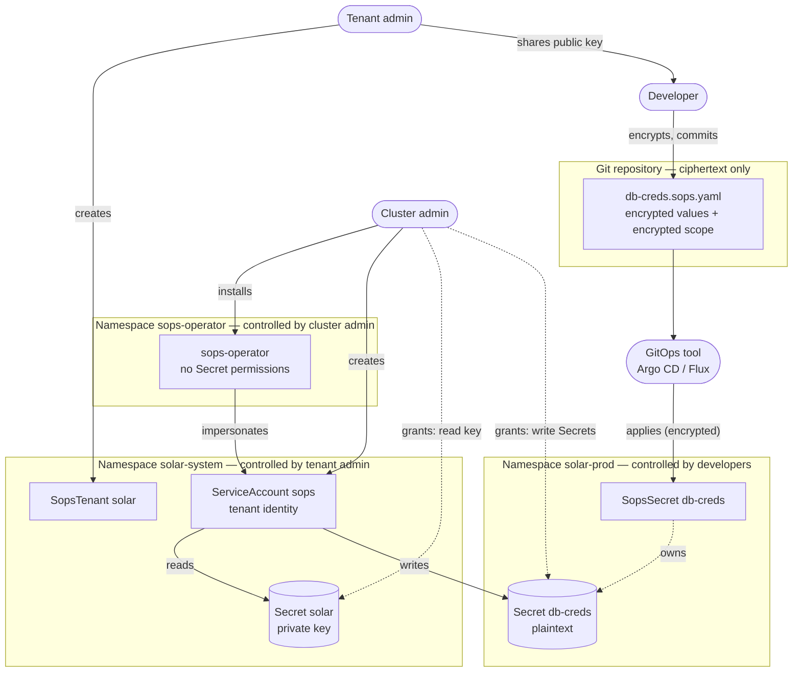
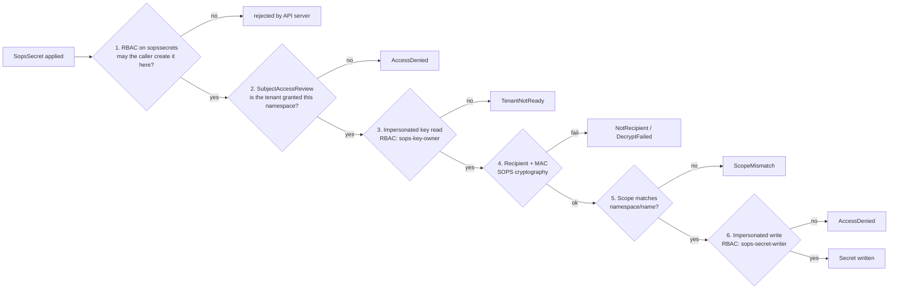

# SOPS Operator — Design

Status: **Draft** · Last updated: 2026-10-09

A Kubernetes operator that decrypts [SOPS](https://github.com/getsops/sops)-encrypted resources in-cluster into
plain Kubernetes Secrets, with self-service for tenants and zero standing privileges for the operator.

---

## 1. Goals and non-goals

### Goals

- Secrets live in Git **encrypted**; only the cluster decrypts them.
- **Self-service**: tenant admins manage their own keys, developers manage their own secrets.
- **Zero trust**: the operator holds no standing permission on Secrets; every read and write is authorized by the
  Kubernetes API server against an explicit grant made by the cluster admin.
- **No cross-tenant or cross-namespace leakage**, including copying ciphertext between namespaces of the same tenant.
- GitOps-friendly: one-way flow Git → cluster, one owner per Secret, health visible to Argo CD / Flux.
- Long-term maintainability: small API, standard tooling (SOPS CLI, age), OLM distribution.

### Non-goals (v1)

- Fetching secrets from external stores (use External Secrets Operator).
- Git access from the operator.
- Templating, generators, dynamic/leased secrets, PushSecret.
- Adopting, merging into, or seeding pre-existing Secrets.
- Cross-namespace or cluster-wide secrets.
- Automatic key rotation.
- KMS backends (OpenBao, cloud KMS) — planned later behind the same API.

---

## 2. Background facts

### SOPS and age

- SOPS encrypts **values** in YAML/JSON and leaves keys and structure readable, so Git diffs stay reviewable.
- Each file has a random **data key**. Values are encrypted with AES-256-GCM using the data key, with the value's
  path in the document as additional authenticated data — a value cannot be moved to another key.
- The data key is encrypted once per **recipient** and stored in the file's `sops:` metadata block.
- A **MAC** over the values, encrypted with the data key, detects tampering. With `mac_only_encrypted: true` the MAC
  covers only encrypted values, which is required because Kubernetes adds fields to stored objects.
- Anyone with a recipient's **public** key can encrypt. Decrypting — and therefore editing an existing file — requires
  a **private** key.
- **age** key types (age v1.3.2, SOPS v3.13.3 as of this writing):

  | Type | Recipient | Used here |
  |---|---|---|
  | Post-quantum hybrid (ML-KEM-768 + X25519) | `age1pq1…` / `AGE-SECRET-KEY-PQ-1…` | **Generated keys** |
  | X25519 | `age1…` / `AGE-SECRET-KEY-1…` | Accepted for bring-your-own keys |
  | SSH (`ssh-ed25519`, `ssh-rsa`) | `ssh-…` | Rejected |
  | Plugins (YubiKey, TPM, Secure Enclave) | `age1<plugin>1…` | Rejected in-cluster; fine as human break-glass recipients |

- An age identity file contains only private keys; the public key is derived from them. The `# public key:` line
  written by `age-keygen` is a comment and is never trusted.
- SOPS exposes in-memory identity loading per master key (`age.ParsedIdentities.Import` / `ApplyToMasterKey`), so
  tenants' keys never need to pass through process-wide environment variables or files.

### Git is not a KMS

Git stores and delivers **ciphertext**; a KMS (or here, a Kubernetes Secret) holds the **private key** and decrypts.
The operator never talks to Git. A GitOps tool (Argo CD, Flux), CI, or a person applies the still-encrypted
`SopsSecret` to the API server; the operator watches the API.

```
dev: write → sops encrypt → git push
                                │
Argo CD / Flux / CI: apply (still encrypted)
                                │
Kubernetes API: SopsSecret ──► operator: authorize → load key → decrypt → apply Secret
                                │
                         workload mounts Secret
```

### Landscape

| Solution | Model | Why not used as-is |
|---|---|---|
| Bitnami Sealed Secrets | One cluster key pair; controller decrypts | Single key per cluster to back up/rotate; opaque diffs; no tenant model |
| Flux SOPS (kustomize-controller) | Decryption during Flux apply | Requires Flux; ties secrets to a GitOps engine |
| KSOPS / helm-secrets | Decrypt in Argo CD repo-server or CI | Plaintext passes through the pipeline |
| isindir/sops-secrets-operator | Operator, one key set for all | No tenant isolation |
| peak-scale/sops-operator | Operator with `SopsProvider` selectors (Capsule) | Cluster-wide Secret RBAC and cache; no ciphertext scoping; `GlobalSopsSecret` crosses namespaces |
| External Secrets Operator | Syncs from external stores | Different model (no ciphertext in Git) |
| Vault Secrets Operator | Syncs from Vault | Requires Vault; different model |

---

## 3. Roles

### 3.1 Actors

| Actor | Kind | Owns | Cannot |
|---|---|---|---|
| **Cluster admin** | Human (platform team) | Operator installation (OLM). Tenant onboarding: the tenant `sops` ServiceAccount and the RoleBindings that grant it key ownership in the tenant namespace and Secret write in each namespace the tenant may target. Break-glass private keys (offline). | — |
| **Tenant admin** | Human (team lead / tenant owner) | `SopsTenant` and its key Secret in the tenant namespace. Distributing the public key. Key rotation. | Grant the tenant access to namespaces. |
| **Developer** | Human | `SopsSecret` files in Git and objects in the namespaces they work in. Encrypting with the public key. | Read keys or tenants; decrypt or edit existing files; target a namespace other than the `SopsSecret`'s own. |
| **GitOps tool** (Argo CD, Flux, CI) | Machine | Applying the still-encrypted `SopsSecret` from Git to the cluster. | See plaintext or keys. |
| **Operator** | Machine | Decrypting and writing output Secrets — only by impersonating a tenant identity. | Access any Secret with its own identity. |
| **Tenant identity** (`solar-system:sops`) | Machine (ServiceAccount) | The permissions the cluster admin granted: read the tenant key, write Secrets in granted namespaces. | Be used by workloads (no token automount; lives in the key namespace). |

### 3.2 Boundaries

Each box is a trust boundary; the label says who controls it. Solid arrows are actions, dotted arrows are grants.



### 3.3 Responsibility matrix

✅ performs · ⚙️ performed by the operator as the tenant identity · — not allowed

| Action | Cluster admin | Tenant admin | Developer | GitOps tool | Operator |
|---|---|---|---|---|---|
| Install / upgrade the operator | ✅ | — | — | — | — |
| Onboard a tenant (SA + key-owner RoleBinding) | ✅ | — | — | — | — |
| Grant a tenant Secret write in a namespace | ✅ | — | — | — | — |
| Create / delete a `SopsTenant` | — | ✅ | — | — | — |
| Generate the tenant key | — | triggers | — | — | ⚙️ |
| Hold and back up the tenant private key | — | ✅ | — | — | — |
| Hold break-glass private keys (offline) | ✅ | — | — | — | — |
| Rotate the tenant key | — | ✅ | — | — | — |
| Encrypt a secret | ✅ | ✅ | ✅ | — | — |
| Decrypt a secret | break-glass only | own tenant | — | — | ⚙️ |
| Commit a `SopsSecret` to Git | — | ✅ | ✅ | — | — |
| Apply a `SopsSecret` to the cluster | — | — | if allowed by RBAC | ✅ | — |
| Write the output Secret | — | — | — | — | ⚙️ |
| Read the output Secret | per namespace RBAC | per namespace RBAC | per namespace RBAC | — | — |

### 3.4 Boundary enforcement

| Boundary | Separates | Enforced by |
|---|---|---|
| Tenant ↔ tenant | Different keys, different tenant identities | Kubernetes RBAC: each tenant identity is granted only its own namespaces |
| Key namespace ↔ consumer namespaces | Private keys never leave `solar-system`; developers have no access there | Kubernetes RBAC |
| Namespace ↔ namespace within a tenant | Ciphertext for `solar-prod` cannot be used in `solar-dev` | Cryptography: encrypted `scope`, checked after decryption |
| Git ↔ cluster | Only ciphertext in Git and in the GitOps tool | SOPS encryption |
| Humans ↔ plaintext | Developers encrypt but cannot decrypt | Public-key cryptography |
| Operator ↔ Secrets | No standing access; every access is made as a tenant identity | Kubernetes RBAC + impersonation |

### 3.5 Lifecycle

```mermaid
sequenceDiagram
    autonumber
    actor CA as Cluster admin
    actor TA as Tenant admin
    actor DEV as Developer
    participant GIT as Git
    participant GO as GitOps tool
    participant API as Kubernetes API
    participant OP as Operator

    Note over CA,OP: Onboarding (once per tenant)
    CA->>API: ServiceAccount solar-system/sops + RoleBindings
    TA->>API: SopsTenant solar
    OP->>API: create Secret solar (as solar-system:sops)
    TA->>DEV: public key (.sops.yaml)

    Note over CA,OP: Every secret change
    DEV->>DEV: write values + scope, sops encrypt
    DEV->>GIT: commit ciphertext
    GO->>GIT: pull
    GO->>API: apply SopsSecret (encrypted)
    OP->>API: SubjectAccessReview: may solar-system:sops write here?
    OP->>API: read key (as solar-system:sops)
    OP->>OP: verify recipient, MAC, scope; decrypt
    OP->>API: apply Secret (as solar-system:sops)
    OP->>API: status Ready / Decrypted
```

---

## 4. API

Group `sops.stakater.com`, version `v1alpha1`. Two namespaced kinds.

### 4.1 `SopsTenant`

A tenant is a **key**. It does not list namespaces; access is granted by the cluster admin through RBAC (§5).

```yaml
apiVersion: sops.stakater.com/v1alpha1
kind: SopsTenant
metadata:
  name: solar                    # key Secret: solar-system/solar
  namespace: solar-system        # tenant namespace (dedicated; holds keys only)
spec:
  generateKey: true              # default; generates a post-quantum key if the key Secret is missing
status:
  observedGeneration: 2
  usedBy: 4                      # SopsSecrets referencing this tenant
  conditions:
    - type: Ready
      status: "True"
      reason: KeyLoaded
```

| Field | Default | Meaning |
|---|---|---|
| `spec.generateKey` | `true` | Generate a post-quantum age key when reading the key Secret returns `404 Not Found`. Any other error never triggers generation. Set `false` for bring-your-own keys and during disaster recovery. |
| `status.usedBy` | — | Number of `SopsSecret`s referencing this tenant. |
| `status.conditions[Ready]` | — | Reasons: `KeyLoaded`, `KeyGenerated`, `KeyMissing`, `KeyInvalid`, `AccessDenied` (tenant not onboarded). |

Printer columns: `READY`, `REASON`, `USED BY`, `AGE`.

### 4.2 Key Secret

Same name and namespace as the `SopsTenant`.

```yaml
apiVersion: v1
kind: Secret
metadata:
  name: solar
  namespace: solar-system
  labels:
    app.kubernetes.io/managed-by: sops-operator   # only if generated by the operator
type: Opaque
stringData:
  age.agekey: |
    # public key: age1pq1...
    AGE-SECRET-KEY-PQ-1...
  age.pub: age1pq1...      # primary public key; written when the operator generates the key
```

- `age.agekey` holds one or more identities; the **first** is primary. Several identities allow rotation.
- Generated keys are post-quantum hybrid. Bring-your-own keys may mix PQ and X25519 identities. SSH and plugin
  identities make the key `KeyInvalid`.
- The operator **creates the key only when it is missing and never modifies, overwrites or deletes it** (the tenant identity has only `get` and `create`). An invalid key is reported,
  not replaced.
- **No ownerReference**: deleting the tenant never deletes the key.
- `age.pub` holds the primary public key. The operator writes it when it generates the key (no extra permission:
  the Secret is created with both fields). It is optional for bring-your-own keys; when present it must match the
  primary identity, otherwise the tenant reports `KeyInvalid`. The tenant admin copies it into the team's
  `.sops.yaml`; reading it requires reading the key Secret, so it is not distributed to developers by the cluster.

### 4.3 `SopsSecret`

One `SopsSecret` produces **one** Secret with the **same name** in the **same namespace**.

```yaml
apiVersion: sops.stakater.com/v1alpha1
kind: SopsSecret
metadata:
  name: db-creds                     # → Secret solar-prod/db-creds
  namespace: solar-prod
  annotations:
    sops.stakater.com/suspend: "true"     # optional; pauses reconciliation
spec:
  tenantRef:
    name: solar
    namespace: solar-system
  scope: ENC[AES256_GCM,...]         # encrypted; decrypts to "solar-prod/db-creds"
  deletionPolicy: Delete             # Delete (default) | Retain
  template:                          # optional; metadata for the output Secret
    metadata:
      labels: {}
      annotations: {}
  type: Opaque
  data: {}                           # binary values (base64), encrypted
  stringData: {}                     # text values, encrypted
sops: { ... }                        # written by `sops encrypt`
status:
  observedGeneration: 1
  lastSyncTime: "2026-10-09T10:00:00Z"
  secretUID: 6f1c2b8e-0d1a-4c5e-9b7f-2a3d4e5f6a7b   # UID of the Secret this SopsSecret created
  conditions:
    - type: Ready
      status: "True"
      reason: Decrypted
```

| Field | Required | Meaning |
|---|---|---|
| `spec.tenantRef` | yes | Tenant whose key decrypts this file. |
| `spec.scope` | yes | **Encrypted** `<namespace>/<name>` where this ciphertext may be decrypted. Set by the author before encryption. |
| `spec.deletionPolicy` | no | `Delete`: the output Secret has an ownerReference to the `SopsSecret` and is garbage-collected with it. `Retain`: the output Secret has no ownerReference and stays when the `SopsSecret` is deleted. |
| `spec.template.metadata` | no | Labels and annotations copied to the output Secret (e.g. Reloader annotations). The `SopsSecret`'s own labels are not copied. |
| `spec.type` | no | `Opaque` (default), `kubernetes.io/tls`, `kubernetes.io/dockerconfigjson`, `kubernetes.io/basic-auth`, `kubernetes.io/ssh-auth`. Service-account and bootstrap token types are not allowed. |
| `spec.data` / `spec.stringData` | at least one | Same semantics as on a Secret. A key may not appear in both. |
| `sops` | yes | SOPS metadata written by `sops encrypt`. Must contain `mac`, `lastmodified`, `version`, at least one `age` recipient, `encrypted_regex: ^(data|stringData|scope)$` and `mac_only_encrypted: true`. Only age recipients in a single key group are supported; other key types are rejected by the schema. |

Status reasons: `Decrypted`, `Suspended`, `TenantNotFound`, `TenantNotReady`, `AccessDenied`, `NotRecipient`,
`ScopeMismatch`, `DecryptFailed`, `Conflict`, `ApplyFailed` (e.g. type validation, size limit).

Printer columns: `TENANT`, `READY`, `REASON`, `AGE`.

Behaviour:

- The operator manages only Secrets **it created**. A pre-existing Secret with the same name is a `Conflict`.
- With `deletionPolicy: Delete`, output Secrets carry an ownerReference to the `SopsSecret` (Argo CD shows them as
  children; `blockOwnerDeletion` is not set). Output Secrets never carry GitOps tracking labels or annotations
  (`argocd.argoproj.io/*`, `kustomize.toolkit.fluxcd.io/*`), so GitOps tools do not prune them.
- `status.secretUID` records the Secret the operator created. Every later write is an update with that UID as a
  precondition. The API server rejects it (`409`) when the Secret is gone or was replaced; the operator then creates
  the Secret, which succeeds if it was deleted and fails with `AlreadyExists` → `Conflict` if someone else's Secret
  holds the name. A `SopsSecret` without `status.secretUID` whose Secret already exists is a `Conflict`.
- Drift on the output Secret is corrected on the next periodic resync.

---

## 5. Authorization model

### 5.1 Flow for a `SopsSecret` in namespace X

1. Resolve `tenantRef` → `solar-system/solar`.
2. **Grant check** (SubjectAccessReview): may `system:serviceaccount:solar-system:sops` create Secrets in X?
   If not → `AccessDenied`. Done before any decryption.
3. Read the key Secret **impersonating** `solar-system:sops`.
4. Verify the file's recipients include the tenant key → else `NotRecipient`.
5. Decrypt **only** the encrypted `scope` and verify it equals `X/<name>` → else `ScopeMismatch`. No other value of
   a document scoped elsewhere is decrypted. Then decrypt the values and verify the MAC → else `DecryptFailed`.
   Error messages never contain decrypted values (SOPS does not authenticate a value's type tag, and its parse
   errors quote the plaintext).
6. Create or update the Secret in X **impersonating** `solar-system:sops` (D28). The API server enforces the cluster
   admin's RoleBinding again.

### 5.2 RBAC objects

Shipped as static objects in the OLM bundle:

| ClusterRole | Rules | Bound by | Where |
|---|---|---|---|
| `sops-key-owner` | `secrets`: `get`, `create` | Cluster admin | Tenant namespace |
| `sops-secret-writer` | `secrets`: `create`, `update` — no read (D28) | Cluster admin | Each namespace the tenant may write to |
| `sops-tenant-admin` | full access to `sopstenants`; aggregated to `admin` | — | — |
| `sops-secret-editor` | full access to `sopssecrets`; aggregated to `edit` | — | — |
| `sops-viewer` | read `sopstenants`, `sopssecrets`; aggregated to `view` | — | — |

The tenant-facing ClusterRoles are shipped from `config/tenant-rbac/` with exactly these names (not prefixed).

Cluster admin onboarding template (per tenant; can be applied automatically by Stakater Tenant Operator or Capsule):

```yaml
apiVersion: v1
kind: ServiceAccount
metadata: { name: sops, namespace: solar-system }
automountServiceAccountToken: false
---
apiVersion: rbac.authorization.k8s.io/v1
kind: RoleBinding
metadata: { name: sops-key-owner, namespace: solar-system }
roleRef: { apiGroup: rbac.authorization.k8s.io, kind: ClusterRole, name: sops-key-owner }
subjects: [{ kind: ServiceAccount, name: sops, namespace: solar-system }]
---
# one per namespace the tenant may write to
apiVersion: rbac.authorization.k8s.io/v1
kind: RoleBinding
metadata: { name: sops-solar, namespace: solar-prod }
roleRef: { apiGroup: rbac.authorization.k8s.io, kind: ClusterRole, name: sops-secret-writer }
subjects: [{ kind: ServiceAccount, name: sops, namespace: solar-system }]
```

### 5.3 Operator permissions

```yaml
# clusterPermissions
- apiGroups: [sops.stakater.com]
  resources: [sopstenants, sopssecrets]
  verbs: [get, list, watch]
- apiGroups: [sops.stakater.com]
  resources: [sopstenants/status, sopssecrets/status]
  verbs: [get, update, patch]
- apiGroups: [""]
  resources: [serviceaccounts]
  verbs: [impersonate]
  resourceNames: [sops]
- apiGroups: [authorization.k8s.io]
  resources: [subjectaccessreviews]
  verbs: [create]
- apiGroups: ["", events.k8s.io]
  resources: [events]
  verbs: [create, patch]
# permissions (operator namespace)
- apiGroups: [coordination.k8s.io]
  resources: [leases]
  verbs: [get, list, watch, create, update, patch]
```

The operator has **no** permission on Secrets, ServiceAccounts (other than impersonation), Roles or RoleBindings.
Every Secret access is an impersonated call and appears in the Kubernetes audit log as the operator acting as the
tenant identity.

---

## 6. Zero-trust enforcement

No component is trusted because of where it runs or who deployed it. Every action is verified at the moment it
happens, against an explicit grant, by a component other than the one asking.

### 6.1 Principles and mechanisms

| Principle | Mechanism | Enforced by |
|---|---|---|
| **Never trust, always verify** | Every key read and Secret write is an impersonated API call, checked against RBAC on each request. Every ciphertext is verified (recipient, MAC, scope) before use. | API server, SOPS cryptography |
| **Explicit grants, default deny** | A tenant can write into a namespace only if the cluster admin created a RoleBinding there. No selectors, labels or naming conventions grant access. No grant → `AccessDenied`. | API server |
| **Least privilege** | Operator has no Secret, RBAC or ServiceAccount write permissions. `sops-secret-writer` cannot read Secrets. `sops-key-owner` is bound only in the key namespace. Developers can encrypt but not decrypt. | API server, public-key cryptography |
| **One identity per tenant** | Each tenant acts as its own ServiceAccount; no identity is shared across tenants. | API server |
| **Separation of duties** | Cluster admin grants access but never handles tenant keys or plaintext. Tenant admin manages keys but cannot grant namespaces. Developer writes secrets but cannot read keys. | API server (RBAC per role) |
| **Bind data to its destination** | Encrypted `scope` ties every ciphertext to one namespace and name. | SOPS cryptography + operator check |
| **Assume breach** | Every component's compromise is bounded (§6.4). | Design |
| **Continuous verification** | Grants and keys are re-checked on every reconcile and periodic resync, not cached as decisions. A revoked grant takes effect at the next reconcile. | Operator, API server |
| **Full auditability** | Impersonated calls appear in the Kubernetes audit log with both the operator and the tenant identity. Decisions are visible in status conditions and events. | API server audit log |
| **No long-lived credentials besides keys** | The operator authenticates with its auto-rotated projected token. The tenant ServiceAccount has no token automounted. | Kubernetes |

### 6.2 Enforcement points



| # | Check | Enforced by | Authoritative? |
|---|---|---|---|
| 1 | Caller may create `SopsSecret` in the namespace | API server (RBAC) | Yes |
| 2 | Tenant is granted the namespace | Operator (SubjectAccessReview) | No — early, clear failure; check 6 is authoritative |
| 3 | Tenant identity may read its key | API server (RBAC via impersonation) | Yes |
| 4 | File encrypted for this tenant and untampered | SOPS / age cryptography | Yes |
| 5 | Ciphertext bound to this namespace and name | Operator, on a cryptographically protected value | Yes, given a correct operator |
| 6 | Tenant identity may write Secrets in the namespace | API server (RBAC via impersonation) | Yes |

### 6.3 What must be trusted

Zero trust minimises, but cannot remove, the trusted computing base:

| Component | Trusted for |
|---|---|
| Kubernetes API server, RBAC and etcd | Enforcing grants; storing Secrets (with encryption at rest) |
| SOPS and age libraries | Correct cryptography |
| Operator binary | Performing the scope check (5); not leaking plaintext; impersonating only the tenant named in `tenantRef` |
| Operator image supply chain | Signed images (cosign), SBOM and provenance; pinned by digest in the OLM bundle |
| Nodes and kubelet | Delivering Secrets to workloads |

### 6.4 Blast radius when a component is compromised

| Compromised | Attacker gains | Attacker does not gain |
|---|---|---|
| Developer account | Can apply `SopsSecret`s with values of their choosing in their namespaces | Keys; other namespaces' plaintext; copied ciphertext is rejected by scope |
| Tenant admin account | Own tenant's private key; Secret write in the namespaces granted to the tenant | Other tenants; new namespace grants |
| Tenant identity token | Same as the tenant's grants | Other tenants |
| Git repository or GitOps tool | Ciphertext only; ability to apply or replay `SopsSecret`s it can already apply | Plaintext or keys |
| Operator | Can act as any onboarded tenant identity, within each tenant's grants | Any Secret outside tenant grants; RBAC changes; new grants |
| Cluster admin | Everything (inherent) | — |

### 6.5 Revocation

| Revoke | Effect |
|---|---|
| Remove a namespace RoleBinding | Next reconcile → `AccessDenied`. The already-written Secret remains (the operator can no longer delete it); the cluster admin removes it if required. |
| Delete the tenant's key-owner RoleBinding | All `SopsSecret`s of the tenant → `TenantNotReady`; nothing more is decrypted. |
| Remove a recipient from a file (`sops updatekeys`) | That key can no longer decrypt the new version of the file. |
| Remove an identity from the key Secret | Files encrypted only for that identity → `NotRecipient`. |

---

## 7. Threat model

### 7.1 Attacks and mitigations

| Attack | Mitigation |
|---|---|
| Developer in `mallory-ns` references another tenant's key | No cluster admin grant in `mallory-ns` → `AccessDenied`; the write would be denied by the API server anyway. |
| Tenant admin targets a namespace of another tenant | Tenants cannot grant themselves namespaces; only the cluster admin's RoleBinding does. |
| Developer copies a prod `SopsSecret` into a dev namespace of the same tenant | Encrypted `scope` decrypts to `solar-prod/…` → `ScopeMismatch`. |
| Developer edits `scope` or splices ciphertext between files | Requires the private key; per-file data keys, path-bound values and the MAC make splicing fail. |
| Developer reads keys | Key Secrets live in the dedicated tenant namespace; developers have no access. |
| Tenant SA token stolen from a consumer namespace | No SA exists in consumer namespaces; the tenant SA lives in the tenant namespace with `automountServiceAccountToken: false`. |
| Operator overwrites a Secret it does not own | Only manages Secrets it created; pre-existing Secrets → `Conflict`. |
| Operator compromise reads all Secrets | No Secret RBAC; only impersonation of `sops` SAs, limited to cluster admin grants. |
| GitOps tool prunes output Secrets | Tracking labels never copied; ownerReference to the `SopsSecret`. |
| Plaintext committed to Git | Pre-commit `sops filestatus` / `sops-checker`; documented workflow. |

### 7.2 Accepted risks

| Risk | Rationale / control |
|---|---|
| A compromised operator can act as any tenant within that tenant's grants. | Inherent to central decryption. Reduced later by the OpenBao backend (decryption approved and audited by Bao). |
| Tenant admins can read their own private key. | Own tenant only. Removed later by the OpenBao backend. |
| Anyone allowed to write `SopsSecret`s in a namespace can apply their own values (public key encryption). | Same power as writing a Secret; controlled by RBAC on `sopssecrets`. |
| Replay of an older, validly encrypted `SopsSecret`. | Equivalent to a Git revert; controlled by GitOps and RBAC on manual applies. |
| Drift on output Secrets is corrected only at the next resync. | Configurable interval. |
| `sops-key-owner` grants `get` on all Secrets in the tenant namespace. | Tenant namespace is dedicated to keys. |
| Plaintext in output Secrets. | Outside the operator: enable etcd encryption at rest; restrict `get secrets` in consumer namespaces. |

---

## 8. Workflows

### 8.1 Onboarding

1. Cluster admin applies the onboarding template for the tenant (§5.2).
2. Tenant admin creates `SopsTenant` → operator generates the key → `Ready/KeyGenerated`.
3. Tenant admin reads `age.pub` from the key Secret and commits it to the team's `.sops.yaml`.

### 8.2 Developer: create or change a secret

```yaml
# .sops.yaml (committed)
creation_rules:
  - path_regex: \.sops\.ya?ml$
    encrypted_regex: ^(data|stringData|scope)$
    mac_only_encrypted: true
    age:
      - age1pq1...solar          # tenant public key
      - age1pq1...breakglass     # platform break-glass recipient
```

```bash
# write plaintext SopsSecret (never commit this state), then:
yq -i '.spec.scope = .metadata.namespace + "/" + .metadata.name' prod/db-creds.sops.yaml
yq -i 'sort_keys(..)' prod/db-creds.sops.yaml
sops encrypt -i prod/db-creds.sops.yaml
git add prod/db-creds.sops.yaml && git commit -m "add db-creds"
```

- If the namespace is injected by kustomize, set the scope explicitly: `yq -i '.spec.scope = "solar-prod/db-creds"'`.
- Keys must be sorted byte-wise before encryption (`yq sort_keys` does this). The SOPS MAC depends on key order and
  the Kubernetes API returns objects with keys sorted byte-wise; an unsorted file fails with `DecryptFailed`.
- `stringData` values must be quoted strings. SOPS parses unquoted scalars before encrypting (`0123` would become
  `83`), so the operator rejects them with `DecryptFailed` instead of writing a changed value.
- Developers cannot `sops edit` (requires the private key). To change a value, rewrite and re-encrypt the file.
- Pre-commit: `sops filestatus <file>` must report `{"encrypted":true}`.

### 8.3 Key rotation (manual)

1. Tenant admin prepends a new identity to `age.agekey`.
2. Recipients in `.sops.yaml` are updated; a key holder runs `sops updatekeys -y <file>` for each file.
3. When every `SopsSecret` is `Decrypted` with the new key, remove the old identity.

### 8.4 Migration from existing Secrets

No adoption. Either replace the old Secret with a `SopsSecret` of the same name in one commit (seconds of absence;
running pods unaffected), or create the `SopsSecret` under a new name, switch workloads, then remove the old Secret.

### 8.5 Disaster recovery

Restore key Secrets **before** `SopsTenant`s, or set `generateKey: false`, so no new key is generated in place of the
lost one. Break-glass recipients allow recovery of every file if a tenant key is lost.

---

## 9. Delivery

- **Language/framework**: Go, operator-sdk (go/v4 plugin), controller-runtime, `getsops/sops/v3`, `filippo.io/age`. Tools pinned and checksum-verified by `hack/bootstrap-tools.sh`: operator-sdk v1.42.3, opm v1.74.0.
- **Distribution**: OLM only. Bundle + file-based catalog images; channels `alpha` → `stable`; install mode
  `AllNamespaces`; no webhooks and no OLM dependencies (compatible with OLM v0 `Subscription` and OLM v1
  `ClusterExtension`). Validation with CEL in the CRDs.
- **Configuration**: ConfigMap `sops-operator-config` in the operator namespace and `Subscription.spec.config.env`.
- **Testing**: unit tests; envtest with the RBAC authorizer and a non-admin operator user; e2e on **kind** that
  deploys the operator image (`make test-e2e`) and compares `SopsTenant`, `SopsSecret` and output Secrets with
  committed golden files (`gotest.tools/v3/golden`, plain YAML; record or update with `UPDATE_GOLDEN=true`).
  `test/snapshot` normalizes objects first: volatile values (UIDs, resourceVersion, timestamps after validating
  them) become placeholders, Secret values and ciphertext are redacted, and an object with an age key is refused.
  Golden files no test compares any more fail the run.
  e2e tests are organised by **use case**: one file and one top-level test per use case, named after the feature
  or rule it checks (`TestTenantOnboarding` in `tenant_onboarding_test.go`, `TestSecretDecryption`,
  `TestSecretDeletion`, `TestExistingSecretMigration`, `TestNamespaceIsolation`), one subtest per expected
  behaviour named `shall …`, and golden files stored as `test/e2e/testdata/<Test>/<shall_…>/<kind>-<label>.yaml`.
  Unit and envtest tests follow the same convention: one top-level test per feature (`TestSecretWriter`,
  `TestSecretOwnership`, …) with `shall …` subtests.
- **CI**: own GitHub Actions workflows, no shared pipeline. `pull_request` runs lint, envtest tests and a check that
  generated files are current, builds the image without any write token, and pushes it to
  `ghcr.io/stakater/sops-operator:pr-<number>-<sha7>` from a separate job that holds the only write token
  (`GITHUB_TOKEN` with `packages: write`, no long-lived registry secret) and runs no pull-request code. Actions are
  pinned by commit SHA and kept current by Dependabot. Push and release workflows (signing, SBOM, bundle and catalog)
  follow in plan 3.
- **Conventions** (from Stakater operators): project/module name `sops-operator`; images
  `ghcr.io/stakater/sops-operator`, `-bundle`, `-catalog` tagged `vX.Y.Z`; Makefile variables `VERSION`,
  `OPERATOR_NAME`, `DOCKER_REPO_BASE`, `CATALOG_DIR_PATH`; file-based catalog in `catalog/`; CSV provider
  "Stakater AB", `maturity: alpha`, SVG icon in Stakater style (black outline, `#fecd07`).

---

## 10. Decision log

| # | Decision | Rationale |
|---|---|---|
| D1 | Use SOPS instead of Sealed Secrets | Readable diffs, multiple recipients, no single cluster key, works outside Kubernetes. |
| D2 | Build a new operator | Existing operators require cluster-wide Secret RBAC or lack tenant isolation and ciphertext scoping. |
| D3 | Go + operator-sdk, distributed via OLM only | Operator ecosystem fit (OpenShift, OperatorHub). Helm can be generated from `config/` later. |
| D4 | v1 backend: age key in a Kubernetes Secret; OpenBao later | No infrastructure dependency; backend stays pluggable. |
| D5 | `SopsTenant` is namespaced; key Secret has the same name; generated if missing (`generateKey`) | Self-service via namespace RBAC; predictable key location. |
| D6 | Generated keys are age post-quantum hybrid | Ciphertext lives in Git history indefinitely ("harvest now, decrypt later"). |
| D7 | No public key or `.sops.yaml` in the CR | Public key is derivable from the key Secret; repos own their `.sops.yaml`. |
| D8 | Namespace access is granted only by cluster admin RoleBindings to the tenant `sops` SA | Single source of truth enforced by the API server; no binding CRD, no selectors. |
| D9 | Operator has zero standing privileges; all Secret access through impersonation | Compromise of the operator does not expose or allow tampering with arbitrary Secrets. |
| D10 | SubjectAccessReview before decrypting | Nothing is decrypted for namespaces the tenant cannot write to; clear status. |
| D11 | One `SopsSecret` → one Secret with the same name in the same namespace | Simplest mapping; mirrors a Secret manifest. |
| D12 | No adoption, merge or create-once; foreign Secret → `Conflict` | GitOps is one-way with one owner per Secret. |
| D13 | `deletionPolicy: Delete \| Retain` | Standard GitOps prune plus a safety net. |
| D14 | `data` and `stringData`, no `immutable` | Binary and text values; Secret manifests convert with minimal change. Immutable conflicts with updates from Git. |
| D15 | Required encrypted `spec.scope` | Prevents copying ciphertext to another namespace or name of the same tenant. |
| D16 | `sops` metadata is mutable; integrity comes from SOPS cryptography | Legitimate edits rewrite it; whole-file replacement and replay are accepted risks. |
| D17 | Operator has no Git access | Avoids becoming a GitOps engine and holding Git credentials next to keys. |
| D18 | Key generated only on `404 Not Found`; never overwritten or deleted (RBAC: `get`, `create` only). To replace a bad key, delete it and let it be generated again. | Ease of use; a wrong generation is recoverable by restoring the old key. |
| D19 | No finalizer on `SopsTenant`; no ownerReference on the key | The key must survive tenant deletion; recreating the tenant reuses it. |
| D20 | Service-account and bootstrap token Secret types are not allowed | They are cluster credentials, not application secrets. |
| D21 | `suspend` annotation and `status.lastSyncTime`; no data hash in status | Operational control and visibility without leaking low-entropy values. |
| D22 | GitOps tracking labels are never copied to output Secrets | Prevents GitOps tools from pruning operator-managed Secrets. |
| D23 | e2e on kind; CI on pull requests and pushes | Reproducible locally and in CI. |
| D24 | Authoritative enforcement lives in the API server and in cryptography; operator-side checks exist for early, clear failures (except the scope check) | Keeps the trusted computing base small (§6.3). |
| D25 | Module `github.com/stakater/sops-operator`; images `ghcr.io/stakater/sops-operator`, `-bundle`, `-catalog` | Stakater organization. |
| D26 | Several `SopsTenant`s may share a namespace; they share its `sops` identity and grants | Separate key namespaces when reach must differ. |
| D27 | Minimum Kubernetes 1.31 (OpenShift 4.18+); e2e on 1.31 and the latest release | CEL validation features; current enterprise coverage. |
| D28 | `sops-secret-writer` is write-only; ownership is tracked by storing the created Secret's UID in status and sending it as a precondition on every update; a rejected update falls back to create, and `AlreadyExists` → `Conflict`. Fallback to adding `get` only if the spike disproves this. | Consumer namespaces' Secrets are never readable by the tenant identity or the operator. |
| D29 | Files are key-sorted byte-wise (`yq 'sort_keys(..)'`) before encryption; the operator rebuilds the document as byte-sorted JSON | The SOPS MAC is order-dependent and the API server returns keys sorted byte-wise. |
| D30 | `Retain` means "no ownerReference"; no finalizer on `SopsSecret` | Deletion needs no Secret access and no extra verbs. |
| D31 | Only age recipients in one key group; `encrypted_regex` and `mac_only_encrypted` enforced by the CRD schema | Unsupported files are rejected at apply time, not at decryption. |
| D32 | Tenant-facing ClusterRoles shipped from `config/tenant-rbac/` with fixed names | Onboarding templates reference stable names. |
| D33 | operator-sdk and opm are pinned and installed per project into `bin/` with checksum verification | Reproducible builds locally and in CI; no reliance on globally installed tools. |
| D34 | Own CI workflows instead of the shared Stakater pipeline; PR images pushed with `GITHUB_TOKEN` from an isolated job | Pull-request code never runs with a write token and no long-lived registry secret is needed; the shared pipeline exposed its registry token to PR code. |
| D35 | The scope is verified before any other value is decrypted; decryption errors carry fixed messages | Copied ciphertext with a tampered type tag must not leak plaintext through error messages. |
| D36 | `stringData` accepts only quoted strings | Unquoted scalars are reformatted by SOPS before encryption, which would silently change values. |
| D37 | `status.secretUID` is written with a merge patch without optimistic locking | A stale resourceVersion must not lose the only proof of ownership (D28). |
| D38 | The SopsSecret reconciler reads SopsSecrets uncached (API reader) | A cache that has not seen the last status write would report `Conflict` for the operator's own Secret (found by e2e). |
| D39 | The primary public key is stored as `age.pub` in the key Secret at generation; no separate public object | The tenant admin needs it once to set up `.sops.yaml`; no extra RBAC, and the operator still cannot modify the key. A mismatching `age.pub` is `KeyInvalid`. |

---

## 11. Open questions

| # | Question |
|---|---|
| Q2 | Minimum SOPS version that supports `age1pq1` recipients (needs age ≥ 1.3). |
| Q4 | Default resync interval (proposed 10m). |
| Q5 | Namespace-wide scope (`solar-prod/*`) for files reused under several names — v1 or later? |
| Q6 | Should the operator enforce the presence of platform break-glass recipients in every `SopsSecret`? |
| Q8 | Ship an Argo CD health check for `SopsTenant` and `SopsSecret` in the docs. |
| Q9 | e2e coverage of OLM v1 (`ClusterExtension`) in addition to OLM v0. |
| Q11 | **KMS key stores (parked).** Zero trust without ESO: a `SopsKeyStore` (provider union, OpenBao Transit first, then Azure Key Vault, AWS/GCP KMS) referenced by `SopsTenant.spec.keyStoreRef`; the private key never leaves the KMS. The operator authenticates as the tenant (`TokenRequest` for `<tenant-ns>:sops` → Bao Kubernetes/JWT auth → policy limited to `transit/decrypt/<key>`); developers encrypt with encrypt-only Bao access; the offline age break-glass recipient stays. Must pin the Vault address to the configured endpoint before any network call (SOPS allows all hosts by default and the address is inside the file). Open: who owns the Bao connection (cluster admin endpoints + tenant-chosen role/key recommended). Without a key store: age key Secret + public-key ConfigMap. |
