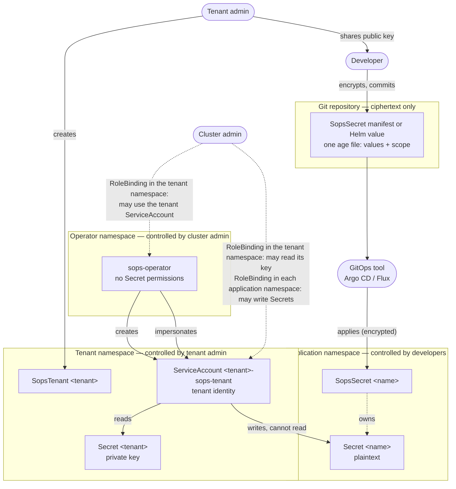
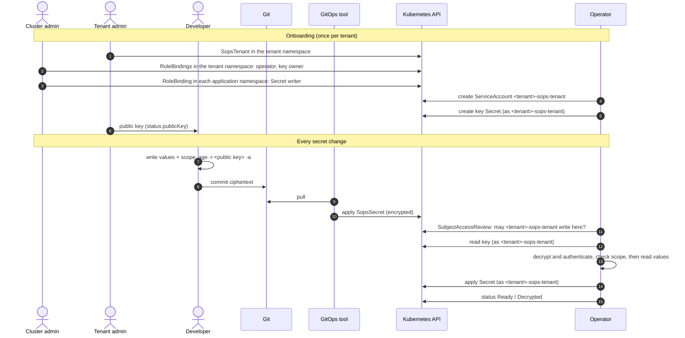
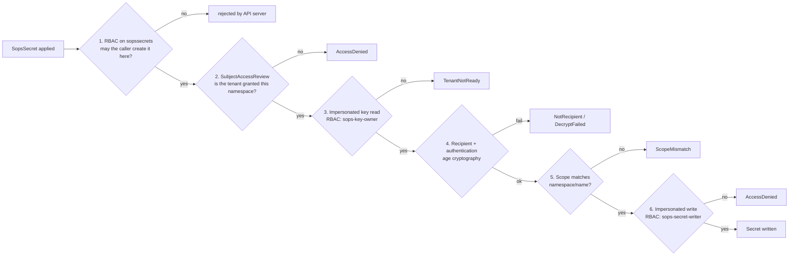

# SOPS Operator — Design

Status: **Draft** · Last updated: 2026-10-16

A Kubernetes operator that decrypts [age](https://age-encryption.org)-encrypted resources in-cluster into
plain Kubernetes Secrets, with self-service for tenants and zero standing privileges for the operator.

---

## 1. Goals and non-goals

### Goals

- Secrets live in Git **encrypted**; only the cluster decrypts them.
- **Self-service**: tenant admins manage their own keys, developers manage their own secrets.
- **Zero trust**: the operator holds no standing permission on Secrets; every read and write is authorized by the
  Kubernetes API server against an explicit grant made by the cluster admin.
- **No cross-tenant or cross-namespace leakage**, including copying ciphertext between namespaces of the same tenant.
- GitOps-friendly: one-way flow Git → cluster, one owner per Secret, health visible to Argo CD / Flux.
- Long-term maintainability: small API, standard tooling (the age CLI), OLM distribution.

### Non-goals (v1)

- Fetching secrets from external stores (use External Secrets Operator).
- Git access from the operator.
- Templating, generators, dynamic/leased secrets, PushSecret.
- Adopting, merging into, or seeding pre-existing Secrets.
- Cross-namespace or cluster-wide secrets.
- Automatic key rotation.
- KMS backends (OpenBao, cloud KMS) — planned later behind the same API.

---

## 2. Background facts

### age

- A `SopsSecret` holds one **age file** in ASCII armor (`age -a`). Its plaintext, the **payload**, is a small YAML
  document: the scope and the Secret's `data` and `stringData` (§4.3). One string fits a manifest and a Helm value.
- Each file has a random **file key**, wrapped once per **recipient** in the file's header. The payload is encrypted
  with ChaCha20-Poly1305 in chunks, with a key derived from the file key, and the header is authenticated with a
  MAC from the same key. A changed, reordered or truncated file fails to decrypt.
- Recipient stanzas do not name their recipient: the operator learns that a file is not for a tenant only by
  failing to unwrap it with the tenant's identities (`NotRecipient`).
- Anyone with a recipient's **public** key can encrypt. Decrypting — and therefore editing an existing file — requires
  a **private** key.
- **age** key types (age v1.3.2 as of this writing):

  | Type | Recipient | Used here |
  |---|---|---|
  | Post-quantum hybrid (ML-KEM-768 + X25519) | `age1pq1…` / `AGE-SECRET-KEY-PQ-1…` | **Generated keys** |
  | X25519 | `age1…` / `AGE-SECRET-KEY-1…` | Accepted for bring-your-own keys |
  | SSH (`ssh-ed25519`, `ssh-rsa`) | `ssh-…` | Rejected |
  | Plugins (YubiKey, TPM, Secure Enclave) | `age1<plugin>1…` | Rejected in-cluster; fine as human break-glass recipients |

- An age identity file contains only private keys; the public key is derived from them. The `# public key:` line
  written by `age-keygen` is a comment and is never trusted.
- The age library takes identities in memory per call (`age.Decrypt(r, identities...)`), so tenants' keys never
  need to pass through process-wide environment variables or files.

### Git is not a KMS

Git stores and delivers **ciphertext**; a KMS (or here, a Kubernetes Secret) holds the **private key** and decrypts.
The operator never talks to Git. A GitOps tool (Argo CD, Flux), CI, or a person applies the still-encrypted
`SopsSecret` to the API server; the operator watches the API.

```
dev: write → age -a → git push
                                │
Argo CD / Flux / CI: apply (still encrypted)
                                │
Kubernetes API: SopsSecret ──► operator: authorize → load key → decrypt → apply Secret
                                │
                         workload mounts Secret
```

### Landscape

| Solution | Model | Why not used as-is |
|---|---|---|
| Bitnami Sealed Secrets | One cluster key pair; controller decrypts | Single key per cluster to back up/rotate; opaque diffs; no tenant model |
| Flux SOPS (kustomize-controller) | Decryption during Flux apply | Requires Flux; ties secrets to a GitOps engine |
| KSOPS / helm-secrets | Decrypt in Argo CD repo-server or CI | Plaintext passes through the pipeline |
| isindir/sops-secrets-operator | Operator, one key set for all | No tenant isolation |
| peak-scale/sops-operator | Operator with `SopsProvider` selectors (Capsule) | Cluster-wide Secret RBAC and cache; no ciphertext scoping; `GlobalSopsSecret` crosses namespaces |
| External Secrets Operator | Syncs from external stores | Different model (no ciphertext in Git) |
| Vault Secrets Operator | Syncs from Vault | Requires Vault; different model |

---

## 3. Roles

### 3.1 Actors

| Actor | Kind | Owns | Cannot |
|---|---|---|---|
| **Cluster admin** | Human (platform team) | Operator installation (OLM). Tenant onboarding: the RoleBindings that let the operator use the tenant ServiceAccount, let it own its key, and let it write Secrets in each namespace the tenant may target (§5.2). Break-glass private keys (offline). | — |
| **Tenant admin** | Human (team lead / tenant owner) | `SopsTenant` and its key Secret in the tenant namespace; may also create the two tenant-namespace RoleBindings (D47). Distributing the public key. Key rotation. | Grant the tenant access to other namespaces. |
| **Developer** | Human | `SopsSecret` files in Git and objects in the namespaces they work in. Encrypting with the public key. | Read keys or tenants; decrypt or edit existing files; target a namespace other than the `SopsSecret`'s own. |
| **GitOps tool** (Argo CD, Flux, CI) | Machine | Applying the still-encrypted `SopsSecret` from Git to the cluster. | See plaintext or keys. |
| **Operator** | Machine | Decrypting and writing output Secrets — only by impersonating a tenant identity. | Access any Secret with its own identity. |
| **Tenant identity** (`team-a-system:team-a-sops-tenant`) | Machine (ServiceAccount) | The permissions its RoleBindings grant: read the tenant key, write Secrets in granted namespaces. | Be used by workloads (no token automount; lives in the key namespace). |

### 3.2 Boundaries

Each box is a trust boundary; the label says who controls it. Solid arrows are actions, dotted arrows are grants.



### 3.3 Responsibility matrix

✅ performs · ⚙️ performed by the operator as the tenant identity · — not allowed

| Action | Cluster admin | Tenant admin | Developer | GitOps tool | Operator |
|---|---|---|---|---|---|
| Install / upgrade the operator | ✅ | — | — | — | — |
| Create the tenant ServiceAccount (`<tenant>-sops-tenant`) | — | triggers | — | — | ✅ |
| Bind the operator and the key owner in the tenant namespace | ✅ | may (D47) | — | — | — |
| Grant a tenant Secret write in a namespace | ✅ | — | — | — | — |
| Create / delete a `SopsTenant` | — | ✅ | — | — | — |
| Generate the tenant key | — | triggers | — | — | ⚙️ |
| Hold and back up the tenant private key | — | ✅ | — | — | — |
| Hold break-glass private keys (offline) | ✅ | — | — | — | — |
| Rotate the tenant key | — | ✅ | — | — | — |
| Encrypt a secret | ✅ | ✅ | ✅ | — | — |
| Decrypt a secret | break-glass only | own tenant | — | — | ⚙️ |
| Commit a `SopsSecret` to Git | — | ✅ | ✅ | — | — |
| Apply a `SopsSecret` to the cluster | — | — | if allowed by RBAC | ✅ | — |
| Write the output Secret | — | — | — | — | ⚙️ |
| Read the output Secret | per namespace RBAC | per namespace RBAC | per namespace RBAC | — | — |

### 3.4 Boundary enforcement

| Boundary | Separates | Enforced by |
|---|---|---|
| Tenant ↔ tenant | Different keys, different tenant identities | Kubernetes RBAC: each tenant identity is granted only its own namespaces |
| Key namespace ↔ consumer namespaces | Private keys never leave `team-a-system`; developers have no access there | Kubernetes RBAC |
| Namespace ↔ namespace within a tenant | Ciphertext for `team-a-prod` cannot be used in `team-a-dev` | Cryptography: encrypted `scope`, checked after decryption |
| Git ↔ cluster | Only ciphertext in Git and in the GitOps tool | age encryption |
| Humans ↔ plaintext | Developers encrypt but cannot decrypt | Public-key cryptography |
| Operator ↔ Secrets | No standing access; every access is made as a tenant identity | Kubernetes RBAC + impersonation |

### 3.5 Lifecycle



---

## 4. API

Group `sops.stakater.com`, version `v1alpha1`. Two namespaced kinds.

### 4.1 `SopsTenant`

A tenant is a **key**. It does not list namespaces; access is granted by the cluster admin through RBAC (§5).

```yaml
apiVersion: sops.stakater.com/v1alpha1
kind: SopsTenant
metadata:
  name: team-a                  # key Secret: team-a-system/team-a-sops-keys
  namespace: team-a-system        # tenant namespace (dedicated; holds keys only)
spec:
  generateKey: true              # default; generates a post-quantum key if the key Secret is missing
status:
  observedGeneration: 2
  serviceAccountName: team-a-sops-tenant
  keySecretName: team-a-sops-keys
  publicKey: age1pq1...
  usedBy: 4                      # SopsSecrets referencing this tenant
  conditions:
    - type: Ready
      status: "True"
      reason: KeyLoaded
```

| Field | Default | Meaning |
|---|---|---|
| `spec.generateKey` | `true` | Generate a post-quantum age key when reading the key Secret returns `404 Not Found`. Any other error never triggers generation. Set `false` for bring-your-own keys and during disaster recovery. |
| `status.serviceAccountName` | — | The tenant's ServiceAccount, `<tenant>-sops-tenant` (D46). |
| `status.keySecretName` | — | The tenant's key Secret, `<tenant>-sops-keys` (D48). |
| `status.publicKey` | — | Public key of the primary key, derived from the key Secret: the recipient developers encrypt for (D39). Empty while the key is not usable. |
| `status.usedBy` | — | Number of `SopsSecret`s referencing this tenant. |
| `status.conditions[Ready]` | — | Reasons: `KeyLoaded`, `KeyGenerated`, `KeyMissing`, `KeyInvalid`, `AccessDenied` (tenant not onboarded). |

Printer columns: `READY`, `REASON`, `USED BY`, `AGE`.

### 4.2 Key Secret

Same name and namespace as the `SopsTenant`.

```yaml
apiVersion: v1
kind: Secret
metadata:
  name: team-a-sops-keys
  namespace: team-a-system
  labels:
    app.kubernetes.io/managed-by: sops-operator   # only if generated by the operator
type: Opaque
stringData:
  age.agekey: |            # private keys only; the public key is in SopsTenant status.publicKey
    AGE-SECRET-KEY-PQ-1...
```

- `age.agekey` holds one or more identities; the **first** is primary. Several identities allow rotation.
- Generated keys are post-quantum hybrid. Bring-your-own keys may mix PQ and X25519 identities. SSH and plugin
  identities make the key `KeyInvalid`.
- The operator **creates the key only when it is missing and never modifies, overwrites or deletes it** (the tenant identity has only `get` and `create`). An invalid key is reported,
  not replaced.
- **No ownerReference**: deleting the tenant never deletes the key.
- The key Secret holds private keys only. The operator derives the primary public key and reports it in the
  tenant's `status.publicKey` (D39), where anyone allowed to read the `SopsTenant` finds it to encrypt for without
  access to the key Secret. Generated key files have no comment lines; comments in bring-your-own key files are
  ignored, as is an `age.pub` field written by v0.0.4 and earlier.

### 4.3 `SopsSecret`

One `SopsSecret` produces **one** Secret with the **same name** in the **same namespace**.

```yaml
apiVersion: sops.stakater.com/v1alpha1
kind: SopsSecret
metadata:
  name: db-creds                     # → Secret team-a-prod/db-creds
  namespace: team-a-prod
  annotations:
    sops.stakater.com/suspend: "true"     # optional; pauses reconciliation
spec:
  tenantRef:
    name: team-a
    namespace: team-a-system
  encrypted: |                       # age -r <status.publicKey> -a
    -----BEGIN AGE ENCRYPTED FILE-----
    ...
    -----END AGE ENCRYPTED FILE-----
  deletionPolicy: Delete             # Delete (default) | Retain
  template:                          # optional; metadata for the output Secret
    metadata:
      labels: {}
      annotations: {}
  type: Opaque
status:
  observedGeneration: 1
  lastSyncTime: "2026-10-09T10:00:00Z"
  secretUID: 6f1c2b8e-0d1a-4c5e-9b7f-2a3d4e5f6a7b   # UID of the Secret this SopsSecret created
  conditions:
    - type: Ready
      status: "True"
      reason: Decrypted
```

The payload, before encryption:

```yaml
scope: team-a-prod/db-creds          # the SopsSecret's <namespace>/<name>
data: {}                             # binary values (base64)
stringData: {}                       # text values, quoted
```

| Field | Required | Meaning |
|---|---|---|
| `spec.tenantRef` | yes | Tenant whose key decrypts `spec.encrypted`. |
| `spec.encrypted` | yes | ASCII-armored age file of the payload. The schema checks that it starts with the armor header (leading whitespace allowed) and is at most 1.5 MiB, etcd's default object size limit. |
| `spec.deletionPolicy` | no | `Delete`: the output Secret has an ownerReference to the `SopsSecret` and is garbage-collected with it. `Retain`: the output Secret has no ownerReference and stays when the `SopsSecret` is deleted. |
| `spec.template.metadata` | no | Labels and annotations copied to the output Secret (e.g. Reloader annotations). The `SopsSecret`'s own labels are not copied. |
| `spec.type` | no | `Opaque` (default), `kubernetes.io/tls`, `kubernetes.io/dockerconfigjson`, `kubernetes.io/basic-auth`, `kubernetes.io/ssh-auth`. Service-account and bootstrap token types are not allowed. |
| payload `scope` | yes | `<namespace>/<name>` where this ciphertext may be decrypted. Set by the author before encryption. |
| payload `data` / `stringData` | at least one | Same semantics as on a Secret. A key may not appear in both. `stringData` values must be quoted strings. No other field is allowed. |

Status reasons: `Decrypted`, `Suspended`, `TenantNotFound`, `TenantNotReady`, `AccessDenied`, `NotRecipient`,
`ScopeMismatch`, `DecryptFailed`, `Conflict`, `ApplyFailed` (e.g. type validation, size limit).

Printer columns: `TENANT`, `READY`, `REASON`, `AGE`.

Behaviour:

- The operator manages only Secrets **it created**. A pre-existing Secret with the same name is a `Conflict`.
- With `deletionPolicy: Delete`, output Secrets carry an ownerReference to the `SopsSecret` (Argo CD shows them as
  children; `blockOwnerDeletion` is not set). Output Secrets never carry GitOps tracking labels or annotations
  (`argocd.argoproj.io/*`, `kustomize.toolkit.fluxcd.io/*`), so GitOps tools do not prune them.
- `status.secretUID` records the Secret the operator created. Every later write is an update with that UID as a
  precondition. The API server rejects it (`409`) when the Secret is gone or was replaced; the operator then creates
  the Secret, which succeeds if it was deleted and fails with `AlreadyExists` → `Conflict` if someone else's Secret
  holds the name. A `SopsSecret` without `status.secretUID` whose Secret already exists is a `Conflict`.
- Drift on the output Secret is corrected on the next periodic resync.

---

## 5. Authorization model

### 5.1 Flow for a `SopsSecret` in namespace X

1. Resolve `tenantRef` → `SopsTenant` `team-a-system/team-a`, whose key is in `team-a-system/team-a-sops-keys`.
2. **Grant check** (SubjectAccessReview): may `system:serviceaccount:team-a-system:team-a-sops-tenant` create Secrets in X?
   If not → `AccessDenied`. Done before any decryption.
3. Read the key Secret **impersonating** `team-a-system:team-a-sops-tenant`.
4. Decrypt `spec.encrypted` with the tenant's identities → `NotRecipient` if none unwraps the file key,
   `DecryptFailed` if it is not an age file or fails authentication.
5. Read **only** the payload's `scope` and verify it equals `X/<name>` → else `ScopeMismatch`. No value of a payload
   scoped elsewhere is read. Then read the values → `DecryptFailed` if the payload is invalid. Error messages name
   fields and keys but never contain decrypted values.
6. Create or update the Secret in X **impersonating** `team-a-system:team-a-sops-tenant` (D28). The API server enforces the cluster
   admin's RoleBinding again.

### 5.2 RBAC objects

Shipped as static objects in the OLM bundle:

| ClusterRole | Rules | Bound by | Where |
|---|---|---|---|
| `sops-operator-tenant` | `serviceaccounts`: `create`, `impersonate` | Cluster admin (or tenant admin, D47), to the operator | Each tenant namespace |
| `sops-key-owner` | `secrets`: `get`, `create` | Cluster admin (or tenant admin, D47) | Tenant namespace |
| `sops-secret-writer` | `secrets`: `create`, `update` — no read (D28) | Cluster admin | Each namespace the tenant may write to |
| `sops-tenant-admin` | full access to `sopstenants`; aggregated to `admin` | — | — |
| `sops-secret-editor` | full access to `sopssecrets`; aggregated to `edit` | — | — |
| `sops-viewer` | read `sopstenants`, `sopssecrets`; aggregated to `view` | — | — |

The tenant-facing ClusterRoles are shipped from `config/tenant-rbac/` with exactly these names (not prefixed).

Each tenant has its own identity, the ServiceAccount `<tenant>-sops-tenant` in the tenant namespace (D46). The
operator creates it, with `automountServiceAccountToken: false` and the labels
`app.kubernetes.io/managed-by: sops-operator`, `app.kubernetes.io/component: tenant-identity` and
`app.kubernetes.io/instance: <tenant>`, and reports its name in `status.serviceAccountName`. It never changes or
deletes an existing ServiceAccount, and the ServiceAccount grants nothing until it is bound.

The operator has no cluster-wide permission on ServiceAccounts. RBAC cannot limit impersonation to a name pattern
such as `*-sops-tenant`, so the operator is allowed to create and act as ServiceAccounts per tenant namespace, with
`sops-operator-tenant` (D46). Until then the tenant reports `AccessDenied`, naming the binding to create. Tenant
namespaces hold tenant keys only, so the operator can act as nothing else there.

Onboarding for tenant `team-a` in tenant namespace `team-a-system`, writing to `team-a-prod`; can be applied
automatically by Stakater Tenant Operator or Capsule. RoleBinding names are free; only `roleRef` and `subjects`
matter. The first two RoleBindings grant only permissions the built-in `admin` role already holds in the tenant
namespace, so the tenant admin may create them too (D47). The Secret-writer RoleBindings are the only grants that
extend a tenant's reach and stay with the cluster admin.

```yaml
# Once per tenant namespace: the operator may create and use tenant ServiceAccounts in team-a-system. The subject
# is the operator's ServiceAccount, in the namespace of its Subscription (openshift-operators here).
apiVersion: rbac.authorization.k8s.io/v1
kind: RoleBinding
metadata:
  name: sops-operator
  namespace: team-a-system
roleRef:
  apiGroup: rbac.authorization.k8s.io
  kind: ClusterRole
  name: sops-operator-tenant
subjects:
  - kind: ServiceAccount
    name: sops-operator-controller-manager
    namespace: openshift-operators
---
# Once per tenant: the tenant ServiceAccount owns its key.
apiVersion: rbac.authorization.k8s.io/v1
kind: RoleBinding
metadata:
  name: team-a-key-owner
  namespace: team-a-system
roleRef:
  apiGroup: rbac.authorization.k8s.io
  kind: ClusterRole
  name: sops-key-owner
subjects:
  - kind: ServiceAccount
    name: team-a-sops-tenant
    namespace: team-a-system
---
# One per namespace the tenant may write to.
apiVersion: rbac.authorization.k8s.io/v1
kind: RoleBinding
metadata:
  name: team-a-secret-writer
  namespace: team-a-prod
roleRef:
  apiGroup: rbac.authorization.k8s.io
  kind: ClusterRole
  name: sops-secret-writer
subjects:
  - kind: ServiceAccount
    name: team-a-sops-tenant
    namespace: team-a-system
```

### 5.3 Operator permissions

```yaml
# clusterPermissions
- apiGroups: [sops.stakater.com]
  resources: [sopstenants, sopssecrets]
  verbs: [get, list, watch]
- apiGroups: [sops.stakater.com]
  resources: [sopstenants/status, sopssecrets/status]
  verbs: [get, update, patch]
- apiGroups: [authorization.k8s.io]
  resources: [subjectaccessreviews]
  verbs: [create]
- apiGroups: ["", events.k8s.io]
  resources: [events]
  verbs: [create, patch]
# permissions (operator namespace)
- apiGroups: [coordination.k8s.io]
  resources: [leases]
  verbs: [get, list, watch, create, update, patch]
```

The operator has **no** permission on Secrets, Roles or RoleBindings, and none on ServiceAccounts outside the tenant
tenant namespaces that granted it `sops-operator-tenant`. There it may create and impersonate ServiceAccounts;
it can never read, change, delete or mint tokens for any.
Every Secret access is an impersonated call and appears in the Kubernetes audit log as the operator acting as the
tenant identity.

---

## 6. Zero-trust enforcement

No component is trusted because of where it runs or who deployed it. Every action is verified at the moment it
happens, against an explicit grant, by a component other than the one asking.

### 6.1 Principles and mechanisms

| Principle | Mechanism | Enforced by |
|---|---|---|
| **Never trust, always verify** | Every key read and Secret write is an impersonated API call, checked against RBAC on each request. Every ciphertext is verified (recipient, authentication, scope) before use. | API server, age cryptography |
| **Explicit grants, default deny** | A tenant can write into a namespace only if the cluster admin created a RoleBinding there. No selectors, labels or naming conventions grant access. No grant → `AccessDenied`. | API server |
| **Least privilege** | Operator has no Secret or RBAC permissions and no cluster-wide ServiceAccount permissions; it acts only in tenant namespaces that granted it `sops-operator-tenant`. `sops-secret-writer` cannot read Secrets. `sops-key-owner` is bound only in the key namespace. Developers can encrypt but not decrypt. | API server, public-key cryptography |
| **One identity per tenant** | Each tenant acts as its own ServiceAccount; no identity is shared across tenants. | API server |
| **Separation of duties** | Cluster admin grants access but never handles tenant keys or plaintext. Tenant admin manages keys but cannot grant namespaces. Developer writes secrets but cannot read keys. | API server (RBAC per role) |
| **Bind data to its destination** | The encrypted `scope` ties every ciphertext to one namespace and name. | age cryptography + operator check |
| **Assume breach** | Every component's compromise is bounded (§6.4). | Design |
| **Continuous verification** | Grants and keys are re-checked on every reconcile and periodic resync, not cached as decisions. A revoked grant takes effect at the next reconcile. | Operator, API server |
| **Full auditability** | Impersonated calls appear in the Kubernetes audit log with both the operator and the tenant identity. Decisions are visible in status conditions and events. | API server audit log |
| **No long-lived credentials besides keys** | The operator authenticates with its auto-rotated projected token. The tenant ServiceAccount has no token automounted. | Kubernetes |

### 6.2 Enforcement points



| # | Check | Enforced by | Authoritative? |
|---|---|---|---|
| 1 | Caller may create `SopsSecret` in the namespace | API server (RBAC) | Yes |
| 2 | Tenant is granted the namespace | Operator (SubjectAccessReview) | No — early, clear failure; check 6 is authoritative |
| 3 | Tenant identity may read its key | API server (RBAC via impersonation) | Yes |
| 4 | File encrypted for this tenant and untampered | age cryptography | Yes |
| 5 | Ciphertext bound to this namespace and name | Operator, on a cryptographically protected value | Yes, given a correct operator |
| 6 | Tenant identity may write Secrets in the namespace | API server (RBAC via impersonation) | Yes |

### 6.3 What must be trusted

Zero trust minimises, but cannot remove, the trusted computing base:

| Component | Trusted for |
|---|---|
| Kubernetes API server, RBAC and etcd | Enforcing grants; storing Secrets (with encryption at rest) |
| age library | Correct cryptography |
| Operator binary | Performing the scope check (5); not leaking plaintext; impersonating only the tenant named in `tenantRef` |
| Operator image supply chain | Signed images (cosign), SBOM and provenance; pinned by digest in the OLM bundle |
| Nodes and kubelet | Delivering Secrets to workloads |

### 6.4 Blast radius when a component is compromised

| Compromised | Attacker gains | Attacker does not gain |
|---|---|---|
| Developer account | Can apply `SopsSecret`s with values of their choosing in their namespaces | Keys; other namespaces' plaintext; copied ciphertext is rejected by scope |
| Tenant admin account | Own tenant's private key; Secret write in the namespaces granted to the tenant | Other tenants; new namespace grants |
| Tenant identity token | Same as the tenant's grants | Other tenants |
| Git repository or GitOps tool | Ciphertext only; ability to apply or replay `SopsSecret`s it can already apply | Plaintext or keys |
| Operator | Can act as any ServiceAccount in tenant namespaces it was granted, within each tenant's grants; can create ServiceAccounts there, which grant nothing until bound | Any Secret outside tenant grants; RBAC changes; new grants; ServiceAccount tokens |
| Cluster admin | Everything (inherent) | — |

### 6.5 Revocation

| Revoke | Effect |
|---|---|
| Remove a namespace RoleBinding | Next reconcile → `AccessDenied`. The already-written Secret remains (the operator can no longer delete it); the cluster admin removes it if required. |
| Delete the tenant's key-owner RoleBinding | All `SopsSecret`s of the tenant → `TenantNotReady`; nothing more is decrypted. |
| Encrypt a payload again without a recipient | That key can no longer decrypt the new version of the file. |
| Remove an identity from the key Secret | Files encrypted only for that identity → `NotRecipient`. |

---

## 7. Threat model

### 7.1 Attacks and mitigations

| Attack | Mitigation |
|---|---|
| Developer in `mallory-ns` references another tenant's key | No cluster admin grant in `mallory-ns` → `AccessDenied`; the write would be denied by the API server anyway. |
| Tenant admin targets a namespace of another tenant | Tenants cannot grant themselves namespaces; only the cluster admin's RoleBinding does. |
| Developer copies a prod `SopsSecret` into a dev namespace of the same tenant | Encrypted `scope` decrypts to `team-a-prod/…` → `ScopeMismatch`. |
| Developer edits `scope` or splices ciphertext between files | age authenticates the whole file, so any change fails. A new scope needs a new payload, which is the same as writing new values (§7.2). |
| Developer reads keys | Key Secrets live in the dedicated tenant namespace; developers have no access. |
| Tenant SA token stolen from a consumer namespace | No SA exists in consumer namespaces; the tenant SA lives in the tenant namespace with `automountServiceAccountToken: false`. |
| Operator overwrites a Secret it does not own | Only manages Secrets it created; pre-existing Secrets → `Conflict`. |
| Operator compromise reads all Secrets | No Secret RBAC; impersonation only in tenant namespaces that granted it, limited to tenant grants. |
| GitOps tool prunes output Secrets | Tracking labels never copied; ownerReference to the `SopsSecret`. |
| Plaintext committed to Git | The schema rejects a `spec.encrypted` that is not an age file; the documented workflow deletes the plaintext file after encrypting it. |

### 7.2 Accepted risks

| Risk | Rationale / control |
|---|---|
| A compromised operator can act as any tenant within that tenant's grants. | Inherent to central decryption. Reduced later by the OpenBao backend (decryption approved and audited by Bao). |
| Tenant admins can read their own private key. | Own tenant only. Removed later by the OpenBao backend. |
| Anyone allowed to write `SopsSecret`s in a namespace can apply their own values (public key encryption). | Same power as writing a Secret; controlled by RBAC on `sopssecrets`. |
| Replay of an older, validly encrypted `SopsSecret`. | Equivalent to a Git revert; controlled by GitOps and RBAC on manual applies. |
| Drift on output Secrets is corrected only at the next resync. | Configurable interval. |
| `sops-key-owner` grants `get` on all Secrets in the tenant namespace, so tenants sharing a namespace can read each other's keys. | Tenant namespace is dedicated to keys; per-tenant key access is planned for tenants sharing a namespace. |
| Plaintext in output Secrets. | Outside the operator: enable etcd encryption at rest; restrict `get secrets` in consumer namespaces. |

---

## 8. Workflows

### 8.1 Onboarding

1. Cluster admin applies the onboarding RoleBindings for the tenant (§5.2).
2. Tenant admin creates the `SopsTenant` → operator creates the `<tenant>-sops-tenant` ServiceAccount and generates
   the key → `Ready/KeyGenerated`. A missing RoleBinding → `Ready/AccessDenied`, naming it.
3. Tenant admin reads `status.publicKey` from the `SopsTenant` and commits it to the team's repository as
   `<tenant>.pub`.

### 8.2 Developer: create or change a secret

```yaml
# db-creds.yaml: plaintext payload, never committed
scope: team-a-prod/db-creds
stringData:
  password: "s3cr3t"
```

```bash
# team-a.pub (committed): the tenant public key and the platform break-glass recipient, one per line
age -R team-a.pub -a -o db-creds.age db-creds.yaml && rm db-creds.yaml
yq -i '.spec.encrypted = load_str("db-creds.age")' prod/db-creds.yaml
git add prod/db-creds.yaml && git commit -m "add db-creds"
```

- The scope is the `SopsSecret`'s namespace and name, also when the namespace is injected later by kustomize or Helm.
- With Helm, the armored file is a chart value and the template renders it into `spec.encrypted` (README).
- `stringData` values must be quoted strings. YAML parses unquoted scalars (`0123` would become `83`), so the
  operator rejects them with `DecryptFailed` instead of writing a changed value.
- Developers cannot decrypt (requires the private key). To change a value, write the payload again and encrypt it.

### 8.3 Key rotation (manual)

1. Tenant admin prepends a new private key to `age.agekey`; `status.publicKey` shows its public key.
2. The new public key replaces the old one in `<tenant>.pub`. Each payload is encrypted again for it, by whoever
   holds the plaintext or by the tenant admin (`age -d -i` with the old key, then `age -R <tenant>.pub -a`).
3. When every `SopsSecret` is `Decrypted` with the new key, remove the old identity.

### 8.4 Migration from existing Secrets

No adoption. Either replace the old Secret with a `SopsSecret` of the same name in one commit (seconds of absence;
running pods unaffected), or create the `SopsSecret` under a new name, switch workloads, then remove the old Secret.

### 8.5 Disaster recovery

Restore key Secrets **before** `SopsTenant`s, or set `generateKey: false`, so no new key is generated in place of the
lost one. Break-glass recipients allow recovery of every file if a tenant key is lost.

---

## 9. Delivery

- **Language/framework**: Go, operator-sdk (go/v4 plugin), controller-runtime, `filippo.io/age`. Tools pinned and checksum-verified by `hack/bootstrap-tools.sh`: operator-sdk v1.42.3, opm v1.74.0.
- **Distribution**: OLM only. Bundle + file-based catalog images; channels `alpha` → `stable`; install mode
  `AllNamespaces`; no webhooks and no OLM dependencies (compatible with OLM v0 `Subscription` and OLM v1
  `ClusterExtension`). Validation with CEL in the CRDs.
- **Bundle**: generated by `make bundle IMG=<image>` from `config/manifests` (base CSV, CRDs, operator RBAC, the
  tenant ClusterRoles of §5.2, samples, scorecard configuration) and validated with the `operatorframework` suite.
  `bundle/` is a build output and is not committed. The base CSV is regenerated from API markers by `make csv`,
  which also stamps `operator-icon.svg` (Hestia's icon) into it.
- **Catalog and promotion** (from Hestia): `catalog/package.yaml` and `catalog/channels.yaml` are committed;
  `channels.yaml` is the upgrade graph. A version is released to a channel by adding `sops-operator.vX.Y.Z` to it
  (with `replaces` or `skipRange`) in a reviewed change, so any number of channels and parallel version streams
  can be maintained. `make catalog-render` renders every bundle the channels list (published ones from
  `ghcr.io/stakater/sops-operator-bundle:vX.Y.Z`) into `catalog/release/index.yaml` and validates it; a version
  listed in no channel builds no catalog, and a bundle that cannot be rendered fails the build.
- **Publishing** (`.github/workflows/push.yaml`): `catalog/channels.yaml` is the only source of truth. A push to
  `main` that does not change `catalog/` publishes nothing. When it does, `hack/release-plan.sh` finds the one listed
  version whose bundle is not published yet; the workflow builds the operator image for `linux/amd64` and
  `linux/arm64`, the bundle referencing the operator by digest, and the catalog, tags them `vX.Y.Z`, attaches SBOM
  and provenance, signs them with cosign (keyless, GitHub OIDC), verifies the signatures and that the images can
  be pulled anonymously, then creates the git tag and GitHub release. When every listed version is already
  published (e.g. promoting a version from `alpha` to `stable`), only the catalog is republished, tagged with the
  highest listed version; a published operator or bundle version is never overwritten. More than one unpublished
  version, or a registry that cannot be read, fails the release.
- **Configuration**: flags, with environment defaults settable through `Subscription.spec.config.env`:
  `RESYNC_INTERVAL` (Go duration, default `10m`). An invalid value stops the operator at startup.
- **Testing**: unit tests; envtest with the RBAC authorizer and a non-admin operator user; e2e on **kind** with the
  operator installed by **OLM** (`make test-e2e`, below) that compares `SopsTenant`, `SopsSecret` and output Secrets with
  committed golden files (`gotest.tools/v3/golden`, plain YAML; record or update with `UPDATE_GOLDEN=true`).
  `test/snapshot` normalizes objects first: volatile values (UIDs, resourceVersion, timestamps after validating
  them) become placeholders, Secret values and ciphertext are redacted, and an object with an age key is refused.
  Golden files no test compares any more fail the run.
  e2e tests are organised by **use case**: one file and one top-level test per use case, named after the feature
  or rule it checks (`TestTenantOnboarding` in `tenant_onboarding_test.go`, `TestSecretDecryption`,
  `TestSecretDeletion`, `TestExistingSecretMigration`, `TestNamespaceIsolation`, `TestAgeCLIWorkflow` with the
  pinned `age` CLI, `TestKeyRotation`, `TestAccessRevocation`, `TestSelfHealing`,
  `TestOperatorRestart`; the operator runs with a 10s resync interval during e2e), one subtest per expected
  behaviour named `shall …`, and golden files stored as `test/e2e/testdata/<Test>/<shall_…>/<kind>-<label>.yaml`.
  Unit and envtest tests follow the same convention: one top-level test per feature (`TestSecretWriter`,
  `TestSecretOwnership`, …) with `shall …` subtests.
  There is one e2e flow, the way customers install: `make test-e2e` builds the operator and
  bundle images and a catalog that lists only that bundle (a fresh install; upgrades along the channel graph
  are tested per release), pushes them to a local registry (`localhost:5011`), installs OLM v0 on a dedicated kind
  cluster and subscribes to the catalog, passing `RESYNC_INTERVAL=10s` through `Subscription.spec.config.env`.
  Nothing from `config/` is applied, so the tenant ClusterRoles must come from the bundle. Each run uses a
  CatalogSource named after its image tag (OLM caches catalog contents by name) and first removes the cluster
  RBAC of the previous install (OLM keeps it after the CSV is deleted). `make scorecard` runs the operator-sdk
  basic and OLM suites against the bundle.
  `make test-upgrade` renders the real `catalog/channels.yaml` instead (published bundles from GHCR, this build
  as `VERSION`) and runs `TestUpgrade`: for each path in its table it subscribes at the starting version with
  manual approval, creates a tenant and a SopsSecret, approves OLM's InstallPlans up to the target version, and
  checks that the upgraded operator decrypts a change into the same Secret with the same tenant key. The table is
  derived from the channel graph and edited in every change that edits the graph.
- **CI**: own GitHub Actions workflows, no shared pipeline. `pull_request` runs lint, envtest tests and a check that
  generated files are current, builds the image without any write token, and pushes it to
  `ghcr.io/stakater/sops-operator:pr-<number>-<sha7>` from a separate job that holds the only write token
  (`GITHUB_TOKEN` with `packages: write`, no long-lived registry secret) and runs no pull-request code. Actions are
  pinned by commit SHA and kept current by Dependabot. A `push` workflow on `main` publishes
  releases (below).
- **Conventions** (from Stakater operators): project/module name `sops-operator`; images
  `ghcr.io/stakater/sops-operator`, `-bundle`, `-catalog` tagged `vX.Y.Z`; Makefile variables `VERSION`,
  `OPERATOR_NAME`, `DOCKER_REPO_BASE`, `CATALOG_DIR_PATH`; file-based catalog in `catalog/`; CSV provider
  "Stakater AB", `maturity: alpha`, SVG icon in Stakater style (black outline, `#fecd07`).

---

## 10. Decision log

| # | Decision | Rationale |
|---|---|---|
| D1 | Use SOPS instead of Sealed Secrets (file format superseded by D49) | Readable diffs, multiple recipients, no single cluster key, works outside Kubernetes. |
| D2 | Build a new operator | Existing operators require cluster-wide Secret RBAC or lack tenant isolation and ciphertext scoping. |
| D3 | Go + operator-sdk, distributed via OLM only | Operator ecosystem fit (OpenShift, OperatorHub). Helm can be generated from `config/` later. |
| D4 | v1 backend: age key in a Kubernetes Secret; OpenBao later | No infrastructure dependency; backend stays pluggable. |
| D5 | `SopsTenant` is namespaced; its key Secret is `<tenant>-sops-keys` (D48); generated if missing (`generateKey`) | Self-service via namespace RBAC; predictable key location. |
| D6 | Generated keys are age post-quantum hybrid | Ciphertext lives in Git history indefinitely ("harvest now, decrypt later"). |
| D7 | No recipient list in the CR; the public key is only reported in status (D39) | Repos own whom they encrypt for; the public key is derived from the key Secret, never configured. |
| D8 | Namespace access is granted only by cluster admin RoleBindings to the tenant ServiceAccount | Single source of truth enforced by the API server; no binding CRD, no selectors. |
| D9 | Operator has zero standing privileges; all Secret access through impersonation | Compromise of the operator does not expose or allow tampering with arbitrary Secrets. |
| D10 | SubjectAccessReview before decrypting | Nothing is decrypted for namespaces the tenant cannot write to; clear status. |
| D11 | One `SopsSecret` → one Secret with the same name in the same namespace | Simplest mapping; mirrors a Secret manifest. |
| D12 | No adoption, merge or create-once; foreign Secret → `Conflict` | GitOps is one-way with one owner per Secret. |
| D13 | `deletionPolicy: Delete \| Retain` | Standard GitOps prune plus a safety net. |
| D14 | `data` and `stringData`, no `immutable` | Binary and text values; Secret manifests convert with minimal change. Immutable conflicts with updates from Git. |
| D15 | Required encrypted scope, in the payload since D49 | Prevents copying ciphertext to another namespace or name of the same tenant. |
| D16 | `sops` metadata is mutable; integrity comes from SOPS cryptography (superseded by D49) | Legitimate edits rewrite it; whole-file replacement and replay are accepted risks. |
| D17 | Operator has no Git access | Avoids becoming a GitOps engine and holding Git credentials next to keys. |
| D18 | Key generated only on `404 Not Found`; never overwritten or deleted (RBAC: `get`, `create` only). To replace a bad key, delete it and let it be generated again. | Ease of use; a wrong generation is recoverable by restoring the old key. |
| D19 | No finalizer on `SopsTenant`; no ownerReference on the key | The key must survive tenant deletion; recreating the tenant reuses it. |
| D20 | Service-account and bootstrap token Secret types are not allowed | They are cluster credentials, not application secrets. |
| D21 | `suspend` annotation and `status.lastSyncTime`; no data hash in status | Operational control and visibility without leaking low-entropy values. |
| D22 | GitOps tracking labels are never copied to output Secrets | Prevents GitOps tools from pruning operator-managed Secrets. |
| D23 | e2e on kind; CI on pull requests and pushes | Reproducible locally and in CI. |
| D24 | Authoritative enforcement lives in the API server and in cryptography; operator-side checks exist for early, clear failures (except the scope check) | Keeps the trusted computing base small (§6.3). |
| D25 | Module `github.com/stakater/sops-operator`; images `ghcr.io/stakater/sops-operator`, `-bundle`, `-catalog` | Stakater organization. |
| D26 | Several `SopsTenant`s may share a namespace; each has its own ServiceAccount and grants (D46) | Reach can differ per tenant; key access is still namespace-wide (`sops-key-owner`), so separate key namespaces until per-tenant key access exists. |
| D27 | Minimum Kubernetes 1.31 (OpenShift 4.18+); e2e on 1.31 and the latest release | CEL validation features; current enterprise coverage. |
| D28 | `sops-secret-writer` is write-only; ownership is tracked by storing the created Secret's UID in status and sending it as a precondition on every update; a rejected update falls back to create, and `AlreadyExists` → `Conflict`. | Consumer namespaces' Secrets are never readable by the tenant identity or the operator. |
| D29 | Files are key-sorted byte-wise (`yq 'sort_keys(..)'`) before encryption; the operator rebuilds the document as byte-sorted JSON (superseded by D49: the payload is decrypted as written) | The SOPS MAC is order-dependent and the API server returns keys sorted byte-wise. |
| D30 | `Retain` means "no ownerReference"; no finalizer on `SopsSecret` | Deletion needs no Secret access and no extra verbs. |
| D31 | Only age recipients in one key group; `encrypted_regex` and `mac_only_encrypted` enforced by the CRD schema (superseded by D49) | Unsupported files are rejected at apply time, not at decryption. |
| D32 | Tenant-facing ClusterRoles shipped from `config/tenant-rbac/` with fixed names | Onboarding templates reference stable names. |
| D33 | operator-sdk and opm are pinned and installed per project into `bin/` with checksum verification | Reproducible builds locally and in CI; no reliance on globally installed tools. |
| D34 | Own CI workflows instead of the shared Stakater pipeline; PR images pushed with `GITHUB_TOKEN` from an isolated job | Pull-request code never runs with a write token and no long-lived registry secret is needed; the shared pipeline exposed its registry token to PR code. |
| D35 | The scope is verified before any other value is read; decryption errors carry fixed messages | Copied ciphertext must be rejected for its scope alone, and errors must not leak plaintext. Since D49 the whole payload is decrypted in memory, but no value is read before the scope matches. |
| D36 | `stringData` accepts only quoted strings | YAML parses unquoted scalars (`0123` becomes `83`), which would silently change values. |
| D37 | `status.secretUID` is written with a merge patch without optimistic locking | A stale resourceVersion must not lose the only proof of ownership (D28). |
| D38 | The SopsSecret reconciler reads SopsSecrets uncached (API reader) | A cache that has not seen the last status write would report `Conflict` for the operator's own Secret (found by e2e). |
| D39 | The key Secret holds only private keys (`age.agekey`, no comment lines); the primary public key is reported in `SopsTenant` `status.publicKey` | One place per kind of key, nothing to keep in sync. Reading the public key needs only `get` on the `SopsTenant`, not on a Secret that also holds the private key. Replaces the `age.pub` field of v0.0.4 and earlier, which is now ignored. |
| D40 | The source SopsSecret is recorded on the output Secret as the annotation `sops.stakater.com/sopssecret`, not a label | Object names can exceed the 63-character label value limit; a label made such Secrets invalid (found by testing ESO's long-name case). |
| D41 | The bundle is generated and not committed; the base CSV is | Generated files drift; the base CSV carries hand-written metadata and is checked by CI like other generated files. |
| D42 | Catalog releases follow Hestia's promotion flow (hand-edited `channels.yaml`, all listed bundles re-rendered) and fail on any bundle that cannot be rendered | Customers run several versions in parallel across channels; releases must be declarative and reviewed, and a missing bundle must never silently remove a version from the upgrade graph. |
| D43 | OLM e2e installs the pull request's bundle from a catalog that lists only that bundle, through a Subscription, not `operator-sdk run bundle` | Tests the path customers use (catalog, channel, OperatorGroup, Subscription config) as a fresh install, independent of which versions `channels.yaml` promotes, and works with kind's standard local registry. Upgrades along the channel graph are tested per release, against the real catalog. |
| D44 | A push to `main` publishes only what `catalog/channels.yaml` lists, and only when `catalog/` changes; the version comes from the channels file, not from git tags or the Makefile | Version rollout is a reviewed change to one file; no image is pushed for unreleased code and no published version is overwritten (Hestia's flow pushes images on every merge under the next version's tag). |
| D45 | The operator creates each tenant's ServiceAccount (create only, never update or delete); the cluster admin creates only RoleBindings | Onboarding is RoleBindings only, and the identity exists as an object the bindings refer to. An unbound ServiceAccount grants nothing. |
| D46 | Each tenant's ServiceAccount is `<tenant>-sops-tenant`; the operator creates and impersonates ServiceAccounts only in tenant namespaces where `sops-operator-tenant` is bound to it | Tenants sharing a namespace need their own identities. RBAC cannot restrict impersonation to a name pattern, so a per-tenant name needs a per-namespace grant instead of a cluster-wide one; this also removes the operator's cluster-wide ServiceAccount permissions. Tenant names are at most 63 characters (label value). |
| D47 | The tenant admin may create the two tenant-namespace RoleBindings (`sops-operator-tenant` to the operator, `sops-key-owner` to the tenant ServiceAccount); `sops-secret-writer` stays with the cluster admin | Both grant only what the built-in `admin` role already holds in that namespace, so a namespace admin may create them (tested in envtest); they extend nobody's reach. Namespaces a tenant may write to remain the cluster admin's decision. |
| D48 | The key Secret is `<tenant>-sops-keys`, not the tenant's own name | A Secret named only after the tenant says nothing about its content and can clash with an application Secret of the same name; the suffix matches `<tenant>-sops-tenant`. A fixed name per tenant also allows a later key-owner grant limited to that one Secret. |
| D49 | `spec.encrypted` holds one ASCII-armored age file of a payload (`scope`, `data`, `stringData`); SOPS and `.sops.yaml` are no longer used. No compatibility with the SOPS format of v0.0.5 and earlier; nothing was deployed with it. | One string per Secret fits a Helm value and needs only the `age` CLI. The SOPS format spread a Secret over several fields and the `sops:` block, and failed in ways users hit: `.sops.yaml` lookup from the working directory, `--age` dropping `mac_only_encrypted`, key order for the MAC. age authenticates the whole file, so scope binding and tamper detection hold. Costs: diffs no longer show which key changed, and `sops edit` is gone. Removes the SOPS dependency and its cloud KMS SDKs from the operator. |

---

## 11. Open questions

| # | Question |
|---|---|
| Q5 | Namespace-wide scope (`team-a-prod/*`) for files reused under several names — v1 or later? |
| Q6 | Should the operator enforce the presence of platform break-glass recipients in every `SopsSecret`? |
| Q8 | Ship an Argo CD health check for `SopsTenant` and `SopsSecret` in the docs. |
| Q9 | e2e coverage of OLM v1 (`ClusterExtension`) in addition to OLM v0. |
| Q11 | **KMS key stores (parked).** Zero trust without ESO: a `SopsKeyStore` (provider union, OpenBao Transit first, then Azure Key Vault, AWS/GCP KMS) referenced by `SopsTenant.spec.keyStoreRef`; the private key never leaves the KMS. The operator authenticates as the tenant (`TokenRequest` for `<tenant-ns>:<tenant>-sops-tenant` → Bao Kubernetes/JWT auth → policy limited to `transit/decrypt/<key>`); developers encrypt with encrypt-only Bao access; the offline age break-glass recipient stays. Since D49 files are age files, so a KMS key store would be an age identity backed by the KMS (or an age plugin) rather than a SOPS key type. Open: who owns the Bao connection (cluster admin endpoints + tenant-chosen role/key recommended). Without a key store: the age key Secret, with the public key in `status.publicKey` (D39). |
