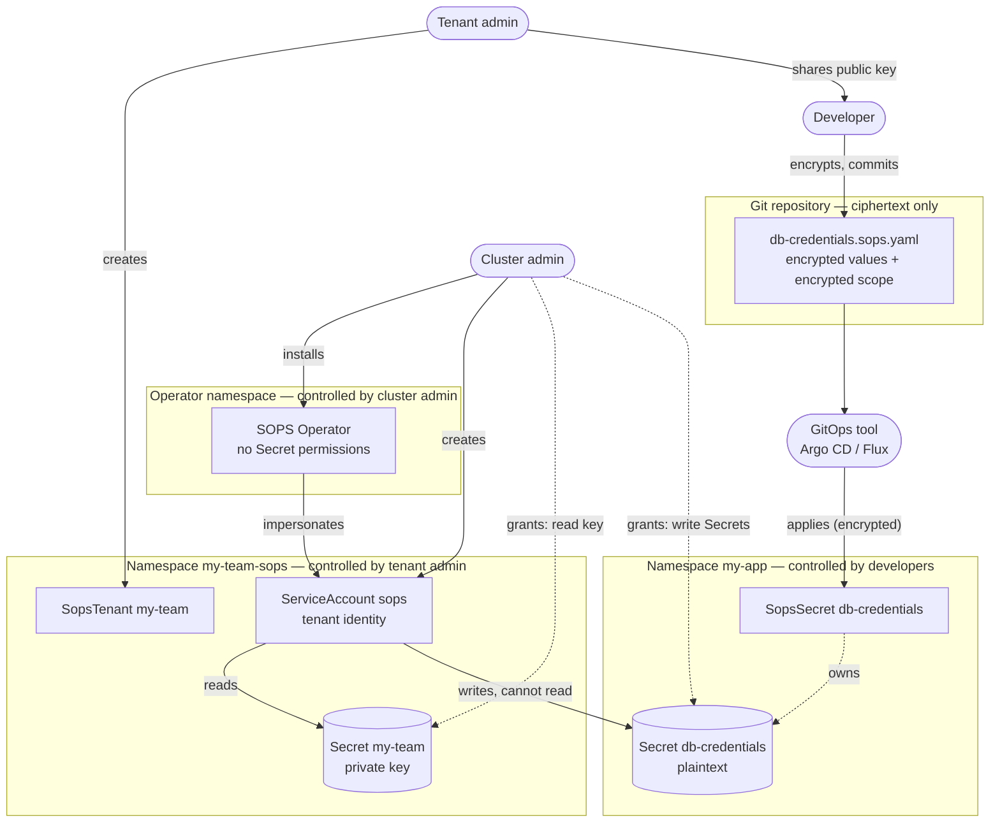

<p align="center">
  
</p>

<h1 align="center">SOPS Operator</h1>

<p align="center">
  <strong>GitOps-first, zero-trust secrets for Kubernetes and OpenShift</strong>
</p>

<p align="center">
  <a href="LICENSE"></a>
  
  
  
  
</p>

---

SOPS Operator delivers secrets from Git to Kubernetes and OpenShift. Teams commit
[SOPS](https://getsops.io)-encrypted `SopsSecret` resources; the operator decrypts them inside the cluster and
writes the Kubernetes Secrets, for many teams on one cluster.

It is built on two principles:

- **GitOps first**: Git is the source of truth. Only ciphertext is stored in Git and applied by the GitOps tool,
  with standard SOPS tooling and no plugin in the delivery pipeline.
- **Zero trust**: no component is trusted because of where it runs. Every key read and every Secret write is
  authorized by the Kubernetes API server against an explicit grant from the cluster admin, and the operator
  holds **no permission on any Secret** of its own.

## GitOps first

### 🌿 Plain SOPS, any GitOps tool

Files are ordinary SOPS documents with readable diffs, encrypted with the standard `sops` CLI. Argo CD, Flux or a
CI job applies them like any other manifest, with nothing to install. **Plaintext never passes through the
delivery pipeline**, and the operator needs no Git access or Git credentials.

### 🔁 One-way flow, one owner per Secret

Each `SopsSecret` produces exactly one Secret with the same name in the same namespace. The operator restores
the Secret when it is changed or deleted, removes it with the `SopsSecret` (or keeps it with
`deletionPolicy: Retain`), and never adopts or overwrites a Secret it did not create. GitOps tracking labels are
not copied to the Secret, so GitOps tools do not prune it.

### 🩺 Status your tooling understands

Every resource reports a standard `Ready` condition with `observedGeneration` and a precise reason, such as
`Decrypted`, `AccessDenied` or `ScopeMismatch`. Flux health checks and other kstatus-based tools read it
without extra configuration.

## Zero trust

### 🔐 Zero standing privileges

The operator cannot read, list or write a single Secret with its own identity. Every key read and every Secret
write is an **impersonated API call as the tenant's own ServiceAccount**, authorized by the Kubernetes API server
against RBAC the cluster admin created. A compromised operator cannot reach any Secret outside a tenant's grants,
and every access appears in the Kubernetes audit log under both identities.

### ✍️ Least privilege in application namespaces

A tenant's identity may create and update Secrets in its namespaces, but **cannot read them**. The operator tracks
ownership through the UID of the Secret it created, so it never needs to read what lives in an application
namespace.

### 🧩 Explicit grants, self-service tenants

Tenant admins create their own `SopsTenant` and manage their own key. Developers write their own `SopsSecret`s.
Only the cluster admin can extend a tenant's reach: a namespace is granted by a RoleBinding the cluster admin
creates, and no selector, label or naming convention grants access.

### 🎯 Ciphertext bound to its destination

Every file carries an **encrypted scope**, `<namespace>/<name>`, written by its author before encryption. A file
encrypted for `prod/db-creds` is rejected in `dev` or under another name, even within the same team and with the
same key. The scope is verified before any other value is decrypted, and error messages never contain decrypted
values.

### 🔑 One key per tenant, post-quantum by default

Every tenant has its own key, generated in place when it does not exist and never overwritten or deleted by the
operator; there is no cluster-wide master key. Generated keys are hybrid **post-quantum age keys**
(ML-KEM-768 + X25519), because ciphertext committed to Git stays readable to anyone who obtains it later.
Bring-your-own X25519 keys, rotation with several keys and break-glass recipients are supported.

## Built for OpenShift

Installed and upgraded through OLM, with console-ready samples and form descriptors, `AllNamespaces` install
mode, no admission webhooks, no dependencies on other operators, and schema validation with CEL in the CRDs.

## At a glance

| | Typical approaches | SOPS Operator |
|---|---|---|
| Plaintext in the delivery pipeline | Often (decrypt in CI or the GitOps tool) | **None**; decrypted in-cluster only |
| Tooling for developers | Custom CLI or plugin | **Standard `sops` CLI** |
| Existing Secrets with the same name | Overwritten or merged | **Not modified**; reported as `Conflict` |
| Secret permissions of the controller | Cluster-wide read/write | **None**; impersonates tenant identities |
| Who grants a team access to a namespace | Labels, selectors or the team itself | **Cluster admin RBAC only**, enforced by the API server |
| Copying ciphertext to another namespace | Usually works | **Rejected** (encrypted scope) |
| Decryption keys | One per cluster, or shared by everyone | **One per tenant**, post-quantum |

## How it works

Each box is a trust boundary, labelled with who controls it. Solid arrows are actions; dotted arrows are grants,
and only the cluster admin makes them.



For every `SopsSecret`, on every change and on a periodic resync, the operator:

1. Checks with a **SubjectAccessReview** that the tenant is granted the target namespace. Otherwise it reports
   `AccessDenied` and decrypts nothing.
2. Reads the tenant key **as the tenant identity**. The API server authorizes the read.
3. Verifies that the file is encrypted for this tenant and is untampered (SOPS MAC).
4. Decrypts **only the scope** first and verifies that it matches the `SopsSecret`'s namespace and name.
5. Decrypts the values and writes the Secret **as the tenant identity**. The API server authorizes the write
   again.

Revoking a grant takes effect at the next reconcile. Grants and keys are re-checked every time, never cached as
decisions.

## Who does what

| Role | Owns | Cannot |
|---|---|---|
| **Cluster admin** | Installing the operator; onboarding tenants; granting namespaces | Needs no access to tenant keys or plaintext |
| **Tenant admin** | `SopsTenant` and the tenant key; sharing the public key; rotation | Grant the tenant new namespaces |
| **Developer** | Writing and encrypting `SopsSecret`s | Read keys; decrypt files; target another namespace |
| **GitOps tool** | Applying encrypted `SopsSecret`s | See plaintext or keys |
| **Operator** | Decrypting and writing Secrets, only as a tenant identity | Access any Secret on its own |

## Quick start

The example uses one tenant, `my-team`, whose key lives in the dedicated namespace `my-team-sops`, and one
application namespace, `my-app`.

### 1. Install the operator (cluster admin)

On OpenShift, find **SOPS Operator** in OperatorHub once the catalog is added, or create the subscription
directly:

```yaml
apiVersion: operators.coreos.com/v1alpha1
kind: CatalogSource
metadata:
  name: sops-operator
  namespace: openshift-marketplace   # olm on vanilla Kubernetes
spec:
  sourceType: grpc
  image: ghcr.io/stakater/sops-operator-catalog:latest
  displayName: SOPS Operator
  updateStrategy:
    registryPoll:
      interval: 1h                   # picks up new releases from the moving latest tag
---
apiVersion: operators.coreos.com/v1alpha1
kind: Subscription
metadata:
  name: sops-operator
  namespace: openshift-operators     # operators on vanilla Kubernetes
spec:
  channel: alpha
  name: sops-operator
  source: sops-operator
  sourceNamespace: openshift-marketplace
  installPlanApproval: Automatic     # Manual: approve each upgrade's InstallPlan yourself
```

New releases reach the cluster through the catalog: OLM upgrades along the `alpha` channel (for example
v0.0.1 → v0.0.2) as soon as the CatalogSource has polled the new catalog. To pin the available versions instead,
use an immutable catalog tag such as `v0.0.2` and change it deliberately.

The bundle also installs the tenant-facing ClusterRoles `sops-key-owner` and `sops-secret-writer`.

### 2. Onboard a tenant (cluster admin)

Create the tenant's identity, let it own keys in its key namespace, and grant it each namespace it may write to:

```yaml
apiVersion: v1
kind: ServiceAccount
metadata: { name: sops, namespace: my-team-sops }
automountServiceAccountToken: false
---
apiVersion: rbac.authorization.k8s.io/v1
kind: RoleBinding
metadata: { name: sops-key-owner, namespace: my-team-sops }
roleRef: { apiGroup: rbac.authorization.k8s.io, kind: ClusterRole, name: sops-key-owner }
subjects: [{ kind: ServiceAccount, name: sops, namespace: my-team-sops }]
---
# One per namespace the tenant may write Secrets to
apiVersion: rbac.authorization.k8s.io/v1
kind: RoleBinding
metadata: { name: sops-my-team, namespace: my-app }
roleRef: { apiGroup: rbac.authorization.k8s.io, kind: ClusterRole, name: sops-secret-writer }
subjects: [{ kind: ServiceAccount, name: sops, namespace: my-team-sops }]
```

Tenant operators such as Stakater Tenant Operator or Capsule can apply this template automatically.

### 3. Create the tenant key (tenant admin)

```yaml
apiVersion: sops.stakater.com/v1alpha1
kind: SopsTenant
metadata:
  name: my-team
  namespace: my-team-sops
spec:
  generateKey: true   # default: generate a post-quantum key if the key Secret does not exist
```

```console
$ kubectl get sopstenant -n my-team-sops
NAME      READY   REASON         USED BY   AGE
my-team   True    KeyGenerated   0         5s
```

Read the public key and commit it to the team's `.sops.yaml`:

```bash
kubectl get secret my-team -n my-team-sops -o jsonpath='{.data.age\.pub}' | base64 -d
```

```yaml
# .sops.yaml
creation_rules:
  - path_regex: \.sops\.ya?ml$
    encrypted_regex: ^(data|stringData|scope)$
    mac_only_encrypted: true
    age:
      - age1pq1...   # my-team
```

To use an existing key, create the Secret `my-team-sops/my-team` with your identity in `age.agekey` first, and
set `generateKey: false`.

### 4. Write and encrypt a secret (developer)

```yaml
# my-app/db-credentials.sops.yaml, before encryption: never commit this state
apiVersion: sops.stakater.com/v1alpha1
kind: SopsSecret
metadata:
  name: db-credentials
  namespace: my-app
spec:
  tenantRef:
    name: my-team
    namespace: my-team-sops
  stringData:
    username: "app"
    password: "s3cr3t"
```

```bash
yq -i '.spec.scope = .metadata.namespace + "/" + .metadata.name' my-app/db-credentials.sops.yaml
yq -i 'sort_keys(..)' my-app/db-credentials.sops.yaml
sops encrypt -i my-app/db-credentials.sops.yaml
git add my-app/db-credentials.sops.yaml && git commit -m "Add database credentials"
```

Once your GitOps tool applies the file:

```console
$ kubectl get sopssecret -n my-app
NAME             TENANT    READY   REASON      AGE
db-credentials   my-team   True    Decrypted   8s
```

The Secret `my-app/db-credentials` now exists, owned by the `SopsSecret` and deleted with it.

> [!TIP]
> - Sort keys before encrypting (`yq 'sort_keys(..)'`): the SOPS MAC depends on key order.
> - Quote `stringData` values. Unquoted values such as `0123` are rejected instead of being silently changed.
> - Set the scope explicitly when the namespace is injected later, for example by kustomize.
> - Developers encrypt but cannot decrypt: to change a value, rewrite the file and encrypt it again.

## Reference

### `SopsSecret`

| Field | Default | Description |
|---|---|---|
| `spec.tenantRef` | required | The `SopsTenant` whose key decrypts this file. |
| `spec.scope` | required | Encrypted `<namespace>/<name>` this file may be decrypted into. |
| `spec.stringData` / `spec.data` | one required | Encrypted text / base64 values, as on a Secret. |
| `spec.type` | `Opaque` | `Opaque`, `kubernetes.io/tls`, `kubernetes.io/dockerconfigjson`, `kubernetes.io/basic-auth`, `kubernetes.io/ssh-auth`. |
| `spec.template.metadata` | — | Labels and annotations for the Secret, for example for Reloader. |
| `spec.deletionPolicy` | `Delete` | `Delete` removes the Secret with the `SopsSecret`; `Retain` keeps it. |
| `sops.stakater.com/suspend: "true"` | — | Annotation that pauses reconciliation. |

### Status reasons

| Reason | Meaning |
|---|---|
| `Decrypted` | The Secret is up to date. |
| `AccessDenied` | The tenant is not granted this namespace. |
| `TenantNotFound` / `TenantNotReady` | The `SopsTenant` does not exist, or its key cannot be read or is invalid. |
| `NotRecipient` | The file is not encrypted for the tenant's key. |
| `ScopeMismatch` | The file was encrypted for another namespace or name. |
| `DecryptFailed` | The file is malformed, tampered with, or has unsorted keys or unquoted values. |
| `Conflict` | A Secret with this name exists and was not created by this `SopsSecret`. |
| `ApplyFailed` | The API server rejected the Secret, for example an invalid TLS Secret. |
| `Suspended` | Reconciliation is paused by annotation. |

`SopsTenant` reports `KeyGenerated`, `KeyLoaded`, `KeyMissing`, `KeyInvalid` or `AccessDenied` (not onboarded).

### Configuration

| Setting | Default | How |
|---|---|---|
| Resync interval | `10m` | `RESYNC_INTERVAL` in `Subscription.spec.config.env`, for example `5m` |

## Operations

- **Key rotation**: prepend a new identity to `age.agekey`, add its public key to `.sops.yaml`, and run
  `sops updatekeys` on each file. When every `SopsSecret` reports `Decrypted`, remove the old identity.
- **Migrating an existing Secret**: replace it with a `SopsSecret` of the same name in one change, or create the
  `SopsSecret` under a new name and switch workloads. Existing Secrets are never adopted.
- **Disaster recovery**: restore key Secrets before `SopsTenant`s, or set `generateKey: false`, so no new key is
  generated in place of a lost one. Break-glass recipients can decrypt every file.
- **Revocation**: removing a namespace RoleBinding stops all writes there at the next reconcile; removing the
  key-owner RoleBinding stops all decryption for the tenant.

## Security

| If this is compromised | The attacker gains | The attacker does not gain |
|---|---|---|
| Git repository or GitOps tool | Ciphertext | Plaintext or keys |
| Developer account | Their own namespaces' `SopsSecret`s | Keys, other namespaces; copied ciphertext is rejected |
| Tenant admin account | Their tenant's key and granted namespaces | Other tenants, new namespaces |
| Operator | Each tenant's grants, nothing more | Any other Secret, RBAC changes, new grants |

The design, threat model and every decision behind it are documented in [DESIGN.md](DESIGN.md). To report a
vulnerability, open a private
[security advisory](https://github.com/stakater/sops-operator/security/advisories/new).

## Compatibility

| | Supported |
|---|---|
| Kubernetes | 1.31 and later |
| OpenShift | 4.18 and later |
| OLM | v0 (`Subscription`), tested end to end; v1 (`ClusterExtension`) by design, not yet tested |
| SOPS CLI | Tested with v3.13.3 |
| Keys | age post-quantum (`age1pq1…`) and X25519 (`age1…`) |

## Roadmap

- Key backends beyond Kubernetes Secrets (OpenBao, cloud KMS) behind the same API.

## Development

Requirements: Go 1.25, Docker (or Colima), and `make`. All other tools (operator-sdk, opm, kind, kustomize, sops,
yq, golangci-lint) are pinned in the Makefile and installed into `bin/`.

```bash
make test               # unit and envtest tests with the RBAC authorizer
make lint
make test-e2e           # end-to-end tests: OLM installs this build on kind; results compared with golden files
make test-upgrade       # upgrade paths through catalog/channels.yaml: published bundles, then this build
make scorecard          # operator-sdk scorecard against the bundle
```

Install from source on a cluster of your choice:

```bash
make docker-build docker-push IMG=<registry>/sops-operator:dev
bin/kustomize build config/default | sed 's#controller:latest#<registry>/sops-operator:dev#' \
  | kubectl --context <context> apply --server-side -f -
kubectl --context <context> apply --server-side -k config/tenant-rbac
```

Releases are made by editing [`catalog/channels.yaml`](catalog/channels.yaml) in a pull request. When it is
merged, the push workflow publishes the newly listed version (operator, bundle and catalog images for amd64 and
arm64, signed with cosign, with SBOM and provenance) and creates the GitHub release. Promoting a published
version to another channel republishes only the catalog. Merges that do not change `catalog/` publish nothing.

## Contributing

Issues and pull requests are welcome. Tests are organised by use case with `shall …` subtests; end-to-end
results are compared with golden files under `test/e2e/testdata` (record them with
`make test-e2e UPDATE_GOLDEN=true`).

## License

Apache License 2.0. See [LICENSE](LICENSE).
