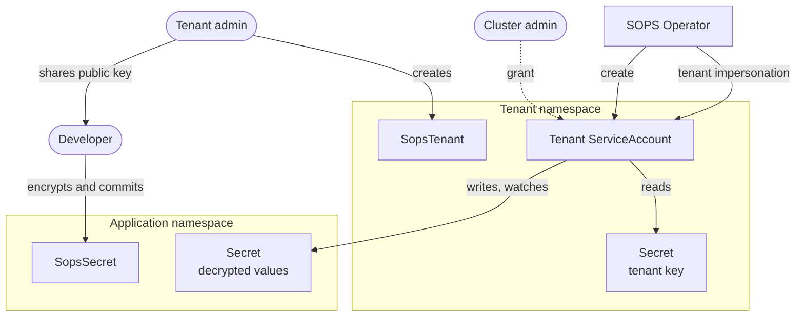

<p align="center">
  
</p>

<h1 align="center">SOPS Operator</h1>

<p align="center">
  <strong>GitOps-first, zero-trust secrets for Kubernetes and OpenShift</strong>
</p>

<p align="center">
  <a href="LICENSE"></a>
  
  
  
  
</p>

---

SOPS Operator delivers secrets from Git to Kubernetes and OpenShift. Teams commit
[SOPS](https://getsops.io)-encrypted `SopsSecret` resources; the operator decrypts them inside the cluster and
writes the Kubernetes Secrets, for many teams on one cluster.

It is built on two principles:

- **GitOps first**: Git is the source of truth. Only ciphertext is stored in Git and applied by the GitOps tool,
  with standard SOPS tooling and no plugin in the delivery pipeline.
- **Zero trust**: no component is trusted because of where it runs. Every key read and every Secret write is
  authorized by the Kubernetes API server against an explicit grant from the cluster admin, and the operator
  holds **no permission on any Secret** of its own.

## GitOps first

### 🌿 Plain SOPS, any GitOps tool

Files are ordinary SOPS documents with readable diffs, encrypted with the standard `sops` CLI. Argo CD, Flux or a
CI job applies them like any other manifest, with nothing to install. **Plaintext never passes through the
delivery pipeline**, and the operator needs no Git access or Git credentials.

### 🔁 One-way flow, one owner per Secret

Each `SopsSecret` produces exactly one Secret with the same name in the same namespace. The operator restores
the Secret at once when it is changed or deleted, removes it with the `SopsSecret` (or keeps it with
`deletionPolicy: Retain`), and never changes a Secret that does not carry its label
`sops.stakater.com/enabled: "true"`. The Secret's labels and
annotations come only from the `SopsSecret`'s template, so the GitOps tool's tracking labels never reach it and the
tool does not prune it.

### 🩺 Status your tooling understands

Every resource reports a standard `Ready` condition with `observedGeneration` and a precise reason, such as
`Decrypted`, `AccessDenied` or `ScopeMismatch`. Flux health checks and other kstatus-based tools read it
without extra configuration.

## Zero trust

### 🔐 Zero standing privileges

The operator cannot read, list or write a single Secret with its own identity. Every key read and every Secret
write is an **impersonated API call as the tenant's own ServiceAccount**, authorized by the Kubernetes API server
against RoleBindings the tenant admin and cluster admin created. A compromised operator cannot reach any Secret outside a tenant's grants,
and every access appears in the Kubernetes audit log under both identities.

### ✍️ Least privilege in application namespaces

A tenant's identity may create, update, list and watch Secrets only in the namespaces the cluster admin granted
to it. Listing includes reading, so grant only namespaces the tenant may see. The operator watches **metadata
only**, and only of the Secrets it owns, which carry the label `sops.stakater.com/enabled: "true"`. A Secret is
the `SopsSecret`'s when it has its name and namespace and carries that label; the operator never reads its data.

### 🧩 Explicit grants, self-service tenants

Tenant admins create their own `SopsTenant` and manage their own key. Developers write their own `SopsSecret`s.
Only the cluster admin can extend a tenant's reach: a namespace is granted by a RoleBinding the cluster admin
creates, and no selector, label or naming convention grants access.

### 🎯 Ciphertext bound to its destination

Every file carries an **encrypted scope**, `<namespace>/<name>`, written by its author before encryption. A file
encrypted for `prod/db-creds` is rejected in `dev` or under another name, even within the same team and with the
same key. The scope is verified before any other value is decrypted, and error messages never contain decrypted
values.

### 🔑 One key per tenant, post-quantum by default

Every tenant has its own key; there is no cluster-wide master key. The operator generates it for a new tenant,
keeps an **immutable backup** of it, and restores the key from that backup when it is deleted or changed. It never
generates a key in place of one that `SopsSecret`s still depend on. Generated keys are hybrid **post-quantum age keys** (ML-KEM-768 + X25519), because ciphertext
committed to Git stays readable to anyone who obtains it later. Bring-your-own keys (post-quantum or X25519) and
break-glass recipients are supported.

## Built for OpenShift

Installed and upgraded through OLM, with console-ready samples and form descriptors, `AllNamespaces` install
mode, no admission webhooks, no dependencies on other operators, and schema validation with CEL in the CRDs.

## At a glance

| | Typical approaches | SOPS Operator |
|---|---|---|
| Plaintext in the delivery pipeline | Often (decrypt in CI or the GitOps tool) | **None**; decrypted in-cluster only |
| Tooling for developers | Custom CLI or plugin | **Standard `sops` CLI** |
| Existing Secrets with the same name | Overwritten or merged | **Not modified**; reported as `Conflict` |
| Secret permissions of the controller | Cluster-wide read/write | **None**; impersonates tenant identities |
| Who grants a team a namespace | Labels, selectors or the team itself | **Cluster admin RBAC only** |
| Copying ciphertext to another namespace | Usually works | **Rejected** (encrypted scope) |
| Decryption keys | One per cluster, or shared by everyone | **One per tenant**, post-quantum |

## How it works

Solid arrows are actions; dotted arrows are grants.



For every `SopsSecret`, on every change and on a periodic resync, the operator:

1. Checks with a **SubjectAccessReview** that the tenant is granted the target namespace. Otherwise it reports
   `AccessDenied` and decrypts nothing.
2. Reads the tenant key **as the tenant identity**. The API server authorizes the read.
3. Verifies that the file is encrypted for this tenant.
4. Decrypts **only the scope** first and verifies that it matches the `SopsSecret`'s namespace and name.
5. Decrypts the values, verifies that the file is untampered (SOPS MAC), and writes the Secret **as the tenant identity**. The API server authorizes the write
   again.
6. Watches the metadata of the tenant's Secrets **as the tenant identity**, so a deleted or changed Secret is
   written back at once rather than at the next resync.

Revoking a grant takes effect at the next reconcile. Grants and keys are re-checked every time, never cached as
decisions.

## Who does what

**Cluster admin**, once per tenant ([step 2](#2-onboard-the-tenant-cluster-admin)):

- Let the operator use the tenant's ServiceAccount in the tenant namespace (`sops-operator-tenant`).
- Let the tenant's ServiceAccount own its key and the key's backups (`sops-key-owner`).
- Grant each namespace the tenant may write Secrets to (`sops-tenant-secret-reconciler`).
- Back up the cluster, tenant namespaces included.

Never needs access to tenant keys or plaintext.

**Tenant admin** ([step 3](#3-create-the-tenant-key-tenant-admin)):

- Create the `SopsTenant`.
- Give developers the public key for their `.sops.yaml`.
- Bring their own key, if they do not want a generated one.

Cannot grant the tenant new namespaces.

**Developer** ([step 4](#4-write-and-encrypt-a-secret-developer)):

- Write a `SopsSecret` with its scope, encrypt it with `sops`, and commit it.
- Check its `Ready` reason when a Secret does not appear.

Cannot read keys, decrypt files or target another namespace.

## Quick start

The example uses one tenant, `team-a`, whose key lives in the dedicated tenant namespace `team-a-system`, and one
application namespace, `team-a-foo`.

### 1. Install the operator (cluster admin)

On OpenShift, find **SOPS Operator** in OperatorHub once the catalog is added, or create the catalog and the
subscription directly.

Add the catalog:

```yaml
apiVersion: operators.coreos.com/v1alpha1
kind: CatalogSource
metadata:
  name: sops-operator
  namespace: openshift-marketplace   # olm on vanilla Kubernetes
spec:
  sourceType: grpc
  image: ghcr.io/stakater/sops-operator-catalog:latest
  displayName: SOPS Operator
  updateStrategy:
    registryPoll:
      interval: 1h                   # picks up new releases from the moving latest tag
```

Subscribe:

```yaml
apiVersion: operators.coreos.com/v1alpha1
kind: Subscription
metadata:
  name: sops-operator
  namespace: openshift-operators     # operators on vanilla Kubernetes
spec:
  channel: alpha
  name: sops-operator
  source: sops-operator
  sourceNamespace: openshift-marketplace
  installPlanApproval: Automatic     # Manual: approve each upgrade's InstallPlan yourself
```

New releases reach the cluster through the catalog: OLM upgrades along the `alpha` channel to each new
version as soon as the CatalogSource has polled the new catalog. To pin the available versions instead, use an
immutable catalog tag such as `vX.Y.Z` and change it deliberately.

The bundle also installs the three ClusterRoles used in step 2: `sops-operator-tenant`, `sops-key-owner` and
`sops-tenant-secret-reconciler`.

### 2. Onboard the tenant (cluster admin)

When the tenant admin creates the `SopsTenant` `team-a` in `team-a-system` (step 3), the operator creates the
ServiceAccount `team-a-sops-tenant` in `team-a-system`. Everything the operator does for `team-a` it does as this
ServiceAccount, and it can do nothing until you grant it the three RoleBindings below. Their names are up to you.

**a. Let the operator use the tenant's ServiceAccount** (once per tenant namespace). The subject is the operator's own
ServiceAccount, `sops-operator-controller-manager`, in the namespace of its Subscription from step 1:

```yaml
apiVersion: rbac.authorization.k8s.io/v1
kind: RoleBinding
metadata:
  name: sops-operator
  namespace: team-a-system
roleRef:
  apiGroup: rbac.authorization.k8s.io
  kind: ClusterRole
  name: sops-operator-tenant
subjects:
  - kind: ServiceAccount
    name: sops-operator-controller-manager
    namespace: openshift-operators
```

**b. Let the tenant own its key and the key's backups** (once per tenant):

```yaml
apiVersion: rbac.authorization.k8s.io/v1
kind: RoleBinding
metadata:
  name: team-a-key-owner
  namespace: team-a-system
roleRef:
  apiGroup: rbac.authorization.k8s.io
  kind: ClusterRole
  name: sops-key-owner
subjects:
  - kind: ServiceAccount
    name: team-a-sops-tenant
    namespace: team-a-system
```

**c. Let the tenant write and watch Secrets in an application namespace** (one per namespace, here `team-a-foo`):

```yaml
apiVersion: rbac.authorization.k8s.io/v1
kind: RoleBinding
metadata:
  name: team-a-secret-reconciler
  namespace: team-a-foo
roleRef:
  apiGroup: rbac.authorization.k8s.io
  kind: ClusterRole
  name: sops-tenant-secret-reconciler
subjects:
  - kind: ServiceAccount
    name: team-a-sops-tenant
    namespace: team-a-system
```

Bindings **a** and **b** stay inside the tenant namespace and grant nothing the tenant admin doesn't already have
there, so the tenant admin may create them instead. Binding **c** decides where the tenant may write, so it stays
with the cluster admin. Stakater Tenant Operator or Capsule can create all three automatically.

### 3. Create the tenant key (tenant admin)

```yaml
apiVersion: sops.stakater.com/v1alpha1
kind: SopsTenant
metadata:
  name: team-a
  namespace: team-a-system
spec:
  generateKey: true   # default: generate a post-quantum key for a new tenant
```

```console
$ kubectl get sopstenant -n team-a-system
NAME     READY   REASON         USED BY   AGE
team-a   True    KeyGenerated   0         5s
```

The private key is in the Secret `team-a-sops-keys`. The operator keeps an immutable copy of it in the Secret
`team-a-sops-keys-<YYYYMMDD-HHMMSS>` and restores `team-a-sops-keys` from it when it is deleted or changed (see
[Key backups](#key-backups)).

### 3a. Or bring your own key (tenant admin)

To bring your own key instead, set `generateKey: false` in the `SopsTenant` and create the Secret
`team-a-sops-keys` with your identity in `age.agekey` and the label `sops.stakater.com/enabled: "true"`. Without
the label the tenant reports `KeyMissing`, and the message names the label. The operator backs the key up when it
first loads it.

```yaml
apiVersion: v1
kind: Secret
metadata:
  name: team-a-sops-keys
  namespace: team-a-system
  labels:
    sops.stakater.com/enabled: "true"
type: Opaque
stringData:
  age.agekey: |
    AGE-SECRET-KEY-PQ-1...
```

### 3b. Share the public key (tenant admin)

Read the tenant's public key:

```bash
kubectl get sopstenant team-a -n team-a-system -o jsonpath='{.status.publicKey}'
```

Add it to the tenant's rule in the GitOps repository's `.sops.yaml`:

```yaml
# .sops.yaml
creation_rules:
  - path_regex: \.sops\.ya?ml$
    encrypted_regex: ^(data|stringData|scope)$
    mac_only_encrypted: true
    age:
      - age1pq1...   # team-a
```

### 4. Write and encrypt a secret (developer)

```yaml
# team-a-foo/db-credentials.sops.yaml, before encryption: never commit this state
apiVersion: sops.stakater.com/v1alpha1
kind: SopsSecret
metadata:
  name: db-credentials
  namespace: team-a-foo
spec:
  tenantRef:
    name: team-a
    namespace: team-a-system
  stringData:
    username: "app"
    password: "s3cr3t"
```

```bash
yq -i '.spec.scope = .metadata.namespace + "/" + .metadata.name' team-a-foo/db-credentials.sops.yaml
yq -i 'sort_keys(..)' team-a-foo/db-credentials.sops.yaml
sops encrypt -i team-a-foo/db-credentials.sops.yaml
git add team-a-foo/db-credentials.sops.yaml && git commit -m "Add database credentials"
```

[`scripts/encrypt.sh`](scripts/encrypt.sh) runs the first three commands, but keeps a scope already set in the file;
see [scripts/README.md](scripts/README.md).

Once your GitOps tool applies the file:

```console
$ kubectl get sopssecret -n team-a-foo
NAME             TENANT    READY   REASON      AGE
db-credentials   team-a    True    Decrypted   8s
```

The Secret `team-a-foo/db-credentials` now exists, owned by the `SopsSecret` and deleted with it.

> [!TIP]
> - Sort keys before encrypting (`yq 'sort_keys(..)'`): the SOPS MAC depends on key order.
> - Quote `stringData` values. Unquoted values such as `0123` are rejected instead of being silently changed.
> - Set the scope explicitly when the namespace is injected later, for example by kustomize.
> - Developers encrypt but cannot decrypt: to change a value, rewrite the file and encrypt it again.

## Reference

### `SopsSecret`

- `spec.tenantRef` (required): the `SopsTenant` whose key decrypts this file.
- `spec.scope` (required): the encrypted `<namespace>/<name>` this file may be decrypted into.
- `spec.stringData` / `spec.data` (one required): encrypted text / base64 values, as on a Secret.
- `spec.type` (default `Opaque`): `Opaque`, `kubernetes.io/tls`, `kubernetes.io/dockerconfigjson`,
  `kubernetes.io/basic-auth` or `kubernetes.io/ssh-auth`.
- `spec.template.metadata`: the labels and annotations of the Secret, for example for Reloader, copied as written.
  They are the only ones copied; the `SopsSecret`'s own labels and annotations are not, so GitOps tracking labels
  never reach the Secret unless you put them here. Keys starting with `sops.stakater.com/` are dropped.
- `spec.deletionPolicy` (default `Delete`): `Delete` removes the Secret with the `SopsSecret`; `Retain` keeps it.
- Annotation `sops.stakater.com/suspend: "true"`: pauses reconciliation.
- `status`: the `Ready` condition and `lastSyncTime`. Status only reports; losing it changes nothing.

### `SopsTenant`

- `spec.generateKey` (default `true`): the operator generates the key of a new tenant, one with no key Secret, no
  key backup and no `SopsSecret` referencing it. Set `false` to bring your own key.
- `status.publicKey`: the public key for `.sops.yaml`.
- `status.keySecretName` and `status.serviceAccountName`: the tenant's key Secret and ServiceAccount.
- `status.usedBy`: the number of `SopsSecret`s referencing the tenant, shown as the `USED BY` column.

Status only reports: the operator rebuilds it on every reconcile from the key Secret, its backups and the
`SopsSecret`s, so losing it changes nothing.

### Status reasons

On a `SopsSecret`:

- `Decrypted`: the Secret is up to date.
- `AccessDenied`: the tenant is not granted this namespace; the message names the ClusterRole and its verbs.
- `TenantNotFound`: the `SopsTenant` does not exist.
- `TenantNotReady`: the tenant's key Secret is missing, cannot be read, lacks the `enabled` label or is invalid.
- `NotRecipient`: the file is not encrypted for the tenant's key.
- `ScopeMismatch`: the file was encrypted for another namespace or name.
- `DecryptFailed`: the file is malformed, tampered with, or has unsorted keys or unquoted values.
- `Conflict`: a Secret with this name exists without the label `sops.stakater.com/enabled: "true"`, or the name is
  that of a tenant's key Secret or key backup in this namespace.
- `ApplyFailed`: the API server rejected the Secret, for example an invalid TLS Secret.
- `Suspended`: reconciliation is paused by annotation.

On a `SopsTenant`:

- `KeyGenerated`, `KeyLoaded`: the key is in place.
- `KeyMissing`: there is no usable key Secret and nothing to restore it from. The message says why: the key Secret
  lacks the `enabled` label, `generateKey` is `false`, or `SopsSecret`s use the tenant, so a new key would decrypt
  none of their files.
- `KeyInvalid`: the key Secret does not hold a valid age key.
- `AccessDenied`: a RoleBinding is missing; the message names it.

### Events

On the `SopsTenant`:

- `KeyGenerated` (Normal): the operator generated the tenant key.
- `KeyRestored` (Warning): the key Secret was deleted or changed and was restored from its backup.

### Configuration

- Resync interval (default `10m`): set `RESYNC_INTERVAL` in `Subscription.spec.config.env`, for example `5m`.

## Operations

### Key backups

- The operator restores `team-a-sops-keys` from the newest backup when it is deleted, holds another key, or lost
  the `enabled` label, and records a Warning event `KeyRestored`.
- Backups are immutable, carry the label `sops.stakater.com/key-backup: "true"` and the public key in the
  annotation `sops.stakater.com/public-key`. List them with:

  ```bash
  kubectl get secret -n team-a-system -l sops.stakater.com/key-backup=true
  ```

- A deleted backup is written again from the key Secret at the next reconcile.
- Do not delete the backups. A tenant admin who deletes the key Secret and all its backups loses the key; only a
  cluster backup can bring it back. A key they then put in place, labelled as in
  [step 3a](#3a-or-bring-your-own-key-tenant-admin), is used and backed up.

### Key rotation

Key rotation is not yet supported. The key Secret cannot be swapped by hand either: an edited or replaced key
Secret is restored from its backup.

### Secret ownership

- A Secret belongs to a `SopsSecret` when it has the same name and namespace and carries the label
  `sops.stakater.com/enabled: "true"`. The operator writes nothing else: any other Secret with that name makes the
  `SopsSecret` report `Conflict`.
- A `SopsSecret` whose status is lost, or that is deleted and applied again, keeps managing its Secret.
- A Secret kept by `deletionPolicy: Retain` is taken over by the next `SopsSecret` with the same name.

### Other operations

- **Migrating an existing Secret**: replace it with a `SopsSecret` of the same name in one change, or create the
  `SopsSecret` under a new name and switch workloads. An existing Secret is not adopted unless you add the label
  `sops.stakater.com/enabled: "true"` to it; the `SopsSecret` then replaces its values, labels and annotations.
- **Disaster recovery**: restore key Secrets and their backups before `SopsTenant`s, or set `generateKey: false`, so
  no new key is generated in place of a lost one. Status need not be restored: a `SopsTenant` without status
  restores its key from the newest backup, and a `SopsSecret` without status keeps its Secret. Break-glass
  recipients can decrypt every file.
- **Revocation**: removing a namespace RoleBinding stops all writes there at the next reconcile; removing the
  key-owner RoleBinding stops all decryption for the tenant.

## Security

What an attacker gains, and does not gain, when a component is compromised:

- **Git repository or GitOps tool**: ciphertext; no plaintext or keys.
- **Developer account**: their own namespaces' `SopsSecret`s; no keys, no other namespaces, and copied ciphertext is
  rejected.
- **Tenant admin account**: their tenant's key and granted namespaces; no other tenants, no new namespaces.
- **Operator**: each tenant's grants, nothing more; no other Secret, no RBAC changes, no new grants.

The design, threat model and every decision behind it are documented in [DESIGN.md](DESIGN.md). To report a
vulnerability, open a private
[security advisory](https://github.com/stakater/sops-operator/security/advisories/new).

## Compatibility

| | Supported |
|---|---|
| Kubernetes | 1.31 and later |
| OpenShift | 4.18 and later |
| OLM | v0 (`Subscription`), tested end to end; v1 (`ClusterExtension`) by design, not yet tested |
| SOPS CLI | Tested with v3.13.3 |
| Keys | age post-quantum (`age1pq1…`) and X25519 (`age1…`) |

Changes and the steps to take when upgrading are listed per release in [CHANGELOG.md](CHANGELOG.md).

## Roadmap

- Key backends beyond Kubernetes Secrets (OpenBao, cloud KMS) behind the same API.

## Development

Requirements: Go 1.26, Docker (or Colima), and `make`. All other tools (operator-sdk, opm, kind, kustomize,
controller-gen, setup-envtest, sops, yq, age-keygen, golangci-lint) are pinned in the Makefile and installed into
`bin/`. `make lint-scripts` needs `shellcheck` installed.

```bash
make test               # unit and envtest tests with the RBAC authorizer
make lint
make test-scripts       # scripts/encrypt.sh with a throwaway key, no cluster
make lint-scripts       # shellcheck on scripts/
make test-e2e           # end-to-end tests: OLM installs this build on kind; results compared with golden files
make test-upgrade       # upgrade paths through catalog/channels.yaml: published bundles, then this build
make scorecard          # operator-sdk scorecard against the bundle
make cleanup-test-e2e   # remove the e2e kind cluster
```

Run a subset of the end-to-end tests with a `go test -run` pattern:

```bash
make test-e2e E2E_RUN='TestSecretOwnership|TestKeyProtection'
```

envtest starts `etcd` and `kube-apiserver` for each test package and stops them when the test is interrupted
(SIGINT or SIGTERM). If a test binary is killed, the next test run stops the control plane it left behind, so no
manual cleanup is needed.

Install from source on a cluster of your choice:

```bash
make docker-build docker-push IMG=<registry>/sops-operator:dev
bin/kustomize build config/default | sed 's#controller:latest#<registry>/sops-operator:dev#' \
  | kubectl --context <context> apply --server-side -f -
kubectl --context <context> apply --server-side -k config/tenant-rbac
```

Releases are made by editing [`catalog/channels.yaml`](catalog/channels.yaml) in a pull request. When it is
merged, the push workflow publishes the newly listed version (operator, bundle and catalog images for amd64 and
arm64, signed with cosign, with SBOM and provenance) and creates the GitHub release. Promoting a published
version to another channel republishes only the catalog. Merges that do not change `catalog/` publish nothing.

## Contributing

Issues and pull requests are welcome. Tests are organised by use case with `shall …` subtests; end-to-end
results are compared with golden files under `test/e2e/testdata` (record them with
`make test-e2e UPDATE_GOLDEN=true`).

## License

Apache License 2.0. See [LICENSE](LICENSE).
